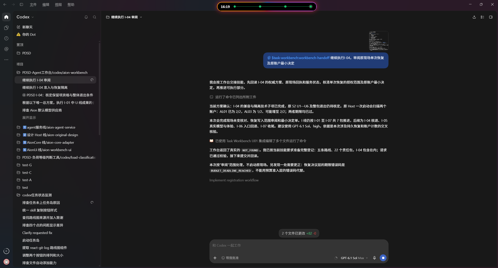
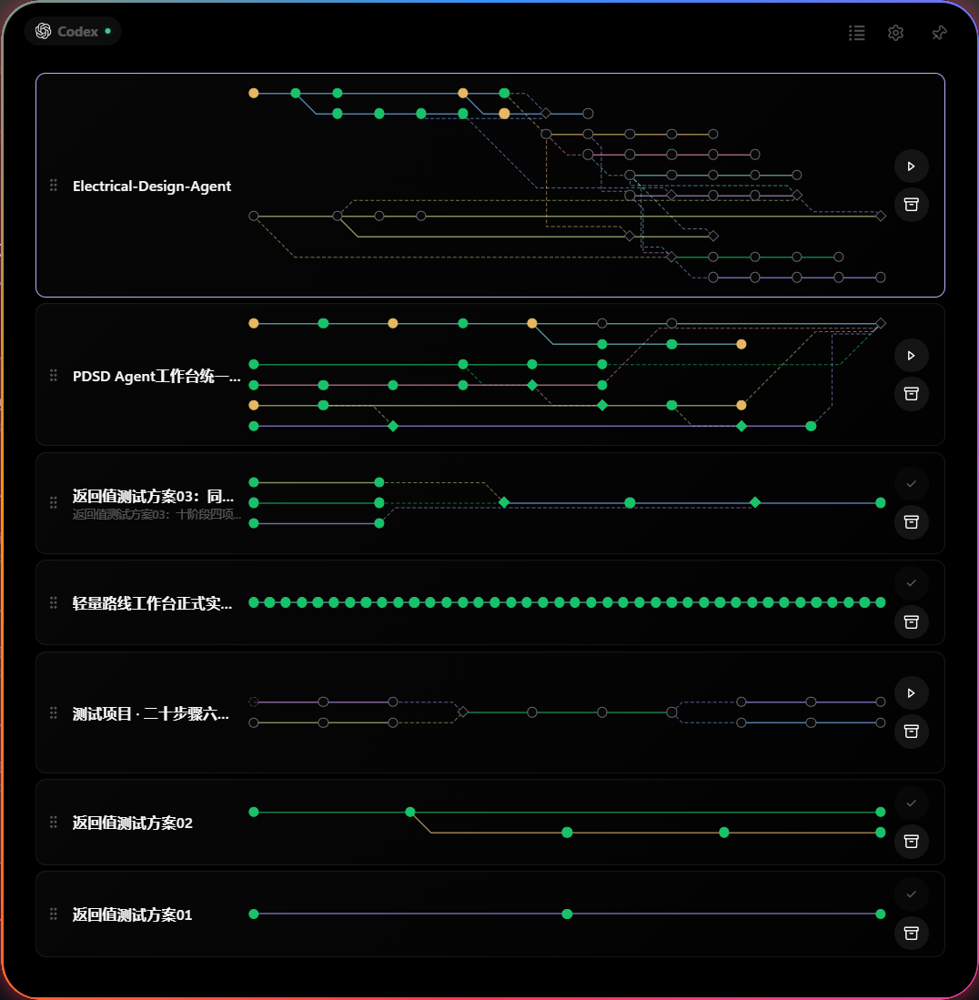
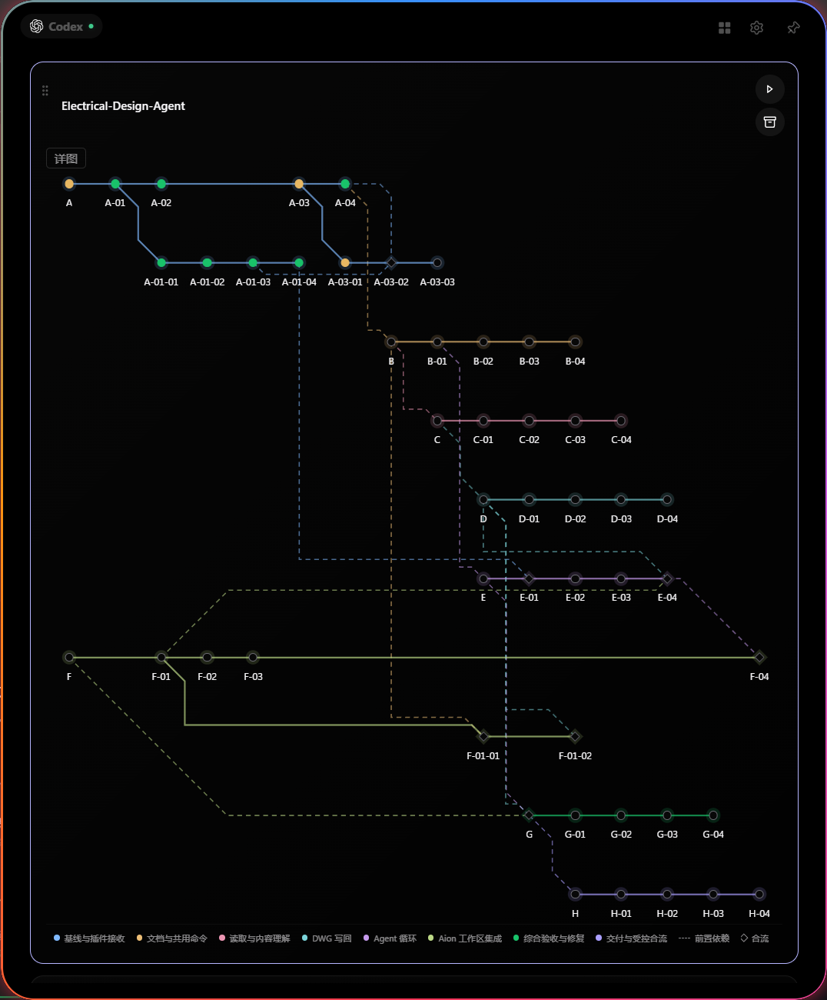

# Codex 任务状态监测工作台

日期：2026-11-19

状态：当前使用说明；以仓库源码与任务岛接入方式为准

将可执行方案变成看得见的任务路线，在 Windows 桌面顶部的“任务岛”中展示步骤、依赖、分叉、合流和执行进度。你继续在现有 Codex 聊天中工作，通过工作台插件登记方案、同步状态和接续任务。

**当前使用流程无需单独配置 AI 服务、API Key 或模型地址。** 方案解析与执行由现有 Codex 完成，本项目负责保存路线、校验状态并展示进度。

## 界面预览

### 顶部收起状态

收起时在桌面顶部显示时间与路线缩略图。



### 多任务路线概览

展开后集中查看多条任务路线，切换显示方式，并使用连续执行与归档入口。



### 路线详情

以不同颜色区分任务线，展示站点状态与分叉、合流关系。



## 为什么做这个项目

复杂任务经常分散在多个聊天、分支和工作树中。局部修复不断增加后，人和 Agent 容易忘记原方案走到哪一步、修到什么程度可以结束，以及完成后应该回到哪里。

工作台围绕原方案保留目标、步骤、依赖、验收要求和结束条件，让局部执行始终能接回总路线：

- 当前工作属于哪份方案、哪条任务线和哪个站点。
- 哪些步骤已经完成，哪些正在执行或等待前置条件。
- 多条任务线在哪里分叉，满足什么条件后才能合流。
- 本轮修复何时结束，结束后继续、等待还是交接。

## 当前组成与能力

| 组成 | 作用 | 源码位置 |
| --- | --- | --- |
| 本地工作台服务 | 持久保存方案、步骤、依赖、执行记录、绑定与事件，提供 MCP 和面板接口 | 本仓库 `app/server`、`app/mcp`、`app/desktop` |
| Codex 插件与 Skill | 从方案提取路线，登记或恢复任务，同步进度、核对交付并生成交接指令 | 本仓库 `plugins/task-workbench` |
| Windows 任务岛 | 展示顶部缩略路线、任务列表及详细路线图，提供设置和任务操作入口 | [任务岛外壳仓库](https://github.com/WuwuZhang0019/windows-dynamic-island/tree/codex/island-workbench-shell) |

截至本文更新，业务源码版本为 `0.2.2`，插件源码版本为 `0.1.26`；本机安装版和当前聊天加载的插件版本需分别核对。

目前支持：

- 按方案登记阶段、步骤、依赖和多条任务线，保留稳定编号与已有进度。
- 在任务岛中切换完整卡片与紧凑列表，查看分叉、合流和各站点状态。
- 关联真实聊天及项目目录；普通非 Git 目录也可登记和绑定，分支与合并操作仍需要 Git。
- 记录执行、受阻、完成和验收结果，换聊天后恢复路线并生成交接指令。
- 在明确授权且满足前置条件后使用连续执行或多线协调能力。

登记路线只会先显示待执行步骤，不会自动开始实施。聊天结束、手动标记完成或 AI 表示“已完成”，都不能替代方案约定的验收；任务线完成和项目整体完成分别核对。

## 日常使用

1. 启动任务岛。桌面程序负责启动随包携带的本地服务；普通使用无需手动启动 Node 开发服务器。
2. 在任务岛设置的 **MCP** 页面连接 Codex，并确认工作台插件与 `workbench-handoff` 技能可用。插件安装与打包说明见[插件 README](plugins/task-workbench/README.md)。
3. 在 Codex 聊天中提供方案文档，使用任务岛 **Skill** 页的“复制指令”，或发送下方指令。
4. 等待路线登记并回读核对后，在任务岛查看待执行步骤；已有路线复用原进度。
5. 需要实施时明确执行范围，由 Codex 按依赖推进并同步结果。换聊天时提供方案与交接信息，继续使用同一条路线。

为路线开启 **连续执行** 后，任务岛会等待必要子步骤通过，将整包验收派发给原父阶段聊天，并在父阶段验收通过、后继前置齐备后接续。必要子步骤交给其他聊天时，后台会等待其结果，并记录等待的步骤和已登记的阻塞原因。现场复验和人工签署按方案要求完成。

```text
请使用 workbench-handoff 技能，读取我提供的方案文档，提取完整阶段、步骤、依赖和分支路线，立即自动登记到任务岛并回读核对，先显示待执行路线图。保留方案内容、依赖和验收要求；已有登记则复用原路线与进度，不重复创建。不要先做业务审查或开始执行。
```

如果连接失败，先确认任务岛及本地服务正常，再在 MCP 页面重试连接。插件更新后，应核对新聊天实际加载的版本；文件已更新不代表现有聊天已经刷新。

## 数据与备份

任务岛默认业务数据目录为：

```text
%LOCALAPPDATA%\com.codextaskmonitor.workbench\data
```

实际使用目录以运行配置为准；源码开发服务的默认目录为 `app/data`，可通过 `WORKBENCH_DATA_DIR` 指定。不要把开发数据目录当成桌面正式数据目录。

备份前正常退出应用并确认服务停止，再复制完整数据目录，保留方案、执行记录、历史、备份和迁移信息。恢复时保留原目录，使用空目标目录并核对数据完整性。旧版“导出项目”不能替代全目录备份。

连接配置和备份可能包含授权信息，不要提交到 Git 或公开分享。新聊天、目录变更及跨机器恢复后需重新核对绑定与授权。

## 源码开发

本仓库维护业务服务、MCP、插件和接入契约。截图中的任务岛界面在独立外壳仓库开发，运行本仓库网页开发入口不会启动该原生窗口。

业务服务开发需要 Node.js **22.16 或更高版本**：

```powershell
cd app
npm ci
npm run dev
```

开发模式仅启动本地 API，默认端口为 `4318`。旧网页界面及其 Tauri 外壳已于 2026-11-16 删除，桌面界面统一使用任务岛。

```powershell
npm test
npm run build
npm run test:desktop
```

准备供任务岛打包的服务资源：

```powershell
npm run desktop:resources
```

资源输出到 `app/desktop/resources`，包含 Node 运行时及业务服务。任务岛外壳的构建脚本默认从相邻的 `Codex-task-monitoring/app/desktop/resources` 获取资源，也可通过 `WORKBENCH_RUNTIME_SOURCE` 指定资源目录。构建原生任务岛还需要外壳仓库的 Bun、Rust 和 Windows Tauri 构建环境。

打包 Windows exe（构建右侧任务岛）：

```powershell
npm run package:exe
```

默认使用相邻的 `windows-dynamic-island` 仓库，可通过 `WORKBENCH_ISLAND_SOURCE` 指定外壳源码目录，通过 `BUN_EXECUTABLE` 指定 Bun。产物位于外壳仓库的 `src-tauri/target/release/bundle/nsis`。

目录概览：

- `app/server`：本地业务服务与持久化。
- `app/mcp`：MCP 接口、协议校验及插件打包。
- `app/desktop`：服务生命周期、运行资源准备与数据迁移。
- `app/contracts`：业务服务与任务岛的接入契约。
- `plugins/task-workbench`：Codex 插件、Skill 与参考脚本。
- `app/tests`：领域、接入和浏览器回归检查。
- `docs`：方案、使用资料与执行记录。

## 项目文档

- [文档导航](docs/README.md)
- [轻量路线工作台文档](docs/03_轻量路线工作台/README.md)
- [插件使用与维护说明](plugins/task-workbench/README.md)
- [任务收敛与交接指令](docs/03_轻量路线工作台/05_使用与指令模板/02_任务收敛与交接指令_原文_2026-11-08.md)
- [路线图源码提取与改造记录](docs/03_轻量路线工作台/06_执行记录/react-git-log-roadmap-20261113/交付记录.md)

文档中的阶段回执和旧版说明保留为历史记录，其版本、操作入口及验收结果应按记录日期理解，不作为当前版本的完整使用说明。

## 许可证

本项目采用 [GPL-3.0-or-later](LICENSE)。来源与修改记录见 [SOURCE.md](SOURCE.md)，第三方许可见 [THIRD-PARTY-NOTICES.txt](THIRD-PARTY-NOTICES.txt)。

## 致谢

感谢以下两个开源项目提供的实现基础与参考：

- [HeyyCzer/windows-dynamic-island](https://github.com/HeyyCzer/windows-dynamic-island)：任务岛桌面外壳的上游来源，沿用并适配了窗口、外观及展开收起动画等实现。任务岛修改版维护在[本项目的外壳分支](https://github.com/WuwuZhang0019/windows-dynamic-island/tree/codex/island-workbench-shell)，保留上游版权与 GPL 许可声明。
- [TomPlum/react-git-log](https://github.com/TomPlum/react-git-log)：任务路线图的连线绘制参考，提取并改造了曲线与边绘制相关源码，用于横向任务路线的分叉和合流展示。外壳仓库保留原始源码快照、来源记录与 Apache-2.0 许可证。
