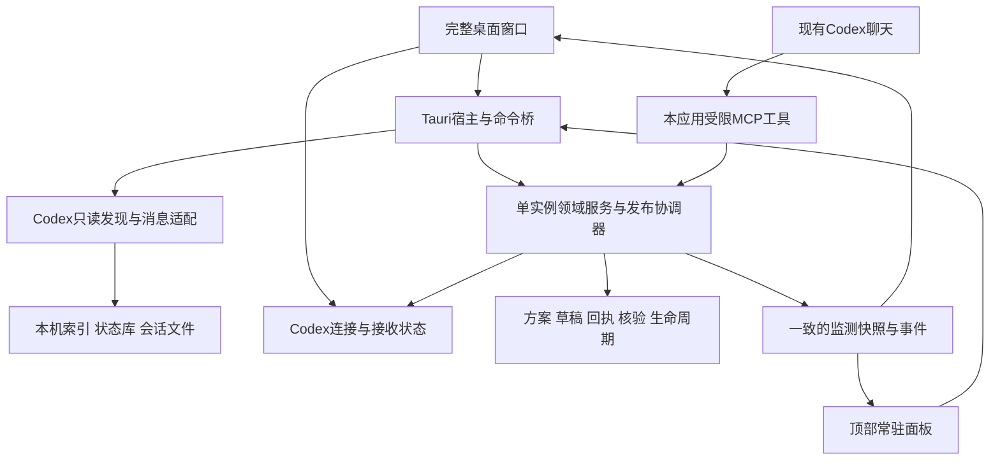

# 桌面任务工作台与 Codex 本地连接需求总结及技术选型

## 统一执行入口（2026-11-09）

后续派发、补充业务规则及最终组合验收统一遵循 [统一执行总纲与手动试跑](00_统一执行总纲与手动试跑_2026-11-09.md)。本文件阶段编号用于来源和证据定位，实际派发使用 U01—U08；旧尺寸、工具数量和实施顺序按总纲的明确映射更新。历史记录保留，不代表实施完成。

日期：2026-11-09

状态：已按用户确认更新技术路线，待实施

版本：1.1

### 修订记录

| 版本 | 日期 | 依据及变化 |
|---|---|---|
| 1.0 | 2026-11-09 | 初稿归档于 Git 提交 `57523cec49856f23813f21ecfa859ddbf28977cd`，包含内置 AI 与 Codex MCP 双入口 |
| 1.1 | 2026-11-09 | 用户确认采用 `create-tauri-app`，方案整理统一交给现有 Codex 对话，通过工作台 MCP 写入，原 AI 面板位置调整为连接与接收状态 |

## 1. 结论与用户真正需要的产品

交付一个 Windows 桌面任务工作台，包含完整窗口和屏幕顶部常驻面板。完整窗口负责导入方案、确认路线、选择本地 Codex 聊天、核验结果及查看历史；顶部面板负责随时显示任务位置、等待对象和完成提醒。两种视图使用同一份项目状态，不维护两套路线或完成判断。

本地会话识别参考 CC Switch 的开源实现，顶部视觉和展开方式参考 Vibe Island 的公开演示。业务仍是当前项目的方案、任务线、地铁路线和证据核验，不扩展成通用终端控制器或大型 AI 聊天客户端。

用户已确认采用 `create-tauri-app` 建立桌面宿主，接入现有 React 工作台。方案讨论、步骤提取和修订由现有 Codex 对话完成，Codex 作为 MCP 客户端调用工作台提供的工具，写入统一草稿并按授权发布路线。原内置 AI 助手位置调整为“Codex 连接与接收状态”，显示授权范围、草稿、校验问题及持久化回执。

本期建立独立的桌面化与连接路线，按下文及配套开发方案验收。本次交付为两份方案的 v1.1 文档修订。

## 2. 现场基线与既有方案的关系

初稿编写现场为2026-11-09、main、`40a6182196d76f7e0598d7700382cde879154d9c`。本次 v1.1 修订前重新核对，仓库及唯一工作树为 `G:\rust\Codex-task-monitoring`，main，HEAD `57523cec49856f23813f21ecfa859ddbf28977cd`，暂存区和工作区干净。适用规则来自用户提供的 AGENTS.md 指令，采用简体中文、UTF-8、实际日期及本地自动提交。

现有工程为 React 19 / TypeScript / Vite 前端与 Node 本地服务。已有项目/关系模型、回执、独立核验、自动关闭、输出及差异展示；目前导入仍主要产生旧 projects.steps，不能把新版文件夹、任务、聊天、方案版本配置全部自动补齐。没有 Tauri 桌面壳、Codex 会话扫描或本应用 MCP 写入服务。

| 资料/能力 | 本次处理 |
|---|---|
| [原 v1.0 方案及 M01—M06](../../99_归档/2026-11-10_旧路线/01_任务监测工作台_v1.0/01_执行方案/01_Codex任务状态监测工作台_可执行方案_2026-11-08.md) | 保留原文、终点和历史；复用证据、依赖、独立关闭和当前待复核规则 |
| [一次导入与配置草稿 I01—I05](../../99_归档/2026-11-10_旧路线/02_方案导入与配置草稿/01_执行方案/01_一次导入自动生成配置草稿与集中确认_可执行方案_2026-11-08.md) | D04承接草稿、来源、集中确认和发布契约，D05提供Codex输入及连接界面，内置模型入口按v1.1已确认的责任映射调整，实施前核对可复用成果 |
| `40a6182` 模型请求超时修复 | 作为旧网页提取功能的历史依据，历史配置和数据按兼容规则迁移，桌面主流程的连接及超时按 MCP 单独定义 |
| 历史隔离脚本和用户实际体验 | 分开记录；旧16场景通过不证明桌面、真实会话连接或新导入闭环已通过 |

完整实施路线、前置和验收见[可执行开发方案](02_桌面工作台与顶部常驻面板_可执行开发方案_2026-11-09.md)。

## 3. 讨论中已经确定和仍待实测的内容

| 内容 | 当前结论 |
|---|---|
| 产品入口 | 独立安装、双击启动；普通用户不必开 PowerShell 或浏览器、不必安装 Node 开发环境 |
| 顶部形式 | 屏幕顶部居中常驻、黑色紧凑条、下方圆角、向下展开、自有图标和文案 |
| 主要内容 | 用户自己的地铁路线、任务/站点状态及交付摘要；不照搬权限审批和终端控制流程 |
| 完成提醒 | 执行结束、本站验收通过、任务线结束和项目结束必须区分 |
| 本地会话 | 自动发现并供选择绑定；保留稳定会话ID、工作目录、标题及来源，不靠手输UUID作为正常流程 |
| 桌面工程入口 | 已选定 `create-tauri-app`，在隔离临时目录生成 React/TypeScript 参考工程，再将必要宿主文件接入现有应用 |
| 方案整理责任 | 用户在现有 Codex 聊天中讨论和修订，Codex 通过工作台 MCP 写入草稿、校验及发布 |
| 工作台连接入口 | 显示本地桥就绪情况、Codex 实际调用记录、授权范围、接收结果及连接恢复操作 |
| Codex侧栏项目身份 | 工作目录归组可实现；能否精确读取侧栏项目ID和全部归属关系需本机实测，不将cwd冒充外部项目ID |
| 跳回原Codex聊天 | 本期必须能打开本应用中的会话详情；精确激活原Codex指定聊天尚未证明，不作为首期终点 |
| 多屏、不抢焦点、动画 | Windows原生窗口专项需验证，公开视频不能证明这些能力在本机已成立 |

## 4. CC Switch 可参考的实际实现

研究基线固定为 CC Switch 提交 `8656ebd91f3eba631837126e29df71e8353b7e43`，避免用移动中的 main 充当精确实施依据。源码读取时间为2026-11-09。

- [Codex provider](https://github.com/farion1231/cc-switch/blob/8656ebd91f3eba631837126e29df71e8353b7e43/src-tauri/src/session_manager/providers/codex.rs)：扫描 sessions / archived_sessions，会话文件缓存与去重，从会话元数据取ID和cwd，从索引/状态库补标题，按需解析消息。
- [Codex状态库路径解析](https://github.com/farion1231/cc-switch/blob/8656ebd91f3eba631837126e29df71e8353b7e43/src-tauri/src/codex_state_db.rs)：处理数据位置覆盖及数据库可读取性。文件内还包含其他操作，本项目只借鉴定位/只读能力。
- [许可文件](https://github.com/farion1231/cc-switch/blob/8656ebd91f3eba631837126e29df71e8353b7e43/LICENSE)：仓库采用MIT；若实际复制代码，在对应文件和发行材料保留其许可及来源，逐项记录取用范围。

应复用其读取思路及必要的小模块，不整合供应商切换、登录迁移、会话删除、路由、终端恢复或会话历史重写。工作台运行不要求CC Switch同时打开，不读取它的密钥库。

数据发现按 Codex 配置目录探测并允许用户选择。常见位置是 `C:\Users\Zyf\.codex`，但不能硬编码为唯一位置；状态库可能受 sqlite_home 等位置配置影响。读取必要的路径设置时不把配置全文、账号或密钥写入日志/界面。

首次建立列表，后续按文件变化增量更新；原会话文件只读，列表先加载必要元数据，正文在用户打开或选定监测后按需加载。截断、锁定、压缩、归档、格式变动应分别显示状态，读取失败不能伪装成“没有聊天”。

### 4.1 身份必须分开

1. 开发项目ID是本应用自己的身份。
2. Codex侧栏项目ID如果有可靠来源，另存并注明来源；没有则待绑定。
3. 工作目录组按主机和规范化路径归组，界面明确写“工作目录组”。
4. 会话使用来源+主机+稳定会话ID定位；同一会话归档或改标题不创建新会话。
5. 任务与聊天的关联需要首次确认；一个任务可跨多个聊天。同目录内不自动认定所有聊天都在执行同一任务。

这样既能获得类似CC Switch“按项目/目录看聊天”的便利，又不把工作树、同名目录或一个目录内的多个任务混为一体。用户可一次批量确认建议映射，不要求逐个手填全部底层字段。

## 5. Vibe Island 演示中可借鉴的显示方式

参考[29秒演示视频](https://www.youtube.com/watch?v=_nh_OE5aSwI)及[产品公开说明](https://vibeisland.app/zh/)。上一轮已通过浏览器定位检查视频关键画面；以下时间为约数，不作为精确动画参数。其[公开仓库](https://github.com/vibeislandapp/vibe-island)是社区反馈入口，没有可直接移植的应用壳。

| 视频片段 | 已观察到的形式 | 本工作台适配 |
|---|---|---|
| 0—10秒 | 顶部黑色窄条，图标/短标题/数量，长文字省略 | 项目、当前站点、运行/等待数量 |
| 约5—17秒 | 状态符号及文字变化，收起时仍可判断状态 | 原执行状态加文字，不能仅靠颜色 |
| 约15秒 | 上沿固定，向下展开；标题、来源、小标签、详情和按钮分层 | 任务头、聊天来源、迷你路线、本站结果和证据入口 |
| 约20秒 | 完成/回复结果卡片 | 执行结束待核验、验收通过、任务结束的不同卡片 |
| 约23—25秒 | 进入多个会话列表，行内摘要/时间/标签，指针行高亮 | 多任务线概览，每行迷你路线；点击进入详情 |
| 约25—26秒 | 切回会话所在终端内容 | 首期打开本应用详情；原Codex精准跳转单独实测 |

悬停延迟、动画曲线、不抢焦点、事件提示保持多久、多屏和全屏行为，不能从短视频准确得到；本方案给出自身可测试的设计值。使用自有品牌和图标，重新实现外观与交互，不嵌入其闭源程序或复制安装包资源。

### 5.1 四种面板状态

| 状态 | 内容与行为 |
|---|---|
| 紧凑条 | 一行项目/当前站/运行和等待数量；多线时汇总，不硬塞完整图 |
| 路线面板 | 单线完整迷你路线或多线分行；范围、交付、等待对象及查看证据按钮 |
| 事件面板 | 完成/失败/待核验的重点卡片，可转入完整路线 |
| 固定展开 | 用户主动固定，便于持续看路线；解除后回到自动收起规则 |

主窗口与浮窗共用状态：点击主窗口站点，浮窗能定位同一任务；浮窗打开详情，主窗口显示相同证据版本。收起不丢未读事件，主窗口关闭到托盘不终止监测，显式退出才停止后台进程。

### 5.2 提醒与颜色

| 事件 | 提醒内容 | 业务颜色 |
|---|---|---|
| 绑定会话开始执行且明确关联当前站 | 正在执行本站；附来源与时间 | 绿色 |
| 一轮聊天结束 | 执行结束，等待核验 | 暗色/待核验文字，不直接红灯 |
| 本站有效核验通过 | 本站验收通过；列合法后继及全部依赖 | 红色 |
| 某任务线有效关闭 | 本任务线结束；明确交接对象 | 红色终点；不让其他任务虚闭 |
| 项目有效关闭 | 项目结束，无本任务下一步 | 项目完成提示 |
| 旧证据失效 | 历史已关闭，当前待复核 | 保留历史，重新计算当前有效判断 |

单凭文件mtime、聊天标题或末句“完成”不能产生绿色或红色。后台运行状态与业务验收状态分别存储；明确站点绑定和有效事件不足时显示未知/待核验。

## 6. 技术选型及最简实现

已选定 **create-tauri-app + Tauri 2 + 现有 React/TypeScript + 复用 Node 领域服务**。D01记录生成工具及模板版本，D02在独立临时目录生成参考工程，检查差异后接入现有应用。Rust负责窗口、托盘、原生文件选择、生命周期及 Codex 本地读取，Node承担方案、回执、证据及关闭服务。所需运行组件按D01/D02验证结果打包。官方工程创建、外部组件与安装说明见来源。[创建工程](https://v2.tauri.app/start/create-project/)、[Node sidecar](https://v2.tauri.app/learn/sidecar-nodejs/)、[Windows安装包](https://v2.tauri.app/distribute/windows-installer/)

这里的“最简”指用户操作和系统范围简单，不宣称安装包字节最小或复刻Vibe Island的内存数字。交付安装包应包含所需应用运行组件并处理WebView2前置；用户不必安装Node/npm或启动命令行。

Rust窗口命令只接受白名单动作，Node仅有一个数据写入所有者。主/浮窗以及MCP不能分别直接改JSON文件。用户看见独立程序窗口和顶部条，不再使用浏览器地址与固定4318端口作为正常入口。

### 6.1 最简主窗口与 Codex 连接入口

主窗口保留“路线”“会话”“方案草稿”“Codex 连接”“历史/设置”。原 AI 助手区域展示连接引导、当前授权项目、最近工具调用及接收结果。正常使用时在 Codex 里说“把这个方案录入工作台”，应用收到草稿后集中展示原文、步骤、依赖、待补项和发布差异，用户可在应用确认或在已明确授权的新空项目范围内直接发布。

连接页区分未配置、本地桥就绪、已收到 Codex 调用、连接异常和授权已撤销，并显示最近成功时间及请求结果。只有实际客户端调用记录才支持“Codex 已调用”的提示。只读扫描与 MCP 主动写入分别显示状态，连接正常时仍需首次确认任务与聊天归属。

正文整理使用 Codex 自身的账户和模型配置。用户选择工作台可提供的上下文范围，MCP 读取工具按项目授权返回必要文本。工作台保存原文、结构化草稿和审计记录，方案确认后的修订形成新版本。

## 7. 其他开源项目的精简推荐

下表在2026-11-09核对仓库介绍、README及许可标注；定位为可借鉴部分，不是整仓采用决定，不将开源社区版能力等同于商业产品全部能力。

| 项目 | 适合借鉴什么 | 本项目建议 | 仓库许可标注 |
|---|---|---|---|
| [create-tauri-app](https://github.com/tauri-apps/create-tauri-app) | 官方桌面骨架，支持React/TypeScript模板 | 已选定为桌面工程入口，在临时目录生成后适配现有工程 | README标注MIT或适用MIT/Apache-2.0；图标另有许可，使用自有图标 |
| [assistant-ui](https://github.com/assistant-ui/assistant-ui) | React聊天输入、消息、运行状态组件 | 前期聊天组件调研记录，v1.1 改用 Codex MCP 后列为历史参考 | MIT |
| [NextChat](https://github.com/ChatGPTNextWeb/NextChat) | 紧凑聊天界面、设置、桌面组织参考 | 保留界面调研记录，当前界面实现采用已有 React 工作台 | MIT |
| [Chatbox Community Edition](https://github.com/chatboxai/chatbox) | 桌面模型设置、简单聊天与本地保存交互 | 保留完整客户端对照，源码取用前核对对应文件许可 | GPL-3.0 |
| [CC Switch](https://github.com/farion1231/cc-switch) | 本地会话扫描、标题及来源解析 | 作为会话适配参考，不继承其供应商/账号管理平台范围 | MIT |

当前实施组合为“create-tauri-app 生成的 Tauri 宿主 + 现有 React 路线图 + Codex MCP + 本地会话只读适配”。代码取用记录、固定版本和发行许可由D01核定。

## 8. 已选定的 Codex MCP 直接写入流程

**工作台提供 MCP 服务，Codex 作为客户端调用工作台工具。** 本机首选安装包内的 STDIO 桥，具体连接与工具权限在当前 Codex 宿主实测。官方支持本地 STDIO 和 Streamable HTTP MCP 连接。[官方MCP说明](https://learn.chatgpt.com/docs/extend/mcp?surface=cli)

用户在已有 Codex 聊天中要求“读取此方案，保留原编号和验收，调用工作台工具生成路线”。Codex 读取授权项目，提交原文与结构化草稿，获取校验问题，修正后申请发布。应用返回持久化回执和实际 projectId/revision，随后主窗口及顶部面板显示同一路线。首次向空项目发布可按一次明确授权完成，已有方案调整由差异确认控制。Codex自身的账户、用量及运行权限适用。

| 接入方式 | 可行性与定位 |
|---|---|
| 本应用MCP工具，由现有Codex调用 | 已选定的本期输入方式，服务端校验身份、原文、依赖、revision及幂等 |
| Codex向专用inbox写JSON，应用验证接收 | 备选；只写交换目录，仍经过草稿发布，不能直接写projects/models主文件 |
| 应用启动`codex exec --output-schema`提取 | 官方支持结构化非交互输出；适合独立批处理，但不是自动连接原有桌面聊天，需单独处理CLI登录、权限、取消和用量。本期不必实现 |
| 应用内接Codex App Server | 可以构建更完整的Codex客户端；需要管理线程、事件和审批生命周期，对本项目最小范围偏重，本期不实现 |
| 直接授权Codex修改正式JSON/数据库 | 不采用；会绕过现有单写者、revision、核验、历史和跨文件发布边界 |

官方依据：[非交互结构化输出](https://learn.chatgpt.com/docs/non-interactive-mode)、[App Server](https://learn.chatgpt.com/docs/app-server)。这两个替代路线的存在不代表当前应用已经支持它们，也不代表已能接管现有Codex窗口的聊天。

### 8.1 权限应按操作授权

初期工具覆盖读取指定项目、创建/更新草稿、校验草稿、授权发布、登记实际开始及提交未核验回执。新建空项目的授权应限定本次创建目标或草稿，发布后绑定服务端实际项目身份。已有基线的目标、终点、验收及范围修改需取得服务端差异确认凭据。

Codex 在明确任务、站点、方案版本及来源绑定后调用开始登记工具，工作台校验后显示绿色。完成回执先进入待核验，原规则完成独立核验后计算红灯及关闭。开始和回执在只读源与 MCP 双路观察到同一执行时，由稳定执行标识去重并保留两份出处。断线和响应丢失按原幂等键查询或重试，撤销授权立即约束后续提交。

不提供任意SQL、任意文件写入、清除历史或强制标记验收通过的工具。Codex说“已完成”只能成为回执自述；独立验收及有效关闭继续由本应用证据规则判断。将来若提供机器可验证证据适配，也应是单独明确的核验来源，不让自述变成核验。

MCP接入不等于默认“完全访问计算机”。使用本地进程/回环连接，权限限到选定项目、指定工具及必要数据；不要求用户关闭Codex沙箱或批准所有工具。具体宿主工具配置及策略须在D01/D05用当前安装版本实测，本次不改config.toml、不授予运行权限。

## 9. 本期目标、非目标和下一步实施入口

必须交付安装式双窗口桌面应用、自动本地会话发现/选择绑定、统一方案草稿与集中确认、Codex MCP 接入及连接诊断、实际开始/回执接收、顶部路线与提醒，以及证据核验和结束判断。工作台日常入口以路线、来源、草稿和连接状态为中心。

不纳入：多Agent编排、自动写入其他聊天、自动执行开发、权限批准/绕过、终端精确控制、账号切换、跨机器云同步、移动端、插件市场、自动升级系统、任意格式规范解析或大规模数据库改造。

完成依据是实际安装包和本机使用场景：双击打开、选到本地聊天、获得完整可用路线、主/浮窗一致、完成和待核验提醒正确、重开恢复且不改Codex源数据。只生成路线图、在浏览器看过原型或脚本数量增加，都不能作为桌面版完成依据。
