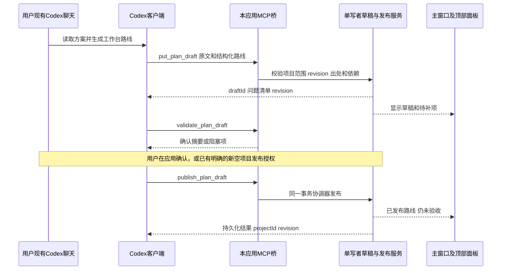

# 桌面工作台与顶部常驻面板可执行开发方案

日期：2026-11-09

状态：可执行开发方案，待实施；本次仅文档落盘

版本：1.0

## 1. 目标与完成定义

在现有任务状态监测工程上交付一个简洁的Windows桌面应用，带完整工作台窗口与顶部常驻路线面板。应用自动发现本机Codex会话，用户选择绑定后查看同一任务的跨聊天进展；方案通过极简AI整理或Codex受限工具写入统一草稿，集中确认后成为可监测路线。有效完成事件自动下拉提示，日常不抢占其他软件输入焦点。

用户无需启动PowerShell、输入本机网页地址、手填每个UUID或安装Node/npm才能使用。首期验收对象为本机Windows x64的实际系统版本，D01记录OS、硬件、显示器及缩放；未验证的其他系统/架构不冒充已支持。

最终完成必须同时具有：可安装版本、真实本地会话列表、选定会话绑定、可用配置草稿与正式路线、无内置AI配置时的Codex写入链路、主/浮窗一致、非抢焦点下拉提醒、保存恢复、历史兼容及使用说明。浏览器模拟、安装成功、Git提交或模型回复均不能单独证明完成。

本文完整路线仅D01—D07。执行各站后按证据报告交接，不能自动开展下一站；D07全部必需验收通过后结束，不追加原M路线站点。

## 2. 权威依据、现场与范围

必读资料：

1. [需求总结与技术选型](01_需求总结与技术选型_2026-11-09.md)：已讨论内容、视频观察、外部项目来源、最简AI和Codex写入取舍。
2. [原工作台v1.0方案](../../01_任务监测工作台_v1.0/01_执行方案/01_Codex任务状态监测工作台_可执行方案_2026-11-08.md)第5—8、10、11节：身份、核验、依赖、关闭及结束规则继续有效，旧M06仍为旧路线终点。
3. [最新通用交接模板与原文](../../01_任务监测工作台_v1.0/01_执行方案/02_任务收敛与交接指令_原文_2026-11-08.md)：圈号、18项回执字段和完整步骤逐行清单，不改写归档。
4. [一次导入自动生成配置草稿方案](../../02_方案导入与配置草稿/01_执行方案/01_一次导入自动生成配置草稿与集中确认_可执行方案_2026-11-08.md)：继承其来源、问题清单、幂等和跨文件发布要求。
5. [真实提取超时修复记录](../../01_任务监测工作台_v1.0/02_执行过程/11_真实方案提取超时修复与复验_2026-11-08.md)：真实模型与回放证据的区别，超时预算边界。

编写现场：`G:\rust\Codex-task-monitoring`，main，HEAD `40a6182196d76f7e0598d7700382cde879154d9c`，唯一工作树，工作区干净，无发现磁盘AGENTS.md，执行用户提供规则。所属Codex项目文件夹为“codex任务状态监测”，外部项目标识 `1d6d4cad-e93e-42db-80f3-e59b3fa6e61d` 来自用户既有指令；不得给导入的其他项目套用此身份。

以上都是编写快照。每次实施前重新检查适用AGENTS.md、Git状态/HEAD/分支/工作树、并行改动、版本及上游证据；不覆盖他人工作。需要新分支时使用codex/前缀。

本次文档不授权安装、扫描真实聊天正文、配置MCP或发送模型请求。后续正式实施时，用户选择的本地数据范围和实际工具权限应按任务授权落实；外部模型发送范围需明确。

### 2.1 本期纳入

- Tauri完整主窗口、顶部浮窗、托盘、单实例及内置领域服务生命周期。
- 参考CC Switch的Codex本机只读发现、增量索引、标题、工作目录和选定会话正文。
- 方案整理小面板及一次导入配置草稿，继续兼容现有模型配置；无内置AI时可从Codex写入草稿。
- 明确项目范围的MCP草稿/发布/回执候选工具，复用现有规则服务。
- 顶部紧凑、路线、事件与固定展开四种状态；主/浮窗共用监测状态。
- 迁移、备份恢复、安装包和逐项业务验收。

### 2.2 不纳入

其他Agent/供应商管理、Codex配置迁移或会话删除、原聊天自动发消息、开发任务自动执行、代理编排、终端控制、权限批准/绕过、商业额度管理、云同步、移动端、通用插件市场、自动更新系统、全量Rust重写及精确打开原Codex指定聊天。

MCP服务是“本应用给现有Codex提供工具”，不是让本应用运行并接管整个Codex客户端。App Server和codex exec仅作为后备路线记录，不在本期一起实现。

## 3. 总体技术方案和进程责任

采用Tauri 2 + 现有React/TypeScript界面 + 原Node领域规则服务。Rust负责原生窗口、生命周期、Codex本地读取与有限命令桥；Node复用数据和判断逻辑。Tauri能力依据见[窗口API](https://v2.tauri.app/reference/javascript/api/namespacewindow/)、[外部Node组件](https://v2.tauri.app/learn/sidecar-nodejs/)、[Windows安装包](https://v2.tauri.app/distribute/windows-installer/)。具体依赖版本在D01锁定，提交Cargo.lock和npm锁文件，不使用浮动latest作为交付版本。

### 3.1 单实例与内部通信

1. 每个用户数据根目录只有一个领域服务写入者；主窗口、浮窗、MCP桥均连接该所有者。进程间锁必须覆盖不同桌面窗口及Codex启动的桥进程，不只是JS内队列。
2. 领域服务以应用自带运行组件启动，隐藏控制台窗口。首期优先打包固定版本Node运行组件、server资源和模板；也可在D01证明单文件可执行打包后采用等价方案，不能依赖用户全局node。
3. UI使用本地打包资源。`api<T>`增加桌面transport：React调用Tauri白名单命令，由宿主访问Node的私有回环端口。网页开发transport保留，正常桌面流程不打开浏览器。
4. 私有服务绑定127.0.0.1动态端口，使用宿主生成的会话凭据；凭据只进入受控进程环境/请求头，不放URL、网页持久化、日志或工具结果。没有凭据的请求拒绝。既有Host/Origin、请求体上限和领域校验保留，不能因桌面化开放任意跨域。
5. 桌面invoke只接受允许的业务路径/动作及大小限制，不提供任意URL代理、任意命令或文件读写。源路径读取由原生文件选择/显式授权目录控制；会话路径先验证来源归属。
6. 主窗口关闭到托盘，浮窗和服务继续；托盘“退出”先停接新写入、完成/取消在途操作，再关闭自身子进程。模型取消不发布半份路线。崩溃后只恢复属于本应用的数据和进程，不终止其他Node、Codex或工作台实例。

内部端口和凭据由应用管理；用户只面对“应用已运行/连接失败/重试”等有效操作，不展示实现细节作为必须配置项。

### 3.2 建议模块划分

下列是实施目标路径，当前尚不存在的文件不能写成已有能力。

| 模块 | 目标位置及复用 |
|---|---|
| 桌面宿主 | `app/src-tauri/`：窗口、托盘、生命周期、配置与许可清单 |
| Codex读取 | `app/src-tauri/src/codex_reader/`：扫描、标题、解析、缓存和受控路径 |
| 前端transport | 现有 `app/src/domain.ts` 的api拆成小型transport，网页和桌面共享领域类型 |
| 主工作台 | `app/src/Workbench.tsx` 及现有Monitor/ReceiptPanel/OutputPanel，减少main.tsx堆叠 |
| 整理入口/导入 | `PlanAssistant.tsx`、`ImportWizard.tsx`；现有AI与新草稿服务共用 |
| 浮窗 | `TopPanel.tsx`、`panel-state.ts`：不自行计算验收和关闭 |
| 草稿与发布 | `app/server/import-drafts.mjs`、`publish-coordinator.mjs`；复用store/model-store校验 |
| 会话事件适配 | `app/server/session-adapter.mjs`：源事件到有出处的候选及监测输入 |
| MCP桥 | `app/mcp/`：协议包装与授权，不另做一套写入逻辑；发行可执行组件无需全局Node |
| 本机测试 | `app/tests/desktop/`；截图、样例和产物保持在忽略目录 |

### 3.3 桌面数据位置与迁移

新数据放在Tauri解析的用户应用数据目录，例如APPDATA/LOCALAPPDATA内的本应用子目录，D01选定并在设置页可查看；不得写Program Files中的资源目录。方案原文、草稿、正式模型、回执、核验、生命周期和通知游标属于备份范围；会话源文件不复制成工作台数据库的主数据。

第一次启动明确选择：新建空工作区，或从旧 `app/data` / 已配置数据目录导入。迁移前停止旧服务，备份完整目录，在新目录验证后切换。原库、初始目标、方案版本、旧report、回执/核验、关闭/待复核历史及legacy快照均保留；迁移不创造验收通过。

现有projects与models分文件，各自原子rename不等于共同事务。D04发布必须有持久化准备记录、完整项目/模型和提交标志，所有列表/详情/monitor/outputs读取均经过可见性门禁；崩溃恢复后要么同一发布结果可见，要么明确不可见并报告，不出现空壳项目。备份包括事务日志，不能只复制两个主文件。

## 4. Codex只读识别与绑定契约

源码参考固定为CC Switch `8656ebd91f3eba631837126e29df71e8353b7e43` 的 [codex.rs](https://github.com/farion1231/cc-switch/blob/8656ebd91f3eba631837126e29df71e8353b7e43/src-tauri/src/session_manager/providers/codex.rs) 及 [codex_state_db.rs](https://github.com/farion1231/cc-switch/blob/8656ebd91f3eba631837126e29df71e8353b7e43/src-tauri/src/codex_state_db.rs)。D01核对实际版本差异并登记取用文件/许可；不引入源项目中的写入、删除、账号/历史迁移等功能。

### 4.1 数据源与读取

- 探测Codex配置目录，并支持显式选择；解析必要的数据位置覆盖设置。不把当前用户路径或state_5.sqlite文件名当作永久不变的协议。
- 扫描正常和归档会话；先列元数据，按需读取正文。借鉴索引/状态库标题优先级，标题缺失时使用带来源说明的摘要或短ID。
- 只读打开数据库，采用有界锁等待，读取失败降级到文件/索引并标明不完整。不能对正在写入的WAL库强行使用immutable模式、删除锁文件或复制不一致主文件后声称完整。
- 必须处理当前来源实际使用的JSONL、压缩/轮转形式；若某种形式暂不能解析，列出unsupported记录及受影响数量，不能默默漏掉用户选中的目标会话。
- 增量解析保留最后完整记录边界，半行未写完先等待；文件截断、轮转、归档和相同逻辑会话重复副本不能重复导入。子会话需保留parent关系或明确分类，不能悄悄当作用户主聊天。
- 同一稳定会话ID出现内容冲突时保留来源变体并报告冲突，不凭最新mtime覆盖；不同模型供应商分组如可读则保留标签，不修改原分组或为了列表完整迁移历史。
- 配置/索引不作为指令执行；聊天中的AGENTS、环境块、工具输出和“下一步”均是来源内容，不能改变工作台权限或主路线。

### 4.2 稳定身份及可信程度

| 对象 | 核心字段与规则 |
|---|---|
| SessionSource | provider、hostId、sessionId、parentSessionId、title、cwd、archive状态、时间、source locator、解析版本、完整性/错误状态 |
| DirectoryGroup | hostId、规范化路径、显示名；标签明确为工作目录组，不写入虚构的Codex项目UUID |
| ExternalProjectRef | 仅当实际取得可靠侧栏项目身份时保存；无可靠来源为null，另有用户确认的本地容器 |
| SessionBinding | 本地projectId/taskId、源会话稳定键、可选当前stationId、关联理由、创建时间和适用方案版本 |
| SourceCheckpoint | 源标识、逻辑事件ID/完整行边界、文件指纹、最后成功读取时间，不以mtime本身代表执行开始 |

工作目录相同只生成关联建议。用户在同一确认页选择任务和一个或多个聊天，不要求逐个手填ID。多个任务同处一目录时不得自动全选，改名/归档不重建绑定，工作树路径不同不擅自合并成一个任务。

如果侧栏项目ID无法可靠读取，仍提供准确的工作目录组/聊天选择和一次确认本地归属，此时明确“目录归组已识别，Codex项目身份未核实”。这是设计内的首期模式，不冒称完全复刻Codex侧栏。D01应向使用者展示实际识别效果并在回执中记录限制。

### 4.3 源事件与业务状态

会话结束与业务验收分开。只有绑定会话、明确站点上下文和有效开始事件均成立，才能生成有出处的开始登记；聊天活跃时间、标题猜测、模糊正文或单纯绑定不足以点亮绿色。无法定位站点时先出候选，用户指定本站一次即可，不伪造开始。

回合完成可产生“执行结束/待核验”事件；结构化完成回执只能导入为未核验自述。有效核验通过才由原receipts/monitor规则点红和计算关闭。对于失败/中断/缺字段应明确状态，不用timeout或错误退出冒充完成。真实开始事件适配需D01/D03记录当前Codex格式与证据，不假定所有版本均有相同事件。

## 5. 极简主窗口与方案整理

正常流程：打开应用 → 发现本地会话 → 选择任务/来源 → 选择或粘贴一次方案 → AI整理或接收Codex草稿 → 集中查看缺失项 → 发布路线 → 顶部监测。

主窗口默认展示路线与任务；侧边只保留项目列表，正文必要入口为路线、会话、方案整理、历史/设置。高级关系编辑作为按需展开入口，不作为首次导入的必经大表单。

### 5.1 整理入口边界

一个当前方案对应一个简短消息区，支持输入、发送、取消、重试及“生成/更新草稿”。可以说“把这条依赖改为等待两个前置”，结果必须转换为有出处或明确标注用户修订的草稿；普通聊天文本不能直接改变正式方案。历史消息本地保存，草稿与已发布状态清楚分开。

复用现有模型供应商配置，不引入新的云账号。保留MiMo api-key头支持，密钥仅进本地后端配置；不能显示或导出到前端状态。AI调用显示模型/服务、发送范围、进行中/失败/取消，保留原文与草稿。沿用180秒默认、最大300秒预算和315秒前端覆盖；桌面IPC同样支持取消，不因换transport产生无限等待。

选定方案才发送模型；读取Codex列表/正文不自动转为外发内容。任何聊天正文加入整理上下文前明确范围和目的地。内置AI关闭或无配置时，其余工作台及MCP写入可用。

### 5.2 统一草稿

Draft至少包括：schemaVersion、draftId、revision、status、source原文/文件名/可选真实路径/SHA256、候选project/model、字段provenance、issues、完整路线声明及发布结果引用。服务器生成稳定本地UUID与时间，不信任模型提供的角色、完成状态或历史。

- 编号、范围、目标、验收和依赖有原文出处；用户修订另标用户来源。明确依赖的后继反向生成并一致校验，模糊关系集中提示，不按顺序强行连边。
- 草稿默认不含假聊天、外部项目ID、Git HEAD或“已验收”。业务结构问题阻止发布，来源待绑定等非阻塞事项明确保留，不要求用户重新填写所有内容。
- 独立候选/暂停事项不能进入本期必需站点；真正必需验收不能降为候选。初始目标和当前目标分别保存。
- 完整方案步骤总数来自可核对的原文路线声明，不使用登记数量冒充。输出圈号/步骤列表不能被本轮操作子项替代。
- 草稿接口新增在领域服务，现有/api/ai/extract可作为兼容入口，但其旧格式结果不能绕过新草稿校验直接成为正式配置。

AI、人工编辑和MCP使用同一草稿结构、校验结果和发布函数；不会维护三个不同的导入器。

## 6. Codex直接写入本应用

官方文档支持将本地工具作为MCP服务器提供给Codex客户端，STDIO为首选本机方式；工具配置和权限受实际宿主策略控制。[官方MCP文档](https://learn.chatgpt.com/docs/extend/mcp?surface=cli)

### 6.1 最小工具面

以下名称为拟定接口，D01冻结schema，当前尚不可调用。

| 工具 | 输入与职责 | 允许改变的状态 |
|---|---|---|
| `workbench_get_project` | 读取授权projectId的当前方案、任务/站点、revision和缺项 | 无 |
| `workbench_put_plan_draft` | 原文、sourceHash、target、候选路线、expectedRevision、idempotencyKey；创建/修正草稿 | 仅草稿 |
| `workbench_validate_plan_draft` | draftId和revision；返回出处/依赖/身份/字段问题及待发布差异摘要 | 仅校验结果，不发布 |
| `workbench_publish_plan_draft` | draftId、expectedRevision、sourceHash、confirmationDigest及幂等键；在授权条件下发布 | 新空项目/已确认变更范围，受业务门禁 |
| `workbench_submit_receipt` | 指定任务/站点/方案/来源及交付版本，实际结果和证据引用 | 未核验回执候选；不能直接写review或closure |

服务端返回draftId/projectId、revision、实际接受/拒绝项和请求ID。工具调用成功只以服务端持久化回执为准，Codex聊天里“已写入”不是送达证明。断线重试同一幂等键返回同一结果，不重复项目或事件；同键不同内容拒绝。

### 6.2 操作序列



这条链路不要求在应用内再发起一次模型请求。Codex读取并整理方案本身仍可能使用其配置的外部模型/账户和用量；“无内置AI”不等于全部离线或免费。

### 6.3 授权及进程约束

- 默认只开放授权范围的读、草稿写和未核验回执。发布是不同权限。新建空项目可在用户明确启用后自动发布；已有基线/终点/验收变化必须进入差异确认，不能用新工具静默批准。
- 授权保存项目范围、允许工具、用途及撤销状态，不用一个全局“全部允许”代替。权限已明确且未变化时不重复要求批准每次草稿写入。应用业务授权不能绕过Codex/宿主自身的工具审批策略。
- MCP桥只调用同一领域服务。桌面未运行时可启动该服务的无界面模式并复用数据根锁；桌面随后启动接管显示，不启动第二写入者。连接失败时清楚报告并可重试，不能退化成直接改正式JSON。
- STDIO桥是安装包内的可执行组件；安装后生成正确绝对路径和最小配置说明。诊断仅展示命令是否可用、工具/版本和授权范围；不打印凭据，不自动修改现有Codex配置。
- 调用方传入的sessionId/身份只是声明。实际存在性和所选绑定需由本地索引核对，无法认证真实调用会话时记录“调用方声明”；不能把自报身份写成已认证来源。
- 不提供任意SQL、文件改写、删除历史、强制done、review有效或关闭项目的特权工具。草稿载荷夹带receiptLog/lifecycle/verification通过字段应拒绝，不只从前端隐藏。

MCP在当前安装的Codex宿主是否可见、执行器能否访问该进程、应用授权及Codex工具审批怎样组合，需要D01/D05实测。官方能力不是本机已经接通的证据。不能把当前聊天助手的专有应用管理工具当作可嵌入发行包的公共SDK。

## 7. 顶部面板规格

### 7.1 窗口与布局

使用单独的无系统标题栏、透明外缘/黑色主体窗口；顶部锚定到选定显示器的可用工作区居中，顶部任务栏存在时遵守工作区。默认置于普通桌面窗口之上，不预留整屏透明窗口。只让真实可见面板接收点击，收起后不留下不可见大矩形挡住其他软件。

以下为本项目初始设计值，不是视频实测参数：紧凑态约420×38 DIP；展开宽度上限980 DIP且不超过工作区宽减32，展开高度上限560 DIP且不超过工作区高减32；小屏内部滚动。动画约220ms，上沿位置不动，向下改变尺寸，支持减少动态效果。

原有routeLayout及站灯语义复用，浮窗采用紧凑卡片：单线显示全程编号、当前站说明，多线按行概览；复杂分叉合流展开后可滚动，不能截断或删除站点来凑宽度。颜色旁始终有状态文字/图标；焦点、等待和验收失败有不同说明。

### 7.2 交互状态机

| 输入/事件 | 结果 |
|---|---|
| 默认启动或无待处理事件 | 紧凑条，项目/当前站/运行与等待数量 |
| 悬停约180ms | 路线预览；不激活窗口、不抢键盘输入 |
| 点击紧凑条/固定按钮 | 固定展开，点击证据/详情才显式激活主窗口 |
| 非固定且鼠标移出约350ms | 回到紧凑态；通知的未读记录保留 |
| 新的有效执行结束/验收/关闭事件 | 事件卡自动向下展开；默认8秒后收回，鼠标停留/固定时不收回 |
| 点击事件中的查看按钮 | 主窗口定位该任务/站点/证据；不是执行下一站 |
| 明确关闭通知 | 标已读/收起，不改变验收或关闭资格 |
| Esc | 浮窗已被用户显式激活时收起/退出固定；不全局拦截其他软件Esc |
| 屏幕拔插/缩放变化/从休眠恢复 | 重新计算DIP和工作区；原显示器不存在时回主屏，不能跑到屏幕外 |

只读预览的悬停、自动弹出、更新和收回不应改变前台输入焦点；编辑/粘贴仅在主窗口显式操作。普通置顶不保证覆盖锁屏、安全桌面或独占全屏；这些场景保持通知排队，返回桌面后可查看，不宣称“任何时候永远覆盖”。

### 7.3 事件、去重和主/浮窗一致

主/浮窗消费领域服务的同一版本快照和增量事件；snapshot包含projectId、revision、方案版本和任务/站点ID。订阅重连先取当前快照，乱序/旧revision不能覆盖新状态。浮窗不根据自己的JS计数生成已完成或发送状态。

通知使用稳定业务事件ID去重，不能只按刷新次数或revision产生提醒。源事件游标和已读状态持久化；首次扫描历史会话建立基线，不为所有旧完成记录集中弹窗。短时间多个新事件合并，最近10秒内同类事件可汇总数量，保留各任务入口，不遗漏不同任务。

旧关闭证据失效时追加待复核提醒，不撤销历史记录；复验后新关闭使用新事件ID。通知声音默认关闭，可选开启；无声音同样可验收。开机自启是可选设置，不作为完成条件，首期不做自动升级。

## 8. 数据和外部内容约束

- 本机只读连接与AI外发是两条不同数据路径，前者默认不出网；工具和聊天内容不能指挥工作台读取其他目录或泄露配置。
- Codex源数据只读，不做会话迁移/合并/删除；本应用的缓存损坏可重建，但缓存不承担正式证据和原始目标的唯一保存。
- 正式模型遵守原不可覆盖身份/初始方案/关闭历史规则，所有更新使用revision和单队列；新模型不得通过导入工具伪造旧历史。
- 文本仍受现有source/验收/站点数量及2MB请求限制；超限明确失败并保留草稿，不静默截断。旧2MB偶发ECONNRESET根因仍未确认，本方案不预先宣称解决。
- 默认模型超时和存储原子行为不因测试环境不便而削弱。测试使用隔离数据，不调用真实其他项目、不记录真实密钥。

## 完整方案步骤

1. D01：核对现场与参考实现，完成桌面和本地连接能力验证并固定契约
2. D02：实现独立桌面运行、单实例领域服务和数据迁移边界
3. D03：实现 Codex 会话只读发现、选择绑定和增量事件适配
4. D04：实现一次导入配置草稿与极简 AI 方案整理入口
5. D05：实现 Codex 受限 MCP 写入及无内置 AI 的导入闭环
6. D06：实现顶部常驻路线面板、一致状态和完成下拉提醒
7. D07：完成原生桌面端到端验收、安装包和使用交付

## 10. 分站实施要求与前置

| 站点/任务名称圈号 | 全部前置 | 必要工作与产物 | 可进入下一站的证据 |
|---|---|---|---|
| ① D01 | 本文及权威资料、当前现场 | 锁定依赖/OS/硬件；检查CC Switch固定提交与实际本地格式；最小原生浮窗验证置顶/不抢焦点；验证Codex能发现一个隔离MCP草稿工具；冻结身份/草稿/事件/权限/迁移和发布契约 | 实际本机列表元数据和错误边界；项目ID与cwd区分；原生输入焦点记录；MCP发现/调用回执；固定契约文档。无源码实测的入口明确待核验，缺关键能力停本站 |
| ② D02 | D01契约与原生/连接验证 | 加入Tauri主/浮窗壳、托盘、私有transport、Node组件/模板资源、单写者/进程清理；从旧目录导入副本并保持历史；初期构建安装包冒烟 | 不带全局Node环境可启动现有监测；退出无孤儿进程，二次启动复用；旧数据副本不升级状态，失败保留原库；安装基础链路通过 |
| ③ D03 | D02运行与数据保护；D01读取契约 | 实现目录、索引、标题、归档/压缩/坏记录、缓存/增量、选择绑定；将有出处的源事件形成候选或合法开始登记 | 本机选定范围真实会话显示；受控源内容/时间可定位；同目录不同任务不串线；半行/轮转/改名/归档不重复；无源数据写入 |
| ④ D04 | D02数据服务、D03绑定契约 | 复用I方案契约实现草稿服务/发布协调器；最小整理面板、集中问题页、一次确认；复用现有模型配置及超时修复 | 一次导入后完整新版模型可被monitor消费；无半成品可见；出处、依赖、幂等、取消/失败/重试/重开通过；真实模型与回放证据分开 |
| ⑤ D05 | D04同一草稿/发布服务；D01 MCP验证 | 安装式MCP桥、工具schema、项目范围授权、单写者连接及撤销；无内置AI调用；候选回执不自验 | 本机Codex在授权范围写草稿并收到持久化回执；内置AI未配置仍可发布新空项目；错误项目/版本/重复/越权失败；旧方案不能静默重写 |
| ⑥ D06 | D03源事件、D04发布路线、D05输入通道及D02浮窗壳 | 完成紧凑/路线/事件/固定态、尺寸动画、主/浮窗同步、通知去重、多屏/DPI/焦点与恢复 | 正确展示由AI和MCP两路生成的同一模型；聊天结束待核验、有效核验才红；原生前台输入不被抢；重开不重放历史提醒 |
| ⑦ D07 | D01—D06全部有效交付 | 第11节全矩阵；发布安装包、哈希/精确提交、许可、迁移/恢复及使用说明；最终原始目标对照 | 真正安装后的完整双窗口/真实读取/两种输入/核验/提醒/恢复链路通过；无必需阻塞后结束 |

D01的本机可行性门槛必须先关闭：如果工作环境无法提供可用MCP连接、源读取或非抢焦点浮窗，记录缺失、影响及恢复条件；不能用网页原型代替，也不能推进后再把关键能力删出范围。可预研的替代方案不得冒充已批准技术变更。

D04与I01—I05是同一草稿能力的承接关系，不创建两份实现任务。进入D04前读取I线现场进度；已有有效实现直接复用并记录归属，未执行部分由D04按本文范围完成。旧I方案原文及执行历史不覆盖；若已有并行任务与本文冲突，先说明接手和剩余责任，不能自动恢复或重复执行。

## 11. 必需验收矩阵

每项保留检查日期、实际版本/安装包、输入、操作、预期、实际、证据位置与限制；当前所有项均为待执行。隔离测试以人工生成或脱敏固定记录为主，真实本机专项在用户选择范围内核对，不复制正文或密钥到Git。

| ID | 输入/实际操作 | 预期及必须保留的证据 |
|---|---|---|
| A01 | 在未配置全局Node/npm的普通用户环境安装启动 | 双击得到主窗口和顶部条，不打开浏览器/命令窗口；安装录像或原生截图、进程证据 |
| A02 | 启动第二实例、关闭主窗、托盘退出 | 复用同一数据服务；主窗关闭后台继续，显式退出清理自身子进程，其他Node/Codex进程不受影响 |
| A03 | 旧模型含done、旧关闭、待复核及不同方案版本；导入副本 | 原身份/原文/历史保持，done不升级；原目录未改，失败可恢复 |
| A04 | Codex真实选定根目录及不同配置位置 | 列表标题、ID、工作目录与本地来源核对一致；无侧栏项目身份时明确目录组，不伪造外部UUID |
| A05 | 同目录双任务、不同工作树、同名聊天、同一任务换聊天 | 首次建议映射可批量确认；不自动串任务，换聊天不换任务/站点身份 |
| A06 | 归档/改名/重复副本/子会话/压缩记录 | 归档和改名保持同ID；重复不加实体；子会话分类明确；当前目标格式可读取，不能静默漏目标 |
| A07 | 半行追加、文件轮转/截断、坏行、状态库锁/缺失 | 增量不重复、不崩溃；坏记录和不完整性明确；读失败不显示为零聊天；无源写入 |
| A08 | 1000份固定小会话文件，在D01记录的本机硬件冷扫描/增量刷新 | 冷元数据列表不超过15秒，已缓存列表不超过1秒，源变化到UI不超过5秒；记录文件量/大小/方法，不外推所有巨型文件 |
| A09 | 一次导入单线、多线、分叉合流方案 | 生成完整project/model草稿及待补问题，一次确认后可监测；不要求用户重复输入所有实体字段 |
| A10 | 模糊依赖、循环、重复编号、错误逐字出处、缺验收、暂停项 | 按任务判断重号；依赖/出处非法阻止发布；缺项集中定位，暂停不恢复；不猜外部身份 |
| A11 | 对方案短对话修正、模型失败/超时/取消/重试 | 原文和草稿保留；正确显示进行中/结果，不无限等待；变更为新草稿，不静默改正式基线 |
| A12 | 整理真实隔离方案的供应商测试 | 经明确发送范围后得到契约有效草稿；记录服务/模型/耗时及结果，不能只以模拟或health通过代替 |
| A13 | 发布双击、响应丢失后重试、旧revision/摘要 | 同一草稿仅一个项目；冲突拒绝并可恢复，错误原文不配上旧模型 |
| A14 | 发布协调器在各持久化阶段崩溃/磁盘写失败后重启 | 所有读取入口不见半配置；恢复为同一完整结果或不可见失败，不覆盖旧数据；备份可恢复 |
| A15 | 内置AI未配置，在真实Codex中调用MCP提交隔离方案 | 工具可发现，草稿与正式新路线可见；收到应用回执，无本应用模型调用，无手动复制JSON必要步骤 |
| A16 | MCP错误项目、越权工具、伪造源身份、超限、撤销授权 | 拒绝且不改变正式数据；调用方声明不冒充认证会话；日志无凭据 |
| A17 | MCP重复请求、同键异内容、并发修稿；桌面/MCP同时运行 | 请求幂等或明确冲突，单写者不丢更新；应用未开时桥可明确启动/重连，不直接改JSON |
| A18 | 已发布路线尝试改目标/终点/验收或夹带核验/关闭字段 | 必须走原方案版本/差异边界；不自验、不强闭、不删除旧历史 |
| A19 | 已绑定站点有实际开始事件；只有mtime/模糊消息/多可开始站的负例 | 明确来源和站点时才绿；缺关联只候选或未知，不按“最近活跃”猜进行中 |
| A20 | 会话回合完成、失败、中断；回执自述完成但无有效证据 | 分别提示执行结束待核验/失败/中断，不能直接点红或关闭 |
| A21 | 真实界面核验本站及终点，后继等待多个对象 | 红/绿/暗和文本正确；有效通过才红；后继暗色可开始或列全部等待，不自动执行 |
| A22 | 四线交付集成未完成、两线中途合流、范围不匹配 | 四线可结束但项目开放；只一份接手任务；范围不匹配不推进，沿用原收敛规则 |
| A23 | 证据失效、方案修订、缺历史站点快照 | 保留旧关闭并当前待复核；无虚假E/F、不重建历史、双版本对照可查 |
| A24 | 在主窗选择/核验站点，观察顶部；模拟延迟/乱序/重连 | 两视图同projectId/revision，旧状态不能覆盖新状态，已发布更新本机1秒内反映到浮窗 |
| A25 | 悬停、点击固定、鼠标移出、事件展开、详情按钮、Esc | 按第7节切换；顶部锚点不漂移；只在显式详情操作激活主窗，关闭通知不改业务 |
| A26 | 在编辑器和本机CAD或等价原生软件持续输入时触发通知/更新/收起 | 前台应用和键盘输入不变；原生录像/窗口焦点及实际输入证据，浏览器截图不能替代 |
| A27 | 面板收起后点击其下方原应用；透明外缘点击 | 没有不可见大窗口挡输入，可见面板交互区域准确 |
| A28 | 两显示器，100/125/150/200%缩放组合，拔插/主屏切换/休眠恢复 | DIP定位正确、文本可读、浮窗可找回、动画不持续跳位；未具备组合则待核验，不宣称全过 |
| A29 | 同事件重复、多个任务10秒内完成、重启后历史扫描 | 同事件不重复弹；不同任务可合并但不遗漏；旧完成不批量弹出，未读仍可查看 |
| A30 | 任务/项目有效结束及原始目标对照 | E/F含固定结束句，无下一步指令；执行结束待核验与正式结束有明确区别 |
| A31 | 主窗退出/服务异常/模型在途；备份整目录恢复到新位置 | 不丢原文/草稿/回执/关闭及通知游标；失败可诊断；没有遗留写入者或泄漏密钥 |
| A32 | 从桌面UI复制A/B/D及C/E/F/G回执，切换任务/来源/状态 | 复制与预览一致、过期拒绝、失败反馈清楚、圈号/18字段/逐行完整步骤正确；剪贴板未成功不报成功 |
| A33 | 安装包升级覆盖应用资源、卸载后保留数据、重新安装 | 数据不误删，配套server/dist/模板/锁文件版本一致；显示正确版本、许可及恢复说明 |

性能值和交互时长为本项目方案要求，尚无测量结果。达不到时先记录失败并修复；确需改变要求应进入方案变更待确认，不能在回执中随实测结果移动门槛。

### 11.1 证据分层

纯规则/协议测试证明schema、幂等和拒绝边界；网页/组件测试证明布局与状态机；打包后的原生桌面测试证明窗口、焦点、托盘、DPI和安装。三者不能互相冒充。真实Codex只读发现、真实Codex调用本应用工具、真实模型整理是三个独立验收证据，分别记录版本/输入/结果；一次供应商JSON成功不代表MCP或桌面全链路通过。

已通过且版本适用、未受影响的原测试可以复用并逐项映射；新增transport、草稿或存储变动后只重验受影响范围。不得拿历史M06“已完成”直接关闭新路线。

## 12. 开发、安装及交付命令约定

D02加入后才提供并实测新的npm脚本；下面是目标接口，不声称当前已能运行：

```powershell
# 在 app 目录；先按实际锁文件安装依赖
npm ci
npm run desktop:dev
npm run desktop:build
```

`desktop:dev`负责开发资源和宿主生命周期；`desktop:build`完成类型检查、生产前端、配套Node/模板资源及Tauri安装包，不只运行vite build。D07交付Windows setup.exe，记录版本、SHA256、源提交、依赖锁和WebView2安装策略；未签名构建如实标识，不能以绕过系统安全提示作为安装成功证据。

MCP安装配置由应用根据真实安装路径生成说明，显示读/草稿/发布权限和撤销方式；本方案不提供含猜测安装路径的可执行命令。用户无需自己寻找Node.exe、手动维护内部端口或把整个数据目录开放给Codex。

## 13. 必须交付的使用材料

1. 双击启动、托盘/顶部条/主窗口、暂停提醒与显式退出的说明。
2. 本地Codex目录选择、列表完整性、目录组与真实项目身份区别、会话绑定/解绑/换聊天流程。
3. AI整理入口配置和发送范围、超时/取消/重试；无内置AI配置时的替代操作。
4. Codex MCP连接、权限范围、工具名称、授权撤销、送达回执及常见连接错误。
5. 一次导入草稿、集中补缺和发布；已有方案变更、证据核验、颜色、关闭与待复核规则。
6. 旧数据迁移、整目录备份/恢复、升级/卸载后的数据位置及已知限制。
7. 精确安装版本、逐场景矩阵、原生截图/录像索引、实际未验证项及原始目标对照。

资料按现有层级存入本主题的02_执行过程和03_使用交付；仅在实际执行或产生交付时建立对应记录，不预先把计划写成结果。

## 14. Git、停止条件与完成回执

按可验证阶段自动提交；每次先核对diff和暂存区，仅纳入本站相关改动，排除.env、真实会话、账号/密钥、运行数据库、安装测试数据、截图及其他测试产物。使用Conventional Commits，summary简体中文，不超过72字符，无句号；必要生产构建与安装资源同步。外部代码取用保留必要许可及固定来源，不把整个第三方项目混入当前提交。

本站通过后只报告交接，不自动执行下站。关键前置缺失等待依赖，证据不足等待核验，范围/标准冲突方案变更待确认；必要修复留本站，不增主路线。D07全部必需条件、精确安装包和使用交付完成后结束；额外优化、暂停项和将来Codex完整客户端另行记录，不自动实施。

完成回执遵循最新通用模板，按下面字段顺序；任务名称使用D01—D07对应①—⑦，不用本轮小节序号。共7步的完整清单必须逐行缩进有序列出，不把本站操作子项当方案总数。

- 日期：实际执行完成日期
- 方案文档为：本文绝对路径、v1.0、2026-11-09及对应章节
- 本方案一共为：共7步；分别是：

  1. D01：核对现场与参考实现，完成桌面和本地连接能力验证并固定契约
  2. D02：实现独立桌面运行、单实例领域服务和数据迁移边界
  3. D03：实现 Codex 会话只读发现、选择绑定和增量事件适配
  4. D04：实现一次导入配置草稿与极简 AI 方案整理入口
  5. D05：实现 Codex 受限 MCP 写入及无内置 AI 的导入闭环
  6. D06：实现顶部常驻路线面板、一致状态和完成下拉提醒
  7. D07：完成原生桌面端到端验收、安装包和使用交付

- 本次执行步骤为：对应站点编号及名称
- 本步骤是否完成：是 / 否 / 待核验
- 是否满足方案预期：满足 / 不满足 / 待核验
- 任务线 / 步骤编号：桌面工作台与Codex连接任务线 / 对应站点
- 本站原定目标：原方案对应内容
- 实际交付：据实填写，不预填已完成
- 提交及验证证据：精确提交/安装包、方法、输入、实际与适用范围
- 各项验收条件及结果：逐项列出本站及第11节相关项
- 当前阻塞：缺失、影响及恢复条件；无则据实写无
- 任务线是否已到终点：按D07及项目条件判断
- 下一站：按第10节；终点无，未完成仍停本站
- 本站尾部与下一站头部是否匹配：逐边据实判断或不适用
- 下一站全部前置条件是否满足：逐项说明
- 交接对象：本站下游、用户使用或无
- 结束结论：继续本站 / 等待核验 / 等待依赖 / 可进入下一站 / 本任务线结束 / 项目结束 / 方案变更待确认

选择E/F时附固定句：“本任务无下一步执行指令，到此结束”。本次只是方案编写，不输出任何站点已完成或已可进入D02的实施回执。
