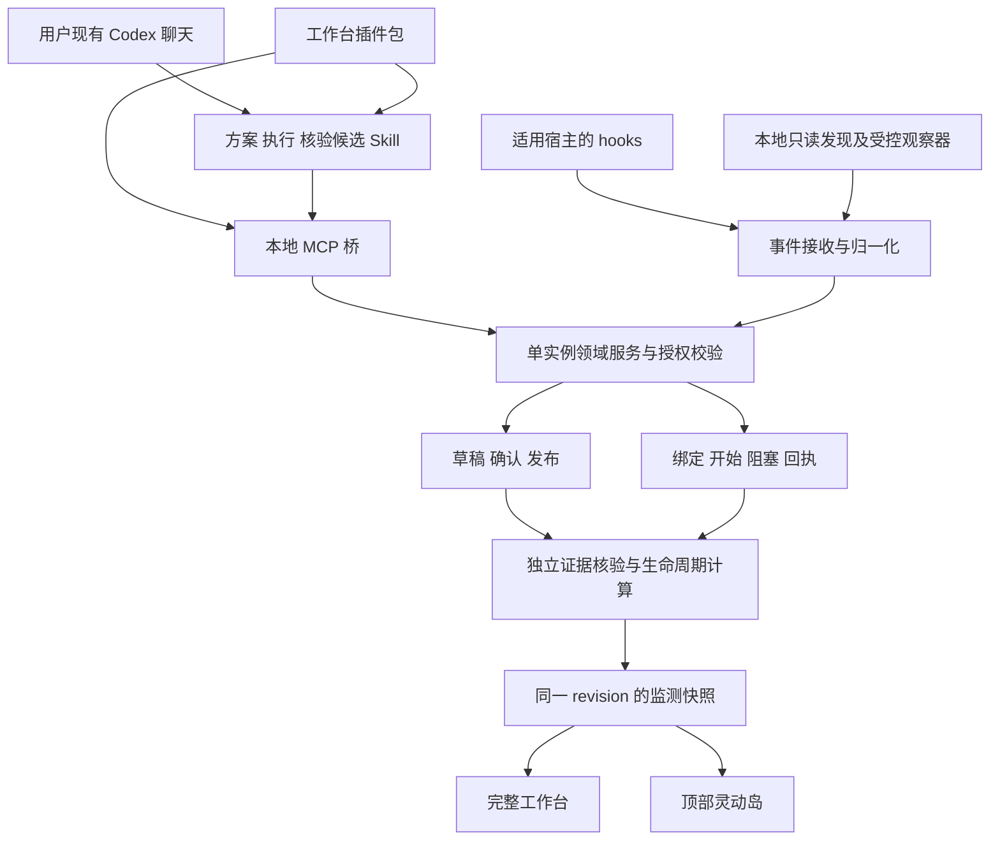

# 任务工作台、MCP、Skill、插件与证据验收组合可执行开发方案

## 统一执行入口（2026-11-09）

后续派发、补充业务规则及最终组合验收统一遵循 [统一执行总纲与手动试跑](00_统一执行总纲与手动试跑_2026-11-09.md)。本文件阶段编号用于来源和证据定位，实际派发使用 U01—U08；旧尺寸、工具数量和实施顺序按总纲的明确映射更新。历史记录保留，不代表实施完成。

日期：2026-11-09

状态：可执行方案，待实施

版本：1.0

## 1. 目标与交付定义

将已确认方案整理为有明确终点的地铁式路线，关联用户现有 Codex 聊天，记录本站执行、阻塞及等待对象，通过逐项证据核验判断本站、任务线和项目的有效完成。完整工作台和顶部灵动岛读取同一份状态。用户通过插件安装工作流，在 Codex 中调用 Skill 完成方案提交、站点执行登记和核验候选提交。

本方案将上一轮确定的“工作台 + MCP + Skill + 插件 + 可用的 hooks/会话观察器 + 独立验收”落实为实施路线。所有新增工具、目录和字段均为设计契约，具体实现由各阶段交付证明。

最终交付包含安装式工作台、项目范围内的 MCP 桥、单一 Skill `workbench-handoff`、插件包及个人安装入口、已验证宿主上的事件采集、证据核验入口、可启动的连续形变顶部面板、恢复及卸载说明。连接能力和适用宿主由配套 Codex 接入方案逐项验收。

## 2. 权威依据与现场

2026-11-09 编写前核对 `G:\rust\Codex-task-monitoring`，分支 `main`，HEAD 为 `d93dfa44cd606c6c95c4b33903dcc27a1c642dca`，工作区干净。仓库已有 React/TypeScript 前端、Node 领域服务和隔离 Tauri 面板原型。`model-store.mjs`、`receipts.mjs`、`monitor.mjs` 已有 revision、回执、逐项核验、依赖及生命周期逻辑，仍需核对实际接入后的适用范围。

| 依据 | 本方案职责 |
|---|---|
| [README 核心目标](../../../README.md#核心目标) | 需求与取舍依据 |
| [02 桌面工作台与顶部常驻面板方案](02_桌面工作台与顶部常驻面板_可执行开发方案_2026-11-09.md) | 继承 D01—D07、单写者、授权、迁移和最终验收要求 |
| [03 连续展开与收起动画方案](03_灵动岛式连续展开与收起动画_独立实现可执行方案_2026-11-09.md) | FX01—FX04 负责动效实现与观感确认 |
| [05 Codex 接入专项方案](05_Codex接入与会话进度监测_可执行方案_2026-11-09.md) | 定义宿主能力门槛、绑定、工具、事件、协议恢复及安装验证 |

本方案 C01—C06 是 D 路线的细化执行切片，接入专项 CX 阶段提供对应证据。站点验收记录只登记一次，集成时引用相同证据及提交。FX 原型验收、插件安装和单项脚本验证分别记录结果，D07 仍按安装后的组合链路验收。

本次只交付两份方案文档。实施前重新核对当前工作树、版本和并行改动，沿用现有可复用成果。

## 3. 会话监测采用方式

采用独立的 Windows 适配层，按官方 MCP、Skill、插件与当前可用 hooks 接口接入。Monitor 的观察思路作为技术参考，后续有明确收益的小模块可按许可和平台验证结果单独评估。

| 选项 | 判断 |
|---|---|
| 直接采用 Monitor 整体产品 | 其项目定位为本地 Mac 工作流监测，桌面 IPC 为内部协议。整套接入仍需要 Windows、工作台数据与路线验收适配 |
| 参考交互和状态思路独立实现 Windows 适配 | 作为本项目主路线，复用当前领域服务和前端，收敛到既定需求 |
| 有选择地复用成熟模块或标准库 | 在具体实施阶段核对许可、固定版本、输入输出和测试后采用，避免重复编写通用协议能力 |

Monitor 当前标注 MIT，允许按其条款取用，实际复制时须保留许可和版权声明。本轮未复制其实现。其 README 记录了 SQLite 目录、桌面内部 IPC 及配套 hooks/回调的分层观察方式，Windows 现成支持尚未核实。平台适配和兼容成本是当前选择独立接入的依据。[Monitor 项目与许可](https://github.com/JustinTervala/monitor)

## 4. 组件分工与数据路径

领域服务是项目数据的唯一写入所有者。MCP 桥与观察器提供受控输入，Skill 提供执行流程，插件负责安装和能力发现。正式模型、回执和核验继续经过现有服务规则，插件侧只保存连接配置和有界待投递队列。

工作台外发给 Codex 的上下文按项目授权裁剪。聊天原文、工具输出、方案文件和观察数据均作为待校验内容处理。

## 5. 用户操作闭环

1. 启动工作台，选择项目或创建空项目，查看连接与授权范围。
2. 安装工作台插件，在诊断聊天确认 MCP 工具和 Skill 已加载。既有聊天的生效方式由 CX01 实测。
3. 在现有聊天中调用 `workbench-handoff` 整理方案，提交方案原文、来源与候选结构。工作台返回草稿、缺项和 revision，用户集中确认后发布。
4. 在工作台选择现有聊天与站点，确认绑定。调用 `workbench-handoff` 核对现场并生成指令，用户手动发送指令；执行聊天按指令读取当前方案和依赖，登记实际开始，取得服务端 executionId。
5. 发生等待时提交阻塞对象与解除条件。执行结束后提交真实交付版本、实际结果及证据引用，工作台进入待核验。
6. 在独立核验入口逐项检查，可先由`workbench-handoff` 的执行后核验流程 汇集候选证据，再由授权核验人或受控验证器记录有效核验。
7. 领域服务计算本站、后继依赖、任务线及项目关闭条件。顶部面板同步位置、等待信息及对应提醒。

同一任务跨聊天续接时，用户选择目标绑定，获取原任务、站点及回执上下文。新执行使用新的 executionId。历史来源、执行和核验记录保留原身份。

## 6. 进度与结果判定

### 6.1 进度三层

| 层级 | 保存内容 | 产生依据 |
|---|---|---|
| 会话运行状态 | 执行中、等待输入、中断、空闲、未知，附来源和新鲜度 | MCP 开始声明、有效宿主事件和观察记录，按来源显示可信等级 |
| 站点业务状态 | 可开始、进行中、阻塞、待核验、已验收、待复核 | 当前方案、绑定、有效开始、回执及核验规则 |
| 验收结果 | 各条件通过、失败或待核验，证据适用版本 | 独立核验记录和受控检查产物 |

界面默认展示“有效验收站数/当前方案站数”、当前站点和阻塞数量。任务各站点默认等权。需要百分比时仅以已有效验收站数占比计算并标注“验收完成比例”，方案版本改变时随分母更新。工时和剩余时长预测留待有明确需求时设计。

会话缺少新鲜信号时运行状态变为未知，已经登记的开始记录和历史验收仍可查询。最终颜色、交接和关闭继续由领域规则生成，红色对应有效核验通过，绿色对应具备有效归属的开始。

### 6.2 每站验收契约

在发布方案时固定站点范围、交付物、依赖、验收条件与结束条件。验收项至少包含稳定条件标识、检查方法、必需标记、允许的证据类型和核验责任。为已有文本验收项建立稳定映射，保留原文及历史引用。

| 示例条件 | 核验依据 | 核验责任 |
|---|---|---|
| 构建通过 | 指定提交/工作树内容指纹上的命令、退出码和产物 | 工作台授权的固定验证器 |
| 符合交付范围 | 方案目标、实际文件差异、逐项核对记录 | 授权核验人，可由 AI 提供审查候选 |
| 顶部内容稳定 | 原生位置采样与开合录像 | 受控测量结合人工观感核对 |
| 动效观感符合用户要求 | 当前安装产物的实际体验确认 | 用户 |

模型提交的通过声明先作为自述保存。`workbench-handoff` 的执行后核验流程 输出进入候选区，普通插件令牌只具有候选提交权限。有效核验记录由授权核验入口批准，或由服务端受控验证器将真实执行结果直接写入。服务端校验核验角色与 provenance，复用现有 receipts/monitor 计算，防止客户端自行伪造 reviewer 字符串而取得关闭资格。

受控验证器使用已发布且用户授权的固定命令与目录配置，执行过程记录环境、命令、退出码、输出摘要、产物指纹及执行身份。导入文本和 MCP 参数中携带的任意命令只作为待审核内容。CI 结果只有在来源及产物关联得到验证后才作为有效证据。

### 6.3 有效性与关闭

- 核对回执和核验引用的 projectId、folderId、taskId、stationId、planId、sourceId 与 deliveryVersion。
- 证据记录保留类型、位置、内容指纹、检查时间、检查方法和核验者。文件存在性只覆盖相应存在性条件。
- 所有必需条件、前置依赖和头尾交接满足后计算通过。任务终点与项目原始目标分别核对。
- 任一必需项失败则保留失败原因，证据不足进入待核验。交付、方案、条件或相关依赖改变后重新评估适用性，历史关闭与当前待复核同时保存。
- 单写者事务把核验记录、生命周期及通知事件作为一致提交处理。恢复后按稳定事件 ID 防重提醒。

## 7. Skill 与插件设计

统一提供 `workbench-handoff` 一个 Skill，接收方案路径和可选台账、回执。完整流程及验收以 06 第 6 节为准，承接现有通用模板。

| 单入口流程 | 必需行为 | 成功依据 |
|---|---|---|
| 方案整理 | 读取原文及权威引用，保留编号、验收和终点，按授权提交草稿及发布 | 来源、缺项、版本及实际持久化结果可回查 |
| 派发前核对 | 核对现场、台账、证据及全部依赖，选择 A—G，生成适用的指令或回执 | 指令含固定完成回执，用户可直接复制到执行聊天 |
| 执行后核验 | 核对实际回执、修复轮次及证据，提交核验候选，取得全局回归判定 | 核验身份、证据和下一步依据可追溯 |

用户手动发送生成的指令开始执行。指令携带已授权工具登记要求。单入口分别验证首次整理、派发、修复、跨聊、等待及结束流程。

承接已有 A—G 指令/回执模板，按当前规则版本输出，复用 `app/server/outputs.mjs` 的表示与判定语义。Skill 只决定操作流程，服务器重新校验权限、版本、依赖和幂等性。

拟建插件目录为 `plugins/task-workbench/`，包含根 `plugin.json`、`mcp.json`、`skills/`、必要的 `hooks/` 及自有资源。优先依据当前官方 portable manifest，当前宿主需要兼容格式时由 CX01 固定实测格式与版本，打包时验证路径解析。安装资源引用发行包内桥程序，实际安装位置通过受支持的配置机制解析。[官方插件打包说明](https://developers.openai.com/plugins/build/plugins)

个人发布先验证本地市场或插件包安装入口，随后再整理团队分发。安装后通过诊断聊天证明工具可见、Skill 可调用，原有聊天逐个核对刷新/续接支持。工作台提供更新、停用、卸载及授权撤销说明，保留用户其他插件和 hooks。插件更新涉及 hooks 变更时，交由宿主要求用户重新审阅和信任。[官方插件使用说明](https://learn.chatgpt.com/docs/plugins)

## 8. 组件落点与兼容

| 模块 | 拟定落点与复用 |
|---|---|
| 关系/回执/监测 | 复用 `app/server/model-store.mjs`、`receipts.mjs`、`monitor.mjs`、`relationships.mjs`，先为新增来源及核验角色建立契约回归 |
| 草稿与发布 | 承接 02 的 `import-drafts.mjs` 与 `publish-coordinator.mjs` 设计及 I 方案，统一发布入口 |
| MCP 与绑定/事件 | `app/mcp/` 及单写者服务中的适配模块，细节归 05 |
| 单一 Skill `workbench-handoff`/插件 | `plugins/task-workbench/`，模板和 schema 复用工作台服务定义 |
| 独立核验 | 在现有核验入口上增加候选审批、受控验证器身份及证据适用性展示 |
| 主窗口/灵动岛 | 接入现有 React 工作台，消费同一快照，FX 动效通过后按 D06 集成 |

既有数据按 02 迁移规则先处理副本。新增字段缺失时采用可说明的待绑定、待核验和来源未知状态，原有方案、回执、开始及历史关闭不得回填为新来源已认证。

## 9. 实施路线与前置

| 阶段 | 工作 | 必需出口 | 对应既有路线 |
|---|---|---|---|
| C01 契约与可行性 | 执行 CX01，核对插件/本地桥/真实现有聊天可用性，冻结能力矩阵、身份和权限 | 一次真实隔离 MCP 往返、目标聊天绑定路径、受限宿主状态说明 | D01 |
| C02 统一服务与持久化 | CX02、CX03，完成草稿/发布/绑定/开始/阻塞/回执服务，单写者与恢复 | 真实输入可生成完整可监测模型，响应丢失可回查，旧数据回归 | D02—D05 对应切片 |
| C03 Skill 与插件闭环 | 单一 Skill `workbench-handoff` 与安装包接线，核验候选和独立核验权限分离 | 用户在现有 Codex 中完成方案、执行及核验候选操作，接收与授权可追溯 | D04、D05 |
| C04 运行事件与结果核验 | CX04、CX05，接入受支持 hooks，受控验证器及证据失效 | 运行状态有出处，真实结果与核验适用性正确，异常场景通过 | D03、D05 |
| C05 一致视图与动效 | 复用 FX01—FX04 成果接入同一快照和去重通知 | 主/浮窗同版本，开始/待核验/通过/待复核显示正确，原生动效确认 | D06 |
| C06 安装后组合验收 | CX06 与 D07 合并使用真实 Windows 安装产物 | 第 10 节通过、恢复卸载及版本证据齐全 | D07 |

C01 发现关键宿主能力缺失时，先验证官方支持的可用连接方式。诊断结论注明恢复条件，后续仅推进不依赖该能力的模块。IPC 扩展按 05 的单独门槛推进，所有未覆盖的被动观察能力在发布说明中保留待验状态。

## 10. 必需验收场景

| 编号 | 场景 | 通过条件 |
|---|---|---|
| T01 | 普通用户安装工作台和插件 | 实际路径正确，无全局 Node 开发环境依赖，诊断显示能力与授权 |
| T02 | 原方案输入、缺项、修订、确认发布 | 保留编号/来源/验收和全部依赖，实际 projectId/revision 可回查 |
| T03 | 同目录多任务、同任务多聊天 | 用户确认后精确绑定，跨聊续接有来源记录，未确认对象待绑定 |
| T04 | 站点执行、等待、结束 | 合法开始有 executionId，阻塞附等待对象，结束进入待核验 |
| T05 | 模型声称通过但缺真实证据 | 保留自述并展示缺项，关闭资格不成立 |
| T06 | 已授权自动检查、人工检查与用户体验项 | 各自 provenance 可查，普通 Skill 候选无法直接批准正式核验 |
| T07 | 前置、头尾交接、任务终点及项目原始目标 | 每层都核对有效证据，后继可开始与实际开始分别记录 |
| T08 | 旧交付、方案修订、证据消失或失效 | 保留历史，当前计算进入待复核或待核验，产生一次对应提醒 |
| T09 | 重复、乱序、超时、并发修订、崩溃恢复 | 幂等或明确冲突，已提交结果可回查，源事件不造成重复开始或通知 |
| T10 | hooks 缺失/未信任、断线、IPC 不支持 | 如实显示覆盖范围、未知状态及操作修复入口，MCP 业务回执可独立查询 |
| T11 | 主窗口与顶部面板 | 同项目同 revision，长路线可达，模拟与真实事件分开，FX 原生验收通过 |
| T12 | 升级、撤销、显式退出、卸载、整目录恢复 | 在途与重试处理一致，撤销立即约束新操作，保留用户数据与其他配置 |

每项保留日期、精确安装包/提交/依赖版本、宿主版本与执行环境、输入、实际操作、预期、结果和证据位置。脚本、真实模型工具调用、安装后原生行为分层登记。

## 11. 交付与收口

交付记录至少包含安装产物与哈希、插件包及版本、单一 Skill `workbench-handoff` 的实际操作示例、权限矩阵、能力覆盖表、MCP 回执、验收矩阵、备份恢复/更新卸载说明及许可记录。源码提交前核对范围，排除真实聊天、凭据及运行数据。

完成组合闭环后对照 README 的核心目标逐项给出结果。被动监测与业务闭环各自记录覆盖范围，Windows 内部 IPC 扩展按独立证据报告。

2026-11-09 当前完成方案编写，C01—C06 待实施。下一实施入口为 C01 与 CX01，共用一次当前 Windows 宿主能力验证结果。
