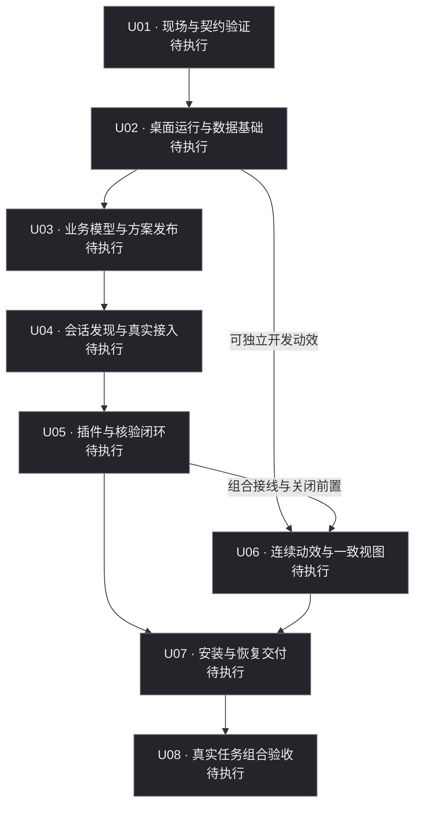

# 桌面工作台与 Codex 连接手动试跑主台账

日期：2026-11-09

状态：已建立，U01—U08 待执行

## 一、目标和使用方式

围绕项目总方向，手动派发和记录各站执行、修复、核验与交接，检验多会话、多工作树和反复修复时是否能回到总路线。本文件是本次手动试跑的主台账；实际发生的操作以人工记录为准。

方案依据：[统一执行总纲与手动试跑](../01_执行方案/00_统一执行总纲与手动试跑_2026-11-09.md)，其他专项方案按总纲引用。所有站点的验收仍以总纲及相应专项方案为准。

## 二、基线

| 项目 | 记录 |
|---|---|
| 基线检查日期 | 2026-11-09 |
| 仓库及当前工作树 | `G:\rust\Codex-task-monitoring` |
| 分支 | `main` |
| 方案基线与检查时 HEAD | `d7adb5de080298a60a31ea51241476263774654b` |
| 检查时工作区 | 创建本台账前 `git status --short` 无输出，工作区干净 |
| 基线之后的变化 | 本台账为基线之后新增文件；执行前重新核对当前 HEAD 和工作区 |
| 方案后续修订 | 暂无；发生时登记新提交、原因及影响站点，保留原基线 |
| 台账记录来源 | `manual`，不代表自动采集或 Codex 接入已完成 |

## 三、主路线

### 站点流程图

更新日期：2026-11-09

U06 可在 U02 验收后独立开发动效，组合接线与本站关闭须等待 U05。U07 同时等待 U05、U06 有效通过。图中状态随下表人工同步更新。

| 站点 | 工作 | 前置 | 状态 | 负责聊天 / 工作树 | 最新回执与证据 | 下一步 |
|---|---|---|---|---|---|---|
| U01 | 现场与契约验证 | 总方向、六方案及统一总纲 | 待执行 | 待指定 | 无 | 核对现场及前置，派发 U01 |
| U02 | 桌面运行与数据基础 | U01 | 待执行 | 待指定 | 无 | 等待 U01 验收 |
| U03 | 业务模型与方案发布 | U02 | 待执行 | 待指定 | 无 | 等待 U02 验收 |
| U04 | 会话发现与真实接入 | U03 | 待执行 | 待指定 | 无 | 等待 U03 验收 |
| U05 | 插件与核验闭环 | U04 | 待执行 | 待指定 | 无 | 等待 U04 验收 |
| U06 | 连续动效与一致视图 | U02；组合接线前须 U05 | 待执行 | 待指定 | 无 | U02 后可独立开发动效，接线与关闭等待 U05 |
| U07 | 安装与恢复交付 | U05、U06 | 待执行 | 待指定 | 无 | 等待全部前置 |
| U08 | 真实任务组合验收 | U07 | 待执行 | 待指定 | 无 | 等待 U07 验收 |

有效验收站点：0 / 8。修复支线不增加主站数量，也不改变分母。此数字是建账时人工记录，随有效核验更新。

## 四、当前站点卡：U01

- 原定目标：验证本机条件，形成可供后续执行的统一接入和身份契约。
- 来源与范围：总纲 U01，关联 D01、C01、CX01、LP01 与 FX01 原生可行性探测。
- 前置：README 总方向、六份专项方案及统一总纲；开始前重新核对版本和现场。
- 必需交付：真实工具往返回执、原有聊天能力表、原生窗口可行性证据、统一契约与缺口记录。
- 验收项：逐项对照来源方案，记录执行方法、实际结果、版本、证据和限制；证据不足标记待核验。
- 当前状态：待执行。负责聊天、执行工作树、开始时间均待登记。
- 回归位置：U01 尚未通过的原验收项；通过后重新核对 U02 的全部前置。
- 退出条件：本站必需验收均有效通过并完成交接；关键前置缺失则记录阻塞和恢复条件。

### U01 逐项验收清单

以下为派发与核验清单，状态均为待执行。责任角色在派发时指定实际聊天或人员，执行者提供证据，核验者记录结论。来源方案的完整要求继续适用。

| 条件 ID | 必需交付及核验方法 | 责任角色 | 状态 / 证据 |
|---|---|---|---|
| U01-K01 | 核对仓库、工作树、分支、HEAD、未提交改动及方案版本，保存现场记录 | 执行聊天采集，核验聊天复核 | 待执行 / 无 |
| U01-K02 | 记录 Windows、硬件、显示器、DPI、Codex 宿主及执行环境，形成逐聊天能力表 | 执行聊天采集，核验聊天复核 | 待执行 / 无 |
| U01-K03 | 固定 create-tauri-app、模板和运行依赖版本，给出运行组件打包与数据迁移契约 | 执行聊天制定，核验聊天检查 | 待执行 / 无 |
| U01-K04 | 在授权数据范围实际读取会话元数据，核对稳定 ID、标题、cwd 与源位置，记录读取错误及格式缺口 | 执行聊天验证，用户确认目标聊天，核验聊天复核 | 待执行 / 无 |
| U01-K05 | 最小隔离 MCP 工具真实往返，保存实际请求和响应；分别验证诊断聊天及既有目标聊天的能力加载 | 执行聊天实施，核验聊天复核 | 待执行 / 无 |
| U01-K06 | 核对插件清单、Skill 加载、路径解析和 hooks 适用性，保存实际版本、实收事件与不支持项 | 执行聊天验证，核验聊天复核 | 待执行 / 无 |
| U01-K07 | 原生验证置顶、非抢焦点、输入命中、固定宿主与区域裁剪可行性，记录 FX01 探测证据 | 执行聊天测量，用户体验确认 | 待执行 / 无 |
| U01-K08 | 冻结统一 schema 与九工具集合，覆盖身份可信度、草稿、绑定、修复轮次、权限、幂等、revision、核验及恢复 | 执行聊天制定，核验聊天逐项检查 | 待执行 / 无 |
| U01-K09 | 汇总缺口、影响、恢复条件和未解决冲突，逐项核对 U02 前置并形成交接结论 | 核验聊天复核，涉及范围取舍由用户确认 | 待执行 / 无 |

关键接入或原生可行性缺失时登记阻塞。hooks 等增强能力按来源方案记录实际覆盖范围。验收项变更追加修订依据与批准记录。

站点卡按站点编号保留。推进到 U02 时新增 U02 卡片，保留 U01 的原目标、条件 ID、证据和最终结论；方案修订追加新版本与差异，历史卡片可回查。

## 五、修复支线

当前无已登记修复案例。发现问题后在原站点下追加记录，保留每轮历史。

| 站点 / 案例 | 原验收项与差距 | 回归位置 | 状态 | 已开始轮数 | 未决事项 |
|---|---|---|---|---:|---|
| 暂无 | — | — | — | 0 | — |

每轮记录：案例 ID、尝试 ID、实际开始与结束时间、负责聊天及工作树、本轮目标与方法、修改、版本或内容指纹、实际结果、证据、剩余差距和核验结论。首次原定交付不算修复轮；已开始后中断计一轮，重试请求或换聊天不重复计轮。同一验收项连续两轮仍未缩小差距时，提示用户重新评估并记录决定。

### 修复尝试明细

案例 ID 使用 Uxx-Rnn，尝试 ID 使用 Uxx-Rnn-Ann，每次实际执行另有执行 ID。人工标识保持唯一，并在后续导入时保留原标识映射。

| 案例 / 尝试 ID | 执行 ID | 轮次 | 开始 / 结束时间 | 方法与修改 | 结果 / 证据 | 剩余差距 / 回归位置 |
|---|---|---|---|---|---|---|
| 暂无 | — | — | — | — | — | — |

停滞评估时追加差距对比、用户决定、理由及下一次尝试方法。

## 六、证据与核验

| 证据 ID | 所属站点 / 条件 ID | 类型 | 版本或指纹 / 环境 | 位置 | 核验人 / 日期 / 结果 | 当前有效性 / 失效原因 |
|---|---|---|---|---|---|---|
| 暂无 | — | — | — | — | — | — |

区分执行自述、实际检查、独立核验和用户观感。证据入表时记录实际位置与适用版本；真实聊天、凭据和大型产物不放入 Git。各项具体核验责任在派发本站时确认，涉及用户观感的项目由用户确认。

证据有效性采用待核对、有效、失效、待复核。代码、方案、验收条件或依赖变化后检查适用性，追加影响记录、复核证据及新结论。历史通过记录保留，主路线按当前有效结果更新。

## 七、执行与交接记录

| 记录日期 | 执行 ID / 站点 / 尝试 ID | 指令记录位置 / 发送时间 | 实际开始 / 结束时间 | 聊天 / 工作树 / 分支 / HEAD | 操作结果 / 回执 / 证据 | 下一步及依据 |
|---|---|---|---|---|---|---|
| 2026-11-09 | 建账，无执行 ID | 未派发 | 未开始 | 建账聊天；现场见第二节 | 建账基线，实施待执行 | U01 待派发 |
| 2026-11-09 | 补充台账，无执行 ID | 用户要求补充台账 | 文档整理 | 本次聊天；工作树见第二节 | 增加验收、修复、执行、阻塞及证据字段 | 派发前指定责任聊天，核对 U01-K01—K09 |

实际执行 ID 采用 Uxx-EXnn，同一次执行跨聊天续接时保留并记录接手。新一轮尝试使用新执行 ID。时间使用北京时间 YYYY-MM-DD HH:mm，补录时分别填写录入时间和实际发生时间。指令记录引用可回查的聊天标识或文件位置，响应缺失时登记待补齐。

每次手动发送指令后登记实际执行及回执，验收后再更新主路线。换聊天时携带当前站点卡、未决修复、最新证据和基线变化；方案或依赖变化时重新核对原回归位置。

## 八、阻塞与待确认事项

| 编号 | 所属站点 / 执行 / 条件 | 问题与影响站点 | 等待对象 | 解除条件 | 状态 | 最新处理时间 / 记录 / 证据 |
|---|---|---|---|---|---|---|
| 暂无已登记项 | — | — | — | — | — | — |

阻塞使用 Bnn，待确认使用 Qnn。发现时登记，恢复时追加依据及解除时间；接手聊天先读取全部未决项。当前责任聊天、具体核验人员尚待派发时指定。

## 九、准备材料入口

八站任务卡、可复制执行/修复模板、核验分工与备份步骤见 [站点任务卡与手动操作准备包](02_站点任务卡与手动操作准备包_2026-11-09.md)。U01 条件以本台账为准，U02—U08 使用准备包固定条件 ID。

2026-11-09 准备状态为任务卡及模板已建立，文档快照已创建。负责聊天、实际数据根确认、业务数据备份及全部站点执行待派发。主台账实际位置采用本目录 02_台账。
