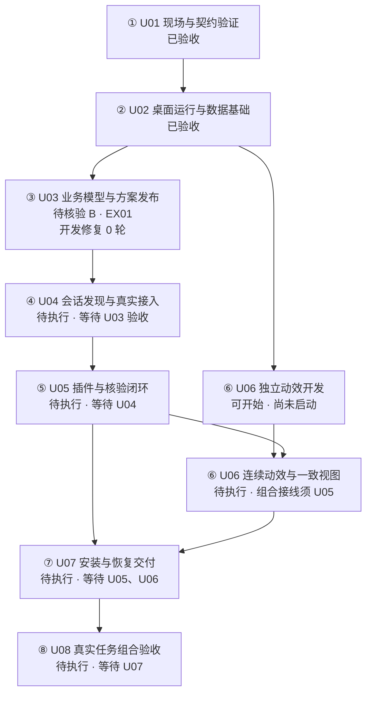

# U03 业务模型与方案发布执行回执

日期：2026-11-10

状态：实现与执行自检完成，独立核验及用户确认待登记，结论 B

## 1. 路线核对与现场

任务为③ 桌面工作台与 Codex 连接统一实施路线 / U03 业务模型与方案发布。依据统一总纲 2026-11-09 版本第 2—4、6 节，02 专项 D04，04 专项 C02，05 专项 CX03 模型切片，06 专项 LP02，以及 U01 冻结契约 1.0.0。D04 引用的 I 方案原文出处、集中补缺和事务要求纳入同一交付。既有 receipts/monitor/outputs 的依赖、验收、历史及 A—G 判定继续适用。

仓库、唯一工作树为 `G:\rust\Codex-task-monitoring`，分支 main。开始 HEAD 为 `367b35bb9b5ea758686b2f8147c5ece4b8af0d01`，开始前工作区干净。U02 已由用户验收，本站全部开始前置满足。

执行 ID 为 U03-EX01，2026-11-10 11:17 +08:00 实际开始，12:05 +08:00 进入初步交付整理，随后补验默认启动兼容性，最终技术结束时间见证据索引中的 validation-summary.json。责任聊天为 `01a1c373-b453-79c2-8e8d-d9721b7e6219`，hostId 为 local，由本次 list_threads 返回核实。应用返回该聊天的 projectId 为 null，开发目录和文件夹名称按用户派发记录保存。外部侧栏项目身份仍待 U04 核对。

本站为首次交付，开发修复轮数 0。实现期间的自检修正及失败日志留存于本执行证据目录。隔离业务样例中的四轮修复属于产品规则测试，与本任务开发修复台账分别记录。

唯一结论为 B。实现出口与 U04 的入口范围匹配。U03 仍需独立核验和用户确认需求映射及回归呈现，U04 全部开始前置尚未满足。

## 2. 实际交付

### 草稿与受控发布

- 先冻结 [来源绑定与业务存储契约](U03_来源绑定与业务存储契约_2026-11-10.md)。新增服务复用 U01 JSON Schema，自包含校验器随源码交付并核对 schema 指纹，统一保存 source、candidate、provenance、稳定实体映射、草稿 revision、修订历史和发布结果。
- 校验原文 SHA256、UTF-16 摘录位置、字段出处、完整路线声明、编号和顺序、唯一归属、双向依赖与无环图、必需验收、结束条件、原始需求和条件映射。问题在同一草稿页集中定位，外部来源待绑定单独提示。
- 服务生成稳定本地实体 ID。草稿输入不能夹带回执、正式核验或关闭字段。已发布模型的目标、路线、验收、需求及方案版本通过草稿差异确认更新。
- 初始目标与当前目标分别保存。任务及项目结束条件进入必需验收。既有方案版本、任务初始目标和站点身份的历史保护在校验和发布时复用同一函数。
- 确认摘要绑定原文、草稿 revision、模型 revision、旧项目 revision、差异、主体和 15 分钟有效期。发布创建项目、完整模型、结果索引、审计及事件，在同一持久事务中可见。

### 修复、认领与全局回归

- 新增 RepairCase、RepairAttempt、ReturnAnchor、执行、阻塞、认领、接手、站内细化、范围候选、重新评估决定和重复案例合并记录。
- 服务生成实际 executionId。同一幂等请求重试保留首次结果，换聊接手保留同一 executionId 和 attemptId。中断计入已执行轮数，首次交付独立记录。重开及案例合并保留原 ID、轮次和计数出处。
- 每轮保存来源、工作树、分支、HEAD、dirty 指纹、方法、修改、交付版本、证据、未决差距及回归锚点。旧执行或旧来源的迟到登记进入历史区。
- 认领检查同工作树及允许修改路径的冲突，接手追加交接记录。绑定校验当前方案、任务、站点、来源、bindingRevision 和工作上下文，工作树或分支变化要求重新确认。
- 站内细化关联父站目标及稳定条件。改变交付、依赖或验收的事项进入方案修订候选。候选、细化和修复轮次分别存储，主路线仍按八站计数。
- 修复解决由当前执行、当前交付版本及有效核验共同计算。自述成功保持待核验。原站未解决修复生成 A，待核验候选生成 B。旧建议依靠 revision 和输出 fingerprint 拒绝复制。
- 未覆盖原需求阻止项目关闭。主窗口展示原目标、原条件、当前修复、剩余差距、回归站点和等待对象，顶部摘要保留主站数量与修复轮次。

### 可靠写入与兼容

本次选择 `aggregate.json` 作为新的领域权威快照，将 projects、models、drafts、请求结果、审计、事件及确认记录共同提交。所有正式入口共用可见性门禁。旧数据文件及 legacy 内容保留，首次切换产生 `aggregate-migration-source.json`。当前快照写入前保留 `aggregate.json.bak`。

事务按完整 prepared 内容、提交标志、主快照的顺序执行同步写入。提交标志前失败保留旧快照，标志后失败进入恢复状态并拒绝读取。重启按事务 ID 和内容哈希恢复同一提交。列表、详情、model、monitor、outputs 和当前读取桥遵守该边界。

整目录备份需要包含聚合文件、备份、草稿、请求结果及事务文件。旧存储入口检测到聚合记录后拒绝回写。正式切换后的目录由当前版本所有者管理。恢复记录损坏时保留现场及诊断，用户可用完整目录备份恢复到新目录。

桌面白名单加入草稿、确认、发布、业务及请求回查路径。桌面初始化和重开识别聚合文件及恢复记录，聚合目录迁移使用实际权威主文件发布。桌面“导入方案”进入集中确认页。网页历史入口继续按既有回归范围验证。

## 3. 提交及验证

| 阶段 | 提交 | 内容 |
|---|---|---|
| 领域服务 | `69ab7a3` | 统一草稿、发布事务、来源绑定、修复回归及对应测试 |
| 界面与随包服务 | `f2e15c4` | 集中确认、修复视图、受控桌面路径、生产 dist 和随包校验器 |
| 正常入口自检修正 | `7ac3039` | 桌面初始化、聚合目录迁移、导入入口及发布前历史保护 |
| 独立启动兼容 | `4d5d2da` | 自包含校验器、冻结 schema 指纹和复用许可收集，维持无 npm 依赖的服务启动 |

业务交付版本为 `4d5d2da`。本报告、台账和索引在其后的文档提交中登记。源码、方案和产物 SHA256 见 [U03 证据索引](U03_证据索引_2026-11-10.json)。原始输入、请求响应、日志和截图位于 `G:\rust\Codex-task-monitoring\app\test-results\manual-trial\U03-EX01`。

| 检查 | 实际结果 | 主要产物 |
|---|---|---|
| 服务、MCP、桌面运行和 U03 定向测试 | 99/99，通过，退出码 0 | backend-delivery.log、K01—K04 JSON |
| 领域检查 | 6/6，通过，退出码 0 | domain-delivery.log |
| U03 生产界面 | 6 项通过，浏览器异常 0，退出码 0 | ui-delivery.log、ui-summary.json、UI 截图 |
| 原网页回归 | 17 项通过，退出码 0 | browser-regression.log |
| M06 组合回归 | 16 项必需场景及分叉附加检查通过，退出码 0 | m06-regression.log |
| Rust 桌面规则 | 2/2，通过，退出码 0 | rust-delivery.log |
| 生产构建 | 校验器生成、TypeScript/Vite 通过，退出码 0 | build-delivery.log、dist |
| 独立默认启动 | 脱离开发目录、无 npm 依赖，固定端口及 dist 一致，通过，退出码 0 | start-regression.log |
| 随包 Node/服务 | 精简 PATH 启动、非法 schema 拒绝、完整发布、monitor、退出排空通过，退出码 0 | packaged-delivery.log、packaged-summary.json |
| 调试安装包构建 | Tauri/NSIS 构建通过，退出码 0 | desktop-build.log、0.2.0 x64 setup.exe |

99 项包含原有 75 项服务/MCP、5 项桌面运行及 19 项 U03 定向检查。U03 定向数量含事务故障和子进程崩溃子项。准确命令、环境、退出码、版本及指纹在索引中登记。

## 4. 本站条件与核验分工

| 条件 | 执行自检 | 证据与限制 | 独立核验 / 用户确认 |
|---|---|---|---|
| U03-K01 | 通过 | 缺项与错误出处、非法字段/依赖/步骤、集中补缺、稳定 ID、差异确认、并发发布、追加版本、原目标与终点保护，以及全部读取入口 | 独立核验待登记，需求映射语义待用户确认 |
| U03-K02 | 通过 | 首次失败不计轮，失败/中断/第三轮换聊、原键重试、候选核验、重开、重复案例合并后共四轮及重评决定，主路线保持八站 | 独立核验待登记，回归呈现待用户确认 |
| U03-K03 | 通过 | 需求遗漏阻止关闭、细化关联原条件、新范围独立保存、同树冲突、接手后旧回执入历史、旧建议拒绝 | 独立核验待登记 |
| U03-K04 | 通过 | 并发 revision、真实响应丢失、四处故障注入、三处真实子进程退出、实际文件 rename 失败、旧数据及纯聚合目录迁移、整目录恢复 | 依验收卡由核验聊天复核版本和持久化结果 |

以上为本执行聊天的实际检查及同聊复查。独立核验角色尚待用户指定。用户整站确认尚未收到，因此 U03 保持待核验。

固定输入证明业务规则。桌面 transport 的一项界面检查采用固定适配，实际原生界面体验需使用下面的调试产物确认。调试安装包本次完成构建。业务验收所用数据均为隔离样例，真实会话发现、九工具、项目授权、候选核验分权与事件覆盖按 U04/U05 的站点卡继续验证。

默认启动补验发现源码 schema 和 npm 依赖缺失，改为随交付附带从冻结 schema 构建的自包含校验器，保留第三方许可并加入源指纹断言，独立目录启动复验通过。此项继续属于同次首次交付。

本轮初测遇到沙箱回环连接 EACCES，使用已授权的本机隔离测试重新运行后通过。Playwright 使用项目已有浏览器缓存。初始失败、fixture 字段补齐、修订草稿前版引用和正常桌面入口修正的日志均保留。本次测试覆盖进程崩溃恢复，未进行断电实验。

## 5. 真实 MCP 登记

本次实际调用已安装 U01 的 workbench_get_project，返回 requestId `3f6ec407-539f-4671-8e60-9f9e8ac73abf`、supportedCapabilities `[project.read.probe]`，错误为 OWNER_UNAVAILABLE，basisRevision 为 null，sourceTrust 为 declared。原始响应为 mcp-capabilities.json。

当前 MCP 缺少开始、修复和回执写工具，本轮开发进度来源为 manual。真实责任聊天元数据单独保存在 responsible-chat.json。U03 的 HTTP/领域服务回执属于隔离业务证据，尚待 U04 经真实 MCP 适配验证。

## 6. 用户复核入口与恢复材料

隔离查看入口为 `G:\rust\Codex-task-monitoring\app\test-results\manual-trial\U03-EX01\view-desktop.cmd`。它启动本次调试构建，使用独立 desktop-workspace-final，已经从 UI 固定样例目录迁移八站方案及一个原条件修复案例。原数据与迁移备份均在本执行目录内。完整调试安装包位于 `G:\rust\Codex-task-monitoring\app\src-tauri\target\debug\bundle\nsis\任务航线工作台_0.2.0_x64-setup.exe`。

1. 查看“方案草稿与集中确认”，选择已发布固定样例，核对原文、需求覆盖及发布状态。
2. 返回监测，选择 U01，查看原定目标、原条件、当前修复、剩余差距、回归位置及主路线八站分母。
3. 明确给出需求映射与回归呈现的验收决定。独立核验按 K01—K04 的版本和实际持久化结果另行登记。

使用该查看入口时发生的问题回归 U03 对应 K 项，保留 U03-EX01 和现有证据。原始固定输入为 ui-fixed-input.json，当前 UI 数据目录在 ui-summary.json 中记录。恢复使用完整目录副本。事务提交标志存在时由当前所有者恢复，恢复失败保留 prepared、committed、主快照及备份供核对。

## 7. 全路线状态及 U04 前置



有效验收进度为 2/8。U03 执行自检完成，整站待核验。U06 独立开发具备前置，尚未在本轮启动，组合接线及关闭等待 U05。U04 的唯一前置为 U03，有效验收后才具备开始条件。

U04 接手使用相同数据所有者和持久化层，将九工具映射到 drafts、publisher、business、requests 及现有核验服务。项目/创建授权、可信调用主体、撤销和真实源绑定由 U04 适配层校验。U01 scope 的初次开始申请在服务登记后取得实际 executionId，后续记录使用返回 ID。UI 确认凭据与普通插件能力分别处理。普通 MCP 候选提交继续按 U05 核验门禁收口。

## 8. 十八字段完成回执

- 日期：2026-11-10
- 方案文档为：G:\rust\Codex-task-monitoring\docs\03_桌面工作台与Codex连接\01_执行方案\00_统一执行总纲与手动试跑_2026-11-09.md，2026-11-09 版本，第 2 节 U03，关联第 3、4、6 节及 D04、C02/CX03、LP02 和 U01 契约
- 本方案一共为：共 8 步，分别是

  1. U01 现场与契约验证
  2. U02 桌面运行与数据基础
  3. U03 业务模型与方案发布
  4. U04 会话发现与真实接入
  5. U05 插件与核验闭环
  6. U06 连续动效与一致视图
  7. U07 安装与恢复交付
  8. U08 真实任务组合验收

- 本次执行步骤为：U03 业务模型与方案发布
- 本步骤是否完成：实现与执行自检完成，整站待核验
- 是否满足方案预期：技术自检通过，独立核验及用户确认待完成
- 任务线 / 步骤编号：桌面工作台与 Codex 连接统一实施路线 / U03
- 本站原定目标：草稿完整发布、来源绑定接口、修复回归、需求覆盖、细化、认领接手、全局判定及可靠写入
- 实际交付：统一业务服务、聚合事务、集中确认和回归视图、兼容迁移、隔离测试及调试桌面产物
- 提交及验证证据：69ab7a3、f2e15c4、7ac3039、4d5d2da，证据索引、99 项服务检查、6 项领域检查、6 项 U03 界面检查、2 项 Rust 测试和随包烟测通过，原网页 17 项及 M06 组合回归通过
- 各项验收条件及结果：U03-K01—K04 执行自检通过，独立核验及用户确认待登记
- 当前阻塞：等待独立核验，以及用户对需求映射和回归呈现的确认
- 任务线是否已到终点：否，有效验收进度 2/8
- 下一站：U04 会话发现与真实接入
- 本站尾部与下一站头部是否匹配：交付接口和范围匹配，正式交接等待 U03 验收
- 下一站全部前置条件是否满足：尚未满足，U03 整站验收待完成
- 交接对象：U03 核验聊天及用户，验收后交接本任务线 U04
- 结束结论：B，等待核验

## 9. 可复制核验入口

```text
使用 $workbench-handoff，执行 U03 交付核验。
日期使用实际执行当天 YYYY-MM-DD。
任务名称：③ 桌面工作台与 Codex 连接统一实施路线 / U03 业务模型与方案发布核验
开发项目及 Codex 文件夹：Codex-task-monitoring
仓库及工作树：G:\rust\Codex-task-monitoring，main，业务交付 4d5d2da，执行前重查实际 HEAD、台账、未提交改动及证据指纹。
方案路径：G:\rust\Codex-task-monitoring\docs\03_桌面工作台与Codex连接\01_执行方案\00_统一执行总纲与手动试跑_2026-11-09.md，2026-11-09，第 2 节 U03 及其全部权威引用。
主台账路径：G:\rust\Codex-task-monitoring\docs\03_桌面工作台与Codex连接\02_台账\01_手动试跑主台账_2026-11-09.md
验收卡：G:\rust\Codex-task-monitoring\docs\03_桌面工作台与Codex连接\02_台账\02_站点任务卡与手动操作准备包_2026-11-09.md
实际回执：G:\rust\Codex-task-monitoring\docs\03_桌面工作台与Codex连接\02_执行过程\U03_业务模型与方案发布_2026-11-10.md
证据索引：G:\rust\Codex-task-monitoring\docs\03_桌面工作台与Codex连接\02_执行过程\U03_证据索引_2026-11-10.json

前置为 U02 已验收。当前 U03-EX01 首次交付，开发修复 0 轮，独立核验及用户确认待登记。
逐项核验 U03-K01 原文与完整发布、K02 修复轮次/中断/重试/重开和回归、K03 覆盖/细化/新范围/认领接手/过期建议、K04 并发/真实响应丢失/磁盘失败/进程崩溃和旧数据/聚合目录迁移。
先核对提交及产物指纹，复用有效证据，必要重验使用隔离目录。登记独立核验人、实际命令、退出码、版本和结果。按报告第 6 节取得用户对需求映射与回归呈现的实际决定。
发现差距回归 U03 对应条件，建立实际修复案例及尝试，保留原标准和历史。全部通过后同步台账、证据和流程图，核对 U04 的全部前置并选择唯一 A—G 结论。按可验证阶段提交本次授权文件，排除无关改动。
核验交付后停止并报告状态。真实会话和完整九工具接入按 U04 另行派发。

方案共 8 步，依次为
  1. U01 现场与契约验证
  2. U02 桌面运行与数据基础
  3. U03 业务模型与方案发布
  4. U04 会话发现与真实接入
  5. U05 插件与核验闭环
  6. U06 连续动效与一致视图
  7. U07 安装与恢复交付
  8. U08 真实任务组合验收

按以下十八字段顺序返回实际核验回执。
- 日期：
- 方案文档为：完整路径、版本及章节
- 本方案一共为：共 8 步，逐行缩进列出以上完整八步
- 本次执行步骤为：U03 业务模型与方案发布核验
- 本步骤是否完成：
- 是否满足方案预期：
- 任务线 / 步骤编号：
- 本站原定目标：
- 实际交付：
- 提交及验证证据：
- 各项验收条件及结果：
- 当前阻塞：
- 任务线是否已到终点：
- 下一站：U04 会话发现与真实接入
- 本站尾部与下一站头部是否匹配：
- 下一站全部前置条件是否满足：
- 交接对象：
- 结束结论：
```
