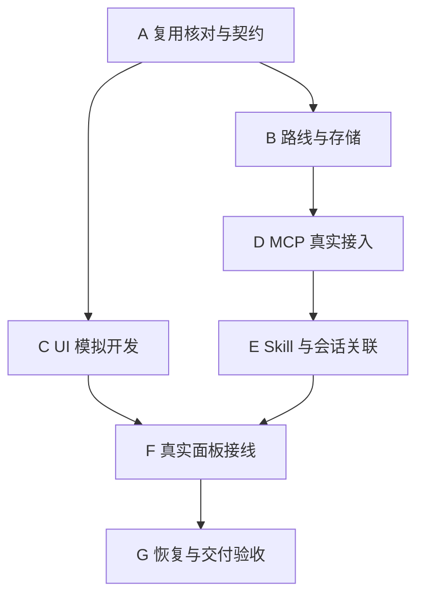

# 新路线实施总纲与接口决定

日期：2026-11-10

状态：路线与接口设计已确定，待实施

## 当前依据

用户决定采用轻量路线新路线，复用已有交付，归档旧路线剩余计划。本文是当前实施顺序和接口取舍入口，七份细化方案提供模块要求。旧 U01—U08 作为历史工作与证据索引使用，实际状态保留在台账。

Skill 在接入时将总阶段规范为 A、B、C 等，阶段内细分步骤使用 A-01、A-02、B-01 等编号，同时保存修改前后的对应关系。会话组织编号与步骤集合通过固定 ID 映射。UI 参数、交互、会话命名与核验范围采用需求与视觉基线目录的最新设计。MCP 业务方向为 Codex 主动上报、保存回执和按需读取。

## 实施路线与出口

| 阶段 | 前置 | 范围 | 出口要求 |
|---|---|---|---|
| A 复用核对与契约 | 用户已确认新方向 | 核对代码、旧交付与接口，登记缺口及模块归属，固定原型基线 | 原文步骤映射、事件、状态、绑定及存储契约可验证，复用清单有实际证据 |
| B 路线与存储 | A | 依赖、五状态、事务、幂等和恢复 | 二十步骤六路线可提交、回读和重启恢复，前置门禁正确 |
| C UI 模拟开发 | A | 使用原型视觉与约定快照开发多项目路线面板 | 原型对照、长路线及多分支交互检查通过 |
| D MCP 真实接入 | B | 读取、方案登记和状态上报，授权、回执与未知结果查询 | 真实聊天可开始、更新、结束，重复及冲突有正确结果 |
| E Skill 与会话关联 | D | 原文提取、上报规则、绑定及可用宿主操作 | 单会话细分任务、多工作树及续接流程可运行 |
| F 真实面板接线 | C、E | UI 消费同一持久状态，原生桌面交互 | 真实上报、回读和面板一致，视觉及焦点检查通过 |
| G 恢复与交付验收 | F | 故障恢复、安装、六路线依赖组合及使用说明 | 七模块必需场景有证据，全部必要步骤和验收满足 |

B 与 C 可以并行，D、E 沿业务路线推进，最终在 F 汇合。A—G 为本方案七个总阶段，依赖决定可执行顺序。会话 A、B、C 对应总阶段执行分组，模块文件 01—07 用于职责分类，分别保存映射。开始阶段前核对其前置证据，阶段完成需记录实现版本、实际检查、结果及未决项。

## 已有交付复用边界

| 历史来源 | 复用内容 | 新路线处理 |
|---|---|---|
| U01 已验收 | MCP 隔离读取、契约和原生可行性证据 | A 核对当前适用性，D 补真实写入闭环 |
| U02 已验收 | 单实例、私有通信、打包运行组件、迁移恢复和退出基础 | B 与 G 复用实现，变更影响范围定向复验 |
| U03 已交付待核验 | 草稿、出处、确认发布、业务模型与事务能力 | A/B 核对适用功能并补核验，保留历史待核验结论 |
| 旧 U04—U08 计划 | 接入、Skill、桌面、安装验收的参考要求 | 剩余工作分别归入 D—G，以本路线验收出口执行 |

旧九工具中读取、草稿保存/校验/发布、开始、阻塞和回执能力优先复用并由适配层接入新模型。发布确认、授权主体、来源可信度及审计边界随服务复用。修复轮次与独立核验候选作为兼容历史能力保存，其新交互按轻量需求实现。

## UI 原始样式基线

用户确认喜欢最初始 UI。视觉来源固定为 `prototypes/top-panel` 的现有原型，源文件指纹见需求与视觉基线目录的原始 UI 样式保留清单。C 从该原型提取组件和样式，形成改动前后对照。

保留黑色主体、圆角轮廓、细边框、紧凑条与路线缩略图、圆点连线和紧凑文字的视觉语言。紧凑条以 600×38 DIP 为基线。展开区以最新设计的宽 960 DIP、高度上限 640 DIP 起步，并受可用工作区约束。顶部条与下方展开区按新结构接合，多项目与分支布局延续原型风格。

原型中的红色完成、绿色执行中语义继续配文字及图标，阻塞、取消、待执行分别可辨。验收需展示原型与新版本对照，并取得用户实际观感确认。

## 统一上报约定

以下接口名称为已选定的新设计，实施时补齐 schema、适配和真实调用证据。所有写请求包含 schemaVersion、projectId、planId、expectedRevision、eventId 和资料来源。作用于步骤时包含固定 stepId，作用于执行时包含 executionId。会话标识必须来自已确认绑定，服务校验授权、归属和版本。

业务修改、历史事件和幂等结果在同一持久事务中提交。eventId 在授权主体、项目及工具范围内去重，同键同内容返回原结果，同键异内容拒绝。已提交请求的幂等回放先于新版本检查。回执返回 eventId、committedRevision、结果及服务接收时间。超时保留提交结果未知，通过原 eventId 查询或重试。

## 步骤五状态接口

采用 `workbench_update_step_status`，输入含 stepId、executionId、targetStatus、reason、occurredAt，可按状态携带 evidence、blocker 和 reopen。状态枚举采用 pending、running、blocked、completed、cancelled，对应待执行、执行中、已阻塞、已完成、已取消。

| 当前状态 | 允许目标 | 条件 |
|---|---|---|
| 待执行 | 执行中 | 全部必要前置完成，绑定和执行上下文有效 |
| 待执行 | 已取消 | 提供原因和受影响后继处理说明 |
| 执行中 | 已阻塞 | 提供阻塞原因、等待对象和恢复条件 |
| 执行中 | 已完成 | 提供验收检查、交付结果和证据引用 |
| 执行中 | 已取消 | 提供原因及未完成事项 |
| 已阻塞 | 执行中 | 提供解除依据，重检全部前置与阻塞来源 |
| 已阻塞 | 已取消 | 提供原因及后继处理说明 |
| 已完成、已取消 | 待执行、执行中 | 显式 reopen、原因和后继影响，进入执行中时重检前置 |

同状态同请求重试按幂等处理。同状态的新事件作为进展说明追加历史，完成证据修订需重新校验。全部状态变化记录旧值、新值、实际执行和来源，保留原完成记录。

一次逻辑执行开始与结束继续映射现有 start、receipt 能力，executionId 由已登记执行取得。步骤执行状态更新与开始登记可由事务适配合并，保证一个逻辑开始。阻塞兼容旧 record_blocker，相关来源全部解除后才可恢复执行。完成步骤按服务端配置的验收要求检查，缺失或待确认的验收资料返回问题清单。整体完成由聚合规则计算。

## 补充事项与旧修复案例映射

采用 `workbench_record_supplement`，动作包括 create、update、linkPlan、resolve、cancel。记录 supplementId、sourceStepId、title、goal、blocksSource、status、关联方案和原 repairId。变更复用统一版本、事件与授权规则。

| 事项类型 | 新处理方式 | 旧数据关联 |
|---|---|---|
| 达成原验收所需的调试、重试、小修复 | 原步骤内追加进展与证据 | 保留 RepairCase/RepairAttempt 历史及原 ID |
| 独立目标、单独安排或验收的新事项 | 创建补充事项，等待确认，再规划关联方案 | 记录来源 repairId，保持双方可追溯 |
| 已有案例含义不明确 | 标记待人工分类，保存原状态和计数 | 保留原案例及来源可信记录 |

补充事项状态采用待确认、待规划、执行中、已完成、已取消。用户确认规划后进入待规划，方案形成并获得执行范围授权后可进入执行中。阻塞事项创建时同步登记来源阻塞，完成或取消时处理该阻塞来源，再重新计算原步骤可执行性。原步骤仍按自己的验收条件更新。取消必要前置事项需要明确替代承接。

create 使用同一 eventId 防重复。linkPlan 校验来源方案与目标方案授权及关联完整性。resolve 校验关联方案的必要交付及结束依据，保留待处理后继。旧修复轮数按历史规则查询，新补充事项通过固定 ID 关联历史。

## 会话与工作树绑定接口

采用 `workbench_bind_context`，动作包括 propose、confirm、revoke。propose 输入原文 stepIds、会话组织编号、外部会话及项目标识、Git 分支、工作树目录和预期绑定版本，返回 bindingId、bindingRevision、校验问题及拟定名称。

confirm 通过已认证工作台确认入口或其签发的限范围确认凭据执行，绑定方案、步骤集合、会话及工作树，并核对目录实际 Git 分支。外部身份无法验证时记录声明来源，保留待确认。revoke 撤销后拒绝基于该绑定的新写入，历史执行保存原绑定版本。

开始执行必须引用有效 bindingId/bindingRevision。续接会话重新核对绑定并记录接续关系，同一次逻辑执行沿用 executionId。一个原文步骤同时只允许一个有效执行责任绑定，重分配显式撤销或接手旧绑定，迟到回执进入历史待核对。

MCP 保存关联和命名意图，宿主适配执行受支持的项目创建、改名、会话移动及跳转。每项操作单独记录 operationId、pending/succeeded/failed/unsupported、目标固定 ID 和重试结果。重试复用已创建项目和序号，防止重复创建。

工作树创建和 Git 分支操作由已有授权的工作区工具执行，结果回传后核实路径。绑定接口只接受结构化关联与操作意图。宿主能力不足时提供建议名称、路径和人工绑定入口。宿主凭据保留在受控适配层，实际文件夹操作能力在 E 逐项验证。

## 文档入口与验收

01_模块方案 目录中的 01—07 七份细化方案分别覆盖 UI、MCP、路线状态、存储、会话关联、Skill 和集成验收。接口专项以本文为准，各模块实现共同遵守事务、授权及固定 ID 边界。

新增验收覆盖五状态全部转换与非法跳转、重复事件、完成后返工、原修复案例关联、补充事项规划与解除阻塞、绑定确认与撤销、接手后迟到更新、宿主操作失败重试和最初 UI 观感对照。其他场景按集成验收文档执行。

## 整理后的执行入口

日期：2026-11-10

从[当前执行台账](01_当前执行台账_2026-11-10.md)核对前置及进度，按 A—G 推进。各模块文件名用于分类查找，阶段先后以本文路线表为准。需求与视觉资料位于 ../02_需求与视觉基线，模拟输入位于 ../03_测试样例，历史交付位于 ../04_已有交付证据。

## 最新步骤编号与常用模板决定

更新日期：2026-11-10

Skill 在接入用户指定方案时，将总阶段编号规范为 A、B、C 等，阶段内细分步骤使用 A-01、A-02、B-01 等编号，保存旧新编号映射并更新依赖与步骤引用。重复导入复用已有编号，新增插入保留已登记步骤身份，具体规则见 Skill 模块。此决定更新此前原文编号保留的接入约定。

[任务收敛与交接指令](../05_使用与指令模板/02_任务收敛与交接指令_原文_2026-11-08.md)为当前通用模板，应用与发行资源继续复用。模板内的原始 PDSD 提示词作为出处资料保存，使用通用模板时填写当前新路线总纲及实际阶段。

## 本方案自身的接入与执行

更新日期：2026-11-10

状态：编号与执行契约已对齐，七步实施待执行

本方案使用本项目的方案接入、依赖门禁、五状态、证据回执与接续流程推进。正式步骤总数为 7，模块内开发列表与验收子项归入所属步骤。当前文档对齐属于执行准备，A 的代码复用核对和契约验收仍需执行。

### 编号与来源映射

规范化前版本通过 Git 提交 `2a2cf40` 下的同路径文件定位，修改差异随本次提交保存。规范化前原始文件 SHA256 为 `6f4c9b33dc5d6658af4cd3c2362b1c93bd033a5707dd182023b25b1f0812a868`。原 N01—N07 按顺序映射 A—G，具体标题、前置和本地关联键保存在当前台账。此前误写的 A-01—A-07 按原顺序更正为 A—G，该历史编号仅用于追溯，不占用当前阶段内细分编号。后续接入复用该映射，服务返回 planId、stepId 后再补充服务身份。

### 步骤与模块交付矩阵

| 总阶段 | 适用模块 | 必需交付与核验边界 |
|---|---|---|
| A | 01—07 全模块 | 核对实际代码、旧 U01/U02/U03 证据和 Skill 已有源码，登记复用与缺口；固定状态、快照、事务、事件、授权、绑定和步骤映射契约；核对当前 Skill 加载来源及 MCP 能力 |
| B | 03 路线、04 存储 | 实现五状态合法及非法转换、依赖门禁、返工与取消影响、补充事项和旧修复历史关联；业务、事件、幂等结果原子提交，覆盖重复回放优先于版本检查及重启恢复 |
| C | 01 UI | 使用 A 约定的模拟快照实现布局与交互，覆盖多项目、长路线、深分支及原型对照；真实状态接入和原生桌面联验归 F |
| D | 02 MCP，配合 03/04 | 核验真实聊天方案登记、开始、更新、结束、授权拒绝、幂等、冲突和未知结果查询；绑定及补充事项接口契约可供 E 使用，面板一致性归 F |
| E | 05 会话、06 Skill，配合 02/03/04 | 编号规范化及幂等登记、真实绑定 propose/confirm/revoke、接手及迟到回执、宿主操作重试、补充事项规划及解除阻塞；完成源码、发布包、实际加载来源与新聊天行为核验 |
| F | 01 UI，联合 02—06 | 使用同一持久状态贯通真实上报、回读与面板，核验绑定跳转、更新期间定位、原生尺寸缩放焦点及最初 UI 观感，取得必要用户体验确认 |
| G | 07 集成，联合 01—06 | 汇总并复核全部必要证据，完成故障、备份恢复、迁移、安装和六路线组合验收；补齐使用说明、验收索引及遗留事项归属 |

模块各条开发和验收要求均纳入上述步骤，各步骤同时遵守本文接口专项。跨阶段验收分别登记，前置通过且必要证据有效时开放后继。

### 使用已有功能逐步接入

1. 执行前读取本总纲和当前台账，核对仓库、分支、HEAD、未提交改动、实际 Skill 来源及可用工具 schema。优先复用既有读取、草稿保存/校验/确认发布、开始、阻塞和结束回执能力，逐项核对新模型语义。
2. 当前会话只发现 U01 隔离读取探测。业务方案在本地台账登记映射，服务 ID 留空，同步状态登记待同步。隔离项目身份只用于探测。A 核对实际能力后，按服务授权与确认流程登记业务草稿或发布，并保存真实返回身份和版本。
3. 已授权且本地前置可核实的工作按台账推进。尚缺新接口时保存有作用域的本地事件键、来源版本、状态及证据，待能力具备后先查原事件再补报；服务端授权、发布和绑定确认要求按实际门禁执行。
4. 每次执行记录开始、步骤变化、阻塞及结束回执。同一次逻辑执行接续沿用真实 executionId，普通调试和原验收修复留在原步骤，独立目标登记补充事项及来源。
5. 五状态与验收、同步状态分别记录。交付待核验时保持 running 并记录待核验，外部条件阻塞时记录 blocked；验收通过后更新 completed。结束聊天后按 A—G 结论交接，整体完成依据全部七步和必要验收。

默认复用当前适用工作树，执行会话按实际责任分组并在台账登记。B/C 具备并行条件，实际并行前分别确认责任范围与文件冲突。新工作树和会话通过可用宿主工具按实际授权创建，再核实目录、分支及绑定。

## 总阶段与细分步骤编号更正

更新日期：2026-11-10

总方案正式阶段为 A—G，共 7 阶段。A 阶段内部细分为 A-01、A-02 等，B 阶段内部细分为 B-01、B-02 等，后续依此类推。阶段细分在实际派发前按范围登记，并保留父阶段、来源位置、依赖及验收映射。总阶段进度由其必要细分步骤与阶段验收共同决定。

当前七阶段依次为 A 复用核对与契约、B 路线与存储、C UI 模拟开发、D MCP 真实接入、E Skill 与会话关联、F 真实面板接线、G 恢复与交付验收。先执行 A 阶段，再根据依赖开放 B/C。交接结论 A—G 单独保存为结论字段，与阶段编号分别解释。

本次更正前版本由 Git 提交 `4a30f7d` 下同路径定位，保留其中误编号与当前编号的修订差异。本次更正尚未向业务服务登记，后续服务 ID 以真实返回为准。
