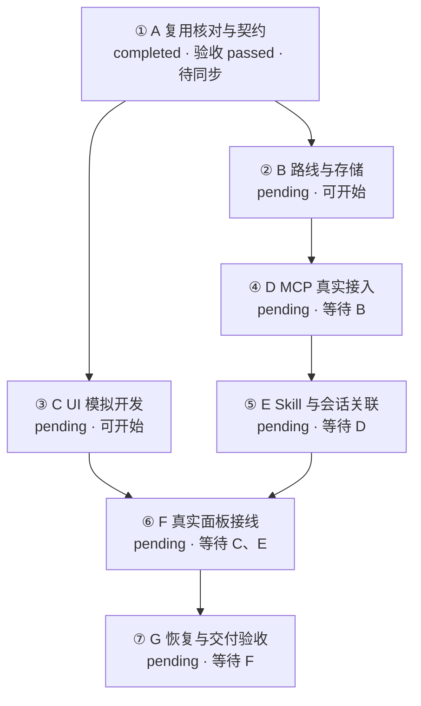

# 当前执行台账

日期：2026-11-10

状态：A 本地验收通过，B/C 可开始，业务服务待同步

统一依据为[新路线总纲](00_新路线实施总纲与接口决定_2026-11-10.md)。旧 U01、U02 已验收，U03 已交付待核验，作为 A 复用核对输入。A 六个细分及八项阶段出口已由本执行聊天核对通过，有效进度为 1/7，B—G 待执行。

| 阶段 | 前置 | 当前状态 | 结束证据 |
|---|---|---|---|
| A 复用核对与契约 | 新方向已确认 | completed，验收 passed，同步 pendingSync | [A-EX01 回执](../06_执行记录/A_复用核对与契约回执_2026-11-10.md) |
| B 路线与存储 | A 完成 | pending，可开始 | 待登记 |
| C UI 模拟开发 | A 完成 | pending，可开始 | 待登记 |
| D MCP 真实接入 | B 完成 | 待执行 | 待登记 |
| E Skill 与会话关联 | D 完成 | 待执行 | 待登记 |
| F 真实面板接线 | C、E 完成 | 待执行 | 待登记 |
| G 恢复与交付验收 | F 完成 | 待执行 | 待登记 |

每次实际执行后登记责任会话、工作树、实现版本、结果、证据、未决项和更新时间。阶段验收按总纲出口及适用模块要求进行，前置完成后开放后继阶段。

## 方案接入与身份映射

更新日期：2026-11-10

状态：本地步骤已规范化，业务 MCP 登记待同步

本地方案关联键为 `light-workbench-20261110`。planId、revision、bindingId、bindingRevision、executionId 均待真实服务返回。服务同步状态与业务五状态分别登记。最初文档对齐为准备工作，以下映射现已按 A-EX01 更新。

| 原编号 | 总阶段编号 | 本地步骤关联键 | 必要前置 | 业务状态 |
|---|---|---|---|---|
| N01 | A | light-workbench-20261110/A-01 | 用户已确认路线 | completed |
| N02 | B | light-workbench-20261110/A-02 | A | pending |
| N03 | C | light-workbench-20261110/A-03 | A | pending |
| N04 | D | light-workbench-20261110/A-04 | B | pending |
| N05 | E | light-workbench-20261110/A-05 | D | pending |
| N06 | F | light-workbench-20261110/A-06 | C、E | pending |
| N07 | G | light-workbench-20261110/A-07 | F | pending |

原编号仅作历史映射。服务 stepId 留空，登记成功后逐行补充，并保留本地关联键。会话 A 已在下方登记实际责任和本地声明绑定，B/C 责任待分配，服务确认绑定待真实返回。

## 已有交付与接入准备记录

| 日期 | 操作 | 结果与证据 | 同步状态 |
|---|---|---|---|
| 2026-11-10 | 规范化本方案编号、模块归属及验收边界 | 总纲与七模块已对齐；修改前来源为 Git 2a2cf40 下同路径，旧新编号见上表 | 本地已保存，业务服务待同步 |
| 2026-11-10 | 登记已有 Skill 源码细化输入 | plugins/task-workbench/skills/workbench-handoff；历史源码提交 b2de93f、2a2cf40；安装来源及真实运行待 A/E 核验 | 复用候选，实施验收待完成 |

后续每次执行在此追加日期、工具步骤、责任会话、实际目录与分支、来源版本、eventId 或 idempotencyKey、expectedRevision、开始及结束结果、证据路径和同步结果。事件键在实际逻辑操作建立时生成，未知服务字段保留待登记。授权发布或确认入口的阻塞单独记录，待同步事件在能力具备后使用原键查询或重试。

## 编号层级更正记录

更新日期：2026-11-10

2026-11-10 按用户确认更正总方案层级。Git 4a30f7d 中误写的 A-01、A-02、A-03、A-04、A-05、A-06、A-07 依次对应当前总阶段 A、B、C、D、E、F、G。原 N01—N07 与上述阶段映射继续保留。阶段内细分编号按 A-01、A-02、B-01 等规则在派发前登记，父阶段和细分步骤分别保存身份。更正当时全部阶段为 pending，A-EX01 当前结果见阶段主表，业务服务登记仍待同步。

既有本地关联键 light-workbench-20261110/A-01 至 light-workbench-20261110/A-07 保持不变，按上表关联总阶段 A—G。这些键是历史关联身份，显示编号采用当前阶段编号，细分步骤另建关联身份。

## A 阶段执行登记

更新日期：2026-11-10

执行关联键为 `light-workbench-20261110/executions/A-EX01`，会话组织编号 A。实际责任聊天为 `01a1c5a8-ec10-7e43-b394-f194fcdbc2b9`，hostId 为 local，由本次 list_threads 返回核实。宿主 projectId 为 null，业务 projectId、planId、stepId、bindingId、bindingRevision、executionId、expectedRevision 均为空，等待服务真实返回。绑定来源为本次用户授权与实际 Git 现场声明，确认状态为待服务确认。

沿用唯一工作树 `G:\rust\Codex-task-monitoring`、分支 `main`，初始 HEAD 为 `cd567137bfb9489b1a4699bfc2296d53c19118bd`，开始前工作区干净。单工作树归类序号沿用 1，本次未创建目录或分支。会话建议名称为 `[A] 复用核对与契约`，实际宿主标题为“执行 A 阶段复用核对与契约”。

细分键统一使用 `light-workbench-20261110/stages/A/steps/A-xx`。总阶段历史键继续保留，避免与细分身份冲突。来源均为总纲“步骤与模块交付矩阵”A 行及对应模块“对应执行步骤与验收归属”。以下为执行前登记，状态随实际核验更新。

| 细分 | 目标 | 必要前置 | 交付 | 验收要求 | 业务状态 | 验收 | 同步 |
|---|---|---|---|---|---|---|---|
| A-01 | 核对现场、规则、来源和安装差异 | 用户已授权 A | 来源指纹、Skill 差异、工具实测 | 版本可定位，业务身份与隔离身份分开记录 | completed | 通过，证据见 A 回执 | pendingSync |
| A-02 | 核对代码与 U01/U02/U03 | A-01 | 复用和缺口矩阵 | 每项关联实际代码、检查及后续责任阶段 | completed | 通过，证据见 A 回执 | pendingSync |
| A-03 | 固定层级、状态、依赖与快照 | A-02 | 结构契约、快照样例 | 编号稳定、无环、五状态、B/C 共用结构可校验 | completed | 通过，证据见 A 回执 | pendingSync |
| A-04 | 固定事务、事件、授权、绑定与回执 | A-03 | 写入契约与旧工具适配矩阵 | 幂等、冲突、未知、撤销及迟到回执有明确规则 | completed | 通过，证据见 A 回执 | pendingSync |
| A-05 | 冻结原型与验证基线 | A-03、A-04 | 原型指纹、定向检查记录 | 原型指纹一致，契约正负样例和已有适用回归通过 | completed | 通过，证据见 A 回执 | pendingSync |
| A-06 | 出口验收与接续交接 | A-01—A-05 | 十八字段回执、台账及待同步事件 | 全出口有证据，B/C 门禁分别核对，保存后回读并提交 | completed | 通过，证据见 A 回执 | pendingSync |

### 本次事件及待同步队列

事件作用域为本地方案与本次执行，稳定键前缀为 `light-workbench-20261110/A-EX01/`。本表是发送侧持久记录，保存主体为当前仓库台账。业务服务尚未收到事件，服务接收时间和已同步版本为空。恢复入口为本台账与 A 执行回执。

| 日期 | 事件后缀 | 操作与范围 | 本地结果 | 送达/同步 | 证据 |
|---|---|---|---|---|---|
| 2026-11-10 | start | 总阶段 A pending → running，建立本地执行及六个细分 | 已保存，用户授权前置满足 | 未发送，pendingSync | 初始 HEAD、Git 现场和本节 |
| 2026-11-10 | capability-read | 读取实际 MCP 能力 | 仅 project.read.probe，隔离读取返回 OWNER_UNAVAILABLE | 读取拒绝，业务写入工具未暴露 | ../06_执行记录/A_MCP实测_2026-11-10.json |
| 2026-11-10 | A-01-start / A-01-complete | 现场、Skill 和 MCP 核对 | pending → running → completed，验收 passed | 未发送，pendingSync | A 回执第 1—2 节、证据索引 skillFiles |
| 2026-11-10 | A-02-start / A-02-complete | 旧交付与七模块复用 | pending → running → completed，验收 passed | 未发送，pendingSync | A 回执第 3 节、36 项定向回归 |
| 2026-11-10 | A-03-start / A-03-complete | 层级、状态、依赖与快照 | pending → running → completed，验收 passed | 未发送，pendingSync | light-v1.json、本地快照、结构检查 |
| 2026-11-10 | A-04-start / A-04-complete | 事务、授权、绑定和回执 | pending → running → completed，验收 passed | 未发送，pendingSync | A 回执第 5 节、正负例及持久化回归 |
| 2026-11-10 | A-05-start / A-05-complete | 原型、契约及复用检查 | pending → running → completed，验收 passed | 未发送，pendingSync | 原型 4/4，服务/MCP/桌面 104 项、领域 6 项通过 |
| 2026-11-10 | A-06-start / A-06-complete | 八项出口、保存回读与交接 | pending → running → completed，验收 passed | 未发送，pendingSync | A 回执第 7—9 节及最终文档检查 |
| 2026-11-10 | complete | A running → completed | 六个必要细分及阶段出口均通过 | 未发送，pendingSync | A 回执、证据索引、本地快照 |
| 2026-11-10 | end | 本次本地逻辑执行结束，outcome 为 completedScope，交接结论 D | 整体完成 1/7，B/C 均可开始 | 未发送，pendingSync | A 十八字段回执与本次 Git 提交 |

同步恢复时先按原事件键查询服务是否已提交，再核对来源 hash、授权项目、发布确认和有效绑定。当前本地事件先形成候选资料，依实际 schema 构造请求，保存精确请求内容及其 hash 后再发送。首次发送时使用真实 expectedRevision，响应未知后保留原请求和原键，版本冲突重读后建立关联的新操作。成功后回读状态、身份及版本，保留本地历史。

### A 出口、未决项及合法后继

更新日期：2026-11-10

业务 completed、验收 passed、同步 pendingSync 分别登记。八项出口逐项结果见 [A 回执第 7 节](../06_执行记录/A_复用核对与契约回执_2026-11-10.md)，实际来源、检查命令、退出码和文件 hash 见 [A 证据索引](../06_执行记录/A_证据索引_2026-11-10.json)。本次采用仓库规则的本地降级流程，服务发布、确认绑定及真实写入待 D/E。

服务同步等待正式业务工具、项目授权和有效确认绑定，恢复先读取本表原键。Skill 安装差异与唯一加载源证据由 E 补齐。U03 保持历史待核验，旧安装包和文档路径变化在 G 的发行及组合验收中处理。每项解除条件与恢复入口见 A 回执第 8 节。

交接结论单独记录为 D。合法下一阶段为 B、C，各自唯一阶段前置 A 已满足。B/C 业务状态保持 pending，开始前分别登记细分、责任会话与实际工作树，核对共享文件冲突。当前证据允许按总纲并行分配。

