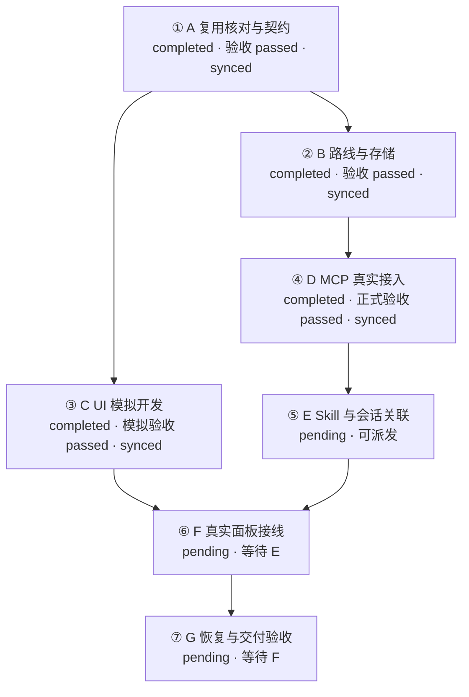

# 当前执行台账

日期：2026-11-10

更新日期：2026-11-11

## B 阶段执行前登记

日期：2026-11-10

父阶段 B，执行键 `light-workbench-20261110/executions/B-EX01`。责任聊天 `01a1c5ee-1fe1-7e43-8473-cc7a4143efd9`，会话组 B，宿主项目 `1d6d4cad-e93e-42db-80f3-e59b3fa6e61d`，本聊天实际 projectId 为 null。业务服务 projectId、planId、stepId、executionId、bindingId、bindingRevision、expectedRevision 均为空。开始事件 `light-workbench-20261110/B-EX01/start` 已本地登记，业务 running，验收 pending，同步 pendingSync，尚未发送。

开始 HEAD 为 `c5ed1257b65d41a2f7373bacc628ef6b8df475de`，main，工作区干净，唯一工作树为 `G:\rust\Codex-task-monitoring`。与交接基线 `50ac8d8` 的差异仅为 Skill 推理推荐及模块 06 文档修正。A 六个交付指纹全部一致，A 出口适用于本次 B。宿主近期聊天中未发现活动 C 开发，C 保持 pending。B 负责 app/server 路线、存储、发送队列和其测试及 B 证据。共享 light-v1.json 冻结，变动必须登记差异。台账由本聊天追加 B 区段，UI、原型、Skill 安装及 MCP 接线归后继阶段。

细分键为 `light-workbench-20261110/stages/B/steps/B-xx`，来源为总纲“步骤与模块交付矩阵”B 行、模块 03/04 开发及验收要求。

| 细分 | 目标 | 依赖 | 交付 | 必要验收 | 初始业务/验收/同步 |
|---|---|---|---|---|---|
| B-01 | 核对复用与来源，扩展明确原文解析 | A | 来源与安装指纹、解析入口 | 原始二十步骤独立副本、旧解析兼容 | running / pending / pendingSync |
| B-02 | 层级、稳定身份与依赖聚合 | B-01 | 领域校验与读取快照 | 缺失、重复、循环、覆盖、父子及六路线门禁 | pending / pending / pendingSync |
| B-03 | 五状态、证据、阻塞、取消与返工 | B-02 | 业务命令入口 | 25 对转换、同状态进展、完成校验及后继影响 | pending / pending / pendingSync |
| B-04 | 补充事项及旧修复关联 | B-03 | 补充事项业务服务 | 多来源阻塞、规划结束与取消承接、repairId 回读 | pending / pending / pendingSync |
| B-05 | 聚合事务、幂等与发送侧恢复 | B-02 | 持久入口、待同步队列及查询 | 回放顺序、异内容、并发、未知结果、旧数据 | pending / pending / pendingSync |
| B-06 | 固定输入、故障及重启验收 | B-03、B-04、B-05 | 独立副本、真实领域入口记录、快照及日志 | 二十步骤六路线完成，磁盘/中断/响应丢失/备份恢复 | pending / pending / pendingSync |
| B-07 | 出口复核、回读与交接 | B-01—B-06 | 回执、证据索引、台账和流程图 | 模块 03/04 必需条件逐项通过，下一站前置核对 | pending / pending / pendingSync |

当前工具只暴露 U01 `workbench_get_project({projectId})`，语义为隔离读取。B 开始及后续进展以本地事件键保存在本区段与 B 证据中，能力具备后先查询原键、核对真实授权与绑定，再构造精确请求。服务接收时间和已同步版本为空。

状态：A/B/C/D 正式验收及服务同步完成，E 可派发

统一依据为[新路线总纲](00_新路线实施总纲与接口决定_2026-11-10.md)。旧 U01、U02 已验收，U03 已交付待核验，作为 A 复用核对输入。A 六个细分及八项阶段出口已通过，B 七个细分及模块 03/04 必要条件已通过，有效进度为 4/7，D 正式桌面验收通过，服务版本94。E的阶段前置已满足，实际开工时核对责任绑定并取得开始回执，F/G按依赖推进。

| 阶段 | 前置 | 当前状态 | 结束证据 |
|---|---|---|---|
| A 复用核对与契约 | 新方向已确认 | completed，验收 passed，同步 synced | [A-EX01 回执](../06_执行记录/A_复用核对与契约回执_2026-11-10.md) |
| B 路线与存储 | A 完成 | completed，验收 passed，同步 synced | [B-EX01 回执](../06_执行记录/B_路线与存储回执_2026-11-10.md) |
| C UI 模拟开发 | A 完成 | completed，验收 passed，同步 synced | [C-EX01 回执](../06_执行记录/C_UI模拟开发回执_2026-11-10.md) |
| D MCP 真实接入 | B 完成 | completed，正式验收 passed，同步 synced | [D 正式回执](../06_执行记录/D_正式桌面验收回执_2026-11-11.md) |
| E Skill 与会话关联 | D 完成 | pending，前置已满足，派发入口已准备 | [E 执行入口](../06_执行记录/E_执行入口_2026-11-11.md) |
| F 真实面板接线 | C、E 完成 | 待执行 | 待登记 |
| G 恢复与交付验收 | F 完成 | 待执行 | 待登记 |

每次实际执行后登记责任会话、工作树、实现版本、结果、证据、未决项和更新时间。阶段验收按总纲出口及适用模块要求进行，前置完成后开放后继阶段。

## 方案接入与身份映射

更新日期：2026-11-11

状态：正式业务登记及核心阶段同步完成，真实身份见末尾正式同步表

本地方案关联键为 `light-workbench-20261110`。正式projectId为 `c166b75f-90f4-4e4c-95f0-608e1084b01a`，planId为 `c6f340ef-4aca-43f7-8e1b-d4cb8647a62b`，回读revision为94。bindingId为 `10be896f-4974-4f2e-a0d2-19215d29fc30`，bindingRevision为2。服务身份、执行映射及同步依据见末尾正式同步表。

| 原编号 | 总阶段编号 | 本地步骤关联键 | 必要前置 | 业务状态 |
|---|---|---|---|---|
| N01 | A | light-workbench-20261110/A-01 | 用户已确认路线 | completed |
| N02 | B | light-workbench-20261110/A-02 | A | completed |
| N03 | C | light-workbench-20261110/A-03 | A | completed |
| N04 | D | light-workbench-20261110/A-04 | B | completed |
| N05 | E | light-workbench-20261110/A-05 | D | pending |
| N06 | F | light-workbench-20261110/A-06 | C、E | pending |
| N07 | G | light-workbench-20261110/A-07 | F | pending |

原编号作为历史映射保存，正式stepId及执行身份见末尾正式同步表。本地关联键继续用于来源追溯，实际桌面验收聊天与控制聊天责任声明分别保存。

## 已有交付与接入准备记录

| 日期 | 操作 | 结果与证据 | 同步状态 |
|---|---|---|---|
| 2026-11-10 | 规范化本方案编号、模块归属及验收边界 | 总纲与七模块已对齐；修改前来源为 Git 2a2cf40 下同路径，旧新编号见上表 | 本地已保存，业务服务待同步 |
| 2026-11-10 | 登记已有 Skill 源码细化输入 | plugins/task-workbench/skills/workbench-handoff；历史源码提交 b2de93f、2a2cf40；安装来源及真实运行待 A/E 核验 | 复用候选，实施验收待完成 |

后续每次执行在此追加日期、工具步骤、责任会话、实际目录与分支、来源版本、eventId 或 idempotencyKey、expectedRevision、开始及结束结果、证据路径和同步结果。事件键在实际逻辑操作建立时生成，未知服务字段保留待登记。授权发布或确认入口的阻塞单独记录，待同步事件在能力具备后使用原键查询或重试。

## 编号层级更正记录

更新日期：2026-11-10

2026-11-10 按用户确认更正总方案层级。Git 4a30f7d 中误写的 A-01、A-02、A-03、A-04、A-05、A-06、A-07 依次对应当前总阶段 A、B、C、D、E、F、G。原 N01—N07 与上述阶段映射继续保留。阶段内细分编号按 A-01、A-02、B-01 等规则在派发前登记，父阶段和细分步骤分别保存身份。更正当时全部阶段为 pending，A-EX01 当前结果见阶段主表，业务服务登记仍待同步。

既有本地关联键 light-workbench-20261110/A-01 至 light-workbench-20261110/A-07 保持不变，按上表关联总阶段 A—G。这些键是历史关联身份，显示编号采用当前阶段编号，细分步骤另建关联身份。

## A 阶段执行登记

更新日期：2026-11-10

执行关联键为 `light-workbench-20261110/executions/A-EX01`，会话组织编号 A。实际责任聊天为 `01a1c5a8-ec10-7e43-b394-f194fcdbc2b9`，hostId 为 local，由本次 list_threads 返回核实。宿主 projectId 为 null，业务 projectId、planId、stepId、bindingId、bindingRevision、executionId、expectedRevision 均为空，等待服务真实返回。绑定来源为本次用户授权与实际 Git 现场声明，确认状态为待服务确认。

沿用唯一工作树 `G:\rust\Codex-task-monitoring`、分支 `main`，初始 HEAD 为 `cd567137bfb9489b1a4699bfc2296d53c19118bd`，开始前工作区干净。单工作树归类序号沿用 1，本次未创建目录或分支。会话建议名称为 `[A] 复用核对与契约`，实际宿主标题为“执行 A 阶段复用核对与契约”。

细分键统一使用 `light-workbench-20261110/stages/A/steps/A-xx`。总阶段历史键继续保留，避免与细分身份冲突。来源均为总纲“步骤与模块交付矩阵”A 行及对应模块“对应执行步骤与验收归属”。以下为执行前登记，状态随实际核验更新。

| 细分 | 目标 | 必要前置 | 交付 | 验收要求 | 业务状态 | 验收 | 同步 |
|---|---|---|---|---|---|---|---|
| A-01 | 核对现场、规则、来源和安装差异 | 用户已授权 A | 来源指纹、Skill 差异、工具实测 | 版本可定位，业务身份与隔离身份分开记录 | completed | 通过，证据见 A 回执 | pendingSync |
| A-02 | 核对代码与 U01/U02/U03 | A-01 | 复用和缺口矩阵 | 每项关联实际代码、检查及后续责任阶段 | completed | 通过，证据见 A 回执 | pendingSync |
| A-03 | 固定层级、状态、依赖与快照 | A-02 | 结构契约、快照样例 | 编号稳定、无环、五状态、B/C 共用结构可校验 | completed | 通过，证据见 A 回执 | pendingSync |
| A-04 | 固定事务、事件、授权、绑定与回执 | A-03 | 写入契约与旧工具适配矩阵 | 幂等、冲突、未知、撤销及迟到回执有明确规则 | completed | 通过，证据见 A 回执 | pendingSync |
| A-05 | 冻结原型与验证基线 | A-03、A-04 | 原型指纹、定向检查记录 | 原型指纹一致，契约正负样例和已有适用回归通过 | completed | 通过，证据见 A 回执 | pendingSync |
| A-06 | 出口验收与接续交接 | A-01—A-05 | 十八字段回执、台账及待同步事件 | 全出口有证据，B/C 门禁分别核对，保存后回读并提交 | completed | 通过，证据见 A 回执 | pendingSync |

### 本次事件及待同步队列

事件作用域为本地方案与本次执行，稳定键前缀为 `light-workbench-20261110/A-EX01/`。本表是发送侧持久记录，保存主体为当前仓库台账。业务服务尚未收到事件，服务接收时间和已同步版本为空。恢复入口为本台账与 A 执行回执。

| 日期 | 事件后缀 | 操作与范围 | 本地结果 | 送达/同步 | 证据 |
|---|---|---|---|---|---|
| 2026-11-10 | start | 总阶段 A pending → running，建立本地执行及六个细分 | 已保存，用户授权前置满足 | 未发送，pendingSync | 初始 HEAD、Git 现场和本节 |
| 2026-11-10 | capability-read | 读取实际 MCP 能力 | 仅 project.read.probe，隔离读取返回 OWNER_UNAVAILABLE | 读取拒绝，业务写入工具未暴露 | ../06_执行记录/A_MCP实测_2026-11-10.json |
| 2026-11-10 | A-01-start / A-01-complete | 现场、Skill 和 MCP 核对 | pending → running → completed，验收 passed | 未发送，pendingSync | A 回执第 1—2 节、证据索引 skillFiles |
| 2026-11-10 | A-02-start / A-02-complete | 旧交付与七模块复用 | pending → running → completed，验收 passed | 未发送，pendingSync | A 回执第 3 节、36 项定向回归 |
| 2026-11-10 | A-03-start / A-03-complete | 层级、状态、依赖与快照 | pending → running → completed，验收 passed | 未发送，pendingSync | light-v1.json、本地快照、结构检查 |
| 2026-11-10 | A-04-start / A-04-complete | 事务、授权、绑定和回执 | pending → running → completed，验收 passed | 未发送，pendingSync | A 回执第 5 节、正负例及持久化回归 |
| 2026-11-10 | A-05-start / A-05-complete | 原型、契约及复用检查 | pending → running → completed，验收 passed | 未发送，pendingSync | 原型 4/4，服务/MCP/桌面 104 项、领域 6 项通过 |
| 2026-11-10 | A-06-start / A-06-complete | 八项出口、保存回读与交接 | pending → running → completed，验收 passed | 未发送，pendingSync | A 回执第 7—9 节及最终文档检查 |
| 2026-11-10 | complete | A running → completed | 六个必要细分及阶段出口均通过 | 未发送，pendingSync | A 回执、证据索引、本地快照 |
| 2026-11-10 | end | 本次本地逻辑执行结束，outcome 为 completedScope，交接结论 D | 整体完成 1/7，B/C 均可开始 | 未发送，pendingSync | A 十八字段回执与本次 Git 提交 |

同步恢复时先按原事件键查询服务是否已提交，再核对来源 hash、授权项目、发布确认和有效绑定。当前本地事件先形成候选资料，依实际 schema 构造请求，保存精确请求内容及其 hash 后再发送。首次发送时使用真实 expectedRevision，响应未知后保留原请求和原键，版本冲突重读后建立关联的新操作。成功后回读状态、身份及版本，保留本地历史。

### A 出口、未决项及合法后继

更新日期：2026-11-10

业务 completed、验收 passed、同步 pendingSync 分别登记。八项出口逐项结果见 [A 回执第 7 节](../06_执行记录/A_复用核对与契约回执_2026-11-10.md)，实际来源、检查命令、退出码和文件 hash 见 [A 证据索引](../06_执行记录/A_证据索引_2026-11-10.json)。本次采用仓库规则的本地降级流程，服务发布、确认绑定及真实写入待 D/E。

服务同步等待正式业务工具、项目授权和有效确认绑定，恢复先读取本表原键。Skill 安装差异与唯一加载源证据由 E 补齐。U03 保持历史待核验，旧安装包和文档路径变化在 G 的发行及组合验收中处理。每项解除条件与恢复入口见 A 回执第 8 节。

交接结论单独记录为 D。合法下一阶段为 B、C，各自唯一阶段前置 A 已满足。B/C 业务状态保持 pending，开始前分别登记细分、责任会话与实际工作树，核对共享文件冲突。当前证据允许按总纲并行分配。

## B 阶段实际结果与待同步回执

日期：2026-11-10

本区段更新执行前登记的实际结果。B-01—B-07 均为 completed / acceptance passed / sync pendingSync。结构检查通过，实际持久领域入口及故障恢复检查通过。总阶段 B completed，全局完成 2/7。C 和 D 仅可开始，业务状态仍为 pending。实际交付及逐项必要验收见 [B 回执](../06_执行记录/B_路线与存储回执_2026-11-10.md)，精确命令、输出、来源及交付指纹见 [B 证据索引](../06_执行记录/B_证据索引_2026-11-10.json)。

| 细分 | 实际交付与验收 | 业务 | 验收 | 同步 |
|---|---|---|---|---|
| B-01 | A 6/6 指纹、Skill 差异及原文解析，旧调用兼容 | completed | passed | pendingSync |
| B-02 | 固定身份、父子聚合、无环、缺引用和六路线门禁 | completed | passed | pendingSync |
| B-03 | 25 对状态、同状态进展、证据与返工、批准替代 | completed | passed | pendingSync |
| B-04 | 补充事项规划、repairId、关联验收及对应阻塞解除 | completed | passed | pendingSync |
| B-05 | 原子提交、回放优先、并发冲突及持久发送队列 | completed | passed | pendingSync |
| B-06 | 二十步骤六路线、三十站、磁盘与进程故障、备份及旧库 | completed | passed | pendingSync |
| B-07 | 模块 03/04 必要出口、文档及快照回读、范围检查和提交 | completed | passed | pendingSync |

### B 本地事件候选

日期：2026-11-10

事件前缀为 `light-workbench-20261110/B-EX01/`，保存主体为本台账和 B 本地快照。细分未逐项计时，结构化事件时间表示登记时刻。真实业务 projectId、planId、stepId、executionId、bindingId、expectedRevision、receivedAt 和 committedRevision 均为空，未发送请求。测试快照中的服务 ID 仅属于独立副本。

| 事件后缀 | 操作 | 实际结果 | 同步 |
|---|---|---|---|
| start | B pending → running，本地开始登记 | A 前置和用户授权有效 | pendingSync |
| B-01-start / B-01-complete | 来源与解析 | completed，来源及旧兼容通过 | pendingSync |
| B-02-start / B-02-complete | 层级与依赖 | completed，结构与业务门禁通过 | pendingSync |
| B-03-start / B-03-complete | 五状态及影响 | completed，全部 25 对及证据门禁通过 | pendingSync |
| B-04-start / B-04-complete | 补充事项及旧关联 | completed，多来源和全部前置重检通过 | pendingSync |
| B-05-start / B-05-complete | 事务、幂等及发送侧 | completed，未知查询、原键重放、授权和并发通过 | pendingSync |
| B-06-start / B-06-complete | 固定输入与故障恢复 | completed，14 组 B 验证及 118 项组合回归通过 | pendingSync |
| B-07-start / B-07-complete | 出口及交接 | completed，回执、索引、快照及流程图回读通过 | pendingSync |
| complete | B running → completed | B 必要出口全部满足 | pendingSync |
| end | B-EX01 outcome completedScope | 结束结论 D，D 前置满足，C 独立待执行 | pendingSync |

当前 B 无阻塞。业务同步等待 D/E 提供真实工具、业务身份、发布确认和有效绑定，恢复从原事件键查询开始。未发送候选先按实际 schema 构造请求并用 lightOutbox.prepare 补真实身份，首次发送后按精确原请求查询或重放。Skill 安装差异归 E，真实桌面与视觉确认归 C/F，用户实际旧库及最终发行恢复归 G。

当前合法下一站为 D，其唯一阶段前置 B 已满足。C 的 A 前置已满足，可独立执行。F 仍等待 C 和 E。B 冻结契约无结构变化，向 C 交付同一 schema 的独立已提交快照。当前聊天到 B 出口结束，后继保持待执行。

### B 并行变化与实现版本

日期：2026-11-10

收尾重新核对 HEAD，发现并行 Skill 提交 `bfdbeab`，仅修改入口、交接参考和模块 06，已保留并读取最新规则。宿主改名成功，当前聊天标题为“② 轻量路线工作台 / B 路线与存储”，threadId 不变。B 实现提交 `37c2a85`，最终证据及台账另行提交。近期聊天核对未发现活动 C 开发。

## C 阶段执行登记

日期：2026-11-10

执行键 `light-workbench-20261110/executions/C-EX01`，责任聊天 `01a1c612-bd76-7220-9493-5460845b9cfd`，标题已由宿主成功更新为“③ 轻量路线工作台 / C UI 模拟开发”。工作树 `G:\rust\Codex-task-monitoring`，分支 main，开始 HEAD `7bd8bab`，工作区干净。派发基线后仅有 Skill 推理推荐位置修正。A 前置有效，B 源码、冻结契约及原型指纹已核对。A 的契约测试和台账变动由 B 增量及后续记录承接。

实际发现工具仅 U01 隔离读取 probe，业务写入工具缺失。服务身份、版本及接收时间为空，未发送业务请求。开始事件 `light-workbench-20261110/C-EX01/start` 已本地保存。C 为 running / acceptance pending / sync pendingSync。C 负责 UI、模拟样例和 C 证据，共享契约保持冻结，台账收尾先重读。

| 细分 | 交付及验收映射 | 前置 | 初始状态 |
|---|---|---|---|
| C-01 | 原型复用与契约样例适配，模块 01 开发 1 | A | running |
| C-02 | 紧凑条、展开区和五状态布局，开发 2—5 | C-01 | pending |
| C-03 | 折叠、分支、深层聚焦及定位，开发 6 | C-02 | pending |
| C-04 | 滚动、阅读保持、详情和键盘，开发 7—8 | C-03 | pending |
| C-05 | 三项目、六路线、三十站、八分支及模拟更新 | C-01 | pending |
| C-06 | UI 正常入口验证、原型对照及构建 | C-02—C-05 | pending |
| C-07 | 回执、证据、台账与 Git 交接 | C-06 | pending |

原生接线及尺寸缩放焦点联验、用户实际观感确认归 F。

## D 阶段执行登记

日期：2026-11-10

执行键为 `light-workbench-20261110/executions/D-EX01`，开始 HEAD 为 `7bd8bab289a07020c1e17e1943cc2d476f2c4512`，main，工作树 `G:\rust\Codex-task-monitoring`。责任聊天为 `01a1c618-df58-7791-bd89-9f9caf19527d`，hostId 为 local，宿主改名成功，标题为“④ 轻量路线工作台 / D MCP 真实接入”。当前聊天宿主 projectId 为 null，列表核实项目“codex任务状态监测”ID 为 `1d6d4cad-e93e-42db-80f3-e59b3fa6e61d`。业务服务身份全部为空。

C 聊天 `01a1c612-bd76-7220-9493-5460845b9cfd` 已活动，初始台账有 C 追加记录，`app/src/light-simulation.json` 为并行未跟踪文件。D 负责新增 MCP 适配和测试及 D 证据，保留 C 改动。共同 light-v1.json 保持冻结。

| 细分 | 必要交付及验收 | 前置 | 初始状态 |
|---|---|---|---|
| D-01 | 现场、来源、实际工具与接口映射 | B | running |
| D-02 | MCP schema、身份及领域服务适配 | D-01 | pending |
| D-03 | 可信发布及绑定确认与所有者部署 | D-02 | pending |
| D-04 | 协议往返、幂等、冲突和恢复检查 | D-02 | pending |
| D-05 | 宿主真实聊天登记、开始、更新及结束 | D-03、D-04 | pending |
| D-06 | 出口、证据回读、台账和交接 | D-01—D-05 | pending |

细分键为 `light-workbench-20261110/stages/D/steps/D-xx`。开始事件键为 `light-workbench-20261110/D-EX01/start`，本地 running / acceptance pending / sync pendingSync。尚未发送，真实 projectId、planId、stepId、executionId、bindingId、expectedRevision、receivedAt 和 committedRevision 为空。当前工具发现只有 U01 隔离读取。插件缓存 0.1.3 的 execution-sync.md 缺失，使用仓库对应参考继续执行，来源一致性问题归 E。

## D 本次实现及验收状态

日期：2026-11-10

本次新增 MCP 九工具适配、受控发布确认、绑定提议确认撤销和所有者创建入口，修复嵌套请求索引及登记查询身份映射。详见 [D 回执](../06_执行记录/D_MCP真实接入回执_2026-11-10.md) 与 D 证据索引。

D-01 completed，D-02 completed（局部自检通过），D-03 running（私有传输及真实认证确认接入待实施），D-04 running（SDK 与组合回归通过，真实通信待联验），D-05 pending，D-06 running（本次回执已保存，阶段出口待验收）。总阶段 running / acceptance pending / sync pendingSync，交接结论 A。服务写入次数为零，业务身份和接收版本保持空。事件 implementation、verification、handoff 使用 D-EX01 前缀，均为本地未发送候选。

E 前置 D 尚未满足。C 当前独立执行中，F 等待 C 和 E。保留全局已验收 2/7，接续沿用 D-EX01，先完成所有者私有通信、认证发布及绑定核验，再取得宿主实际工具发现与业务往返证据。

## C 阶段实际结果与交接

日期：2026-11-10

C-01—C-07 均 completed / acceptance passed / sync pendingSync。C 的模拟出口通过，全局已验收为 A/B/C 共 3/7。13 组模拟 UI、17 组既有主入口端到端、19 项 B 领域及契约、6 项领域回归通过，构建通过。原型和新版均使用 1280×800、浏览器缩放 100% 对照，390×740 小屏另存。证据见 [C 回执](../06_执行记录/C_UI模拟开发回执_2026-11-10.md)与 [C 证据索引](../06_执行记录/C_证据索引_2026-11-10.json)。

C 本地事件前缀为 `light-workbench-20261110/C-EX01/`。start、C-01-start/complete 至 C-07-start/complete、complete、end 均为本地候选，细分时间表示收尾登记时刻，未逐项计时。保存主体为本台账和证据索引。实际服务身份、expectedRevision、receivedAt、committedRevision 为空，业务发送次数为 0。同步恢复先按原键查询，再补齐真实授权、发布和绑定，首次发送后保留精确请求。

本次浏览器无头运行发现深层切换焦点丢失并已修复，原验收修复留在 C-04。首次浏览器受限启动和领域临时目录重命名失败后，使用仓库隔离 TEMP 经审批重跑通过。原型截图等待展开动画结束后重新保存。以上属于首次交付内调试。

D 责任聊天 `01a1c618-df58-7791-bd89-9f9caf19527d` 已实际启动，提交 07afbb8 的回执说明真实宿主链路尚未完成，D 最终验收由其责任聊天核定。保留其 MCP/服务源码及台账区段，C 提交只包含本范围。C 后继 F 等待 E，E 等待 D。交接结论 C（本站完成，等待依赖），F 保持待执行。

原生真实状态、桌面缩放焦点联验及用户实际观感确认由 F 承接。C 独立模拟入口为 `?view=light-simulation`，双击 [C 查看模拟面板](../06_执行记录/C_查看模拟面板.cmd)可运行静态预览，需当前 Node/npm 和已构建 dist。

## D-03—D-06 续接结果

日期：2026-11-11

用户授权继续 D-03—D-06，沿用 D-EX01 和原事件前缀，开始 HEAD 36a440b，main，工作区干净。期间并行 Skill 提交3917021已读取保留。D-03 私有所有者与受控确认、D-04 协议故障及发行检查、D-05 真实 CLI 聊天往返、D-06 证据与交接全部通过。D 本地 completed / acceptance passed / sync pendingSync，全局本地验收为 4/7。

135 项组合、6 项领域、2 项 Rust、5 项打包桥检查通过，构建通过。真实 Codex 临时聊天十三次 MCP 调用贯通登记、绑定、开始、完成及原键查询，同一执行仅一次开始和一次完成。真实验收项目身份、版本与快照单独保存，主方案业务身份仍为空。记录见 [D 接续回执](../06_执行记录/D_MCP接入续接回执_2026-11-11.md)、[真实宿主证据](../06_执行记录/D_真实宿主证据_2026-11-11.json)及十一日证据索引。

本次候选事件后缀为 continuation-start、owner-integration、verification、host-trial、complete、handoff，均使用 light-workbench-20261110/D-EX01/ 前缀，保存主体为当前台账和证据索引，发生时间仅表示登记日期。主方案业务送达仍为未发送，服务身份、expectedRevision、receivedAt、committedRevision 均为空，A/B/C/D 历史候选保留。

交接结论 C。D 的本地出口已完成，E 的方案级前置 D 已满足，但正式主方案服务状态、绑定和开始许可尚待确认。E 保持 pending，实际实施前按最新 Skill 取得成功开始回执。C 已完成，F 等待 E。0.1.4 源码及发布包已核验，现有桌面0.1.3插件安装重载和正式主方案同步由后续接入准备核对。

恢复从本台账原事件键开始，先核对真实所有者、项目授权、发布确认和绑定，再查询或按实际 schema 构造未发送候选，未知结果沿用原精确请求和事件键。真实 CLI 的测试身份只属于独立验收项目，实际用户旧库和原生面板联验分别继续由 G/F 承接。

## D 正式桌面同步及恢复收尾

日期：2026-11-11

用户恢复后，按暂停交接核对当前仓库、证据和正式服务。恢复时HEAD为491c04b，main，工作区干净。首次读取返回OWNER_UNAVAILABLE，确认所有者有explicitExit记录后通过现有原生入口恢复，实际回读仍为94，状态与暂停前正式快照一致。26项实现、运行、安装及证据指纹全部匹配。

正式项目为 `c166b75f-90f4-4e4c-95f0-608e1084b01a`，方案为 `c6f340ef-4aca-43f7-8e1b-d4cb8647a62b`。正式数据根为 `C:\Users\Zyf\AppData\Local\com.codextaskmonitor.workbench\data`。D父阶段完成回执requestId为 `ec9b5d62-8a9f-4565-acc8-db253d03af67`，版本94。A/B/C/D及其已登记必要细分均completed/passed/synced，7个总阶段完成4个，33个步骤实体完成30个。

| 阶段 | 稳定本地关联键 | 正式stepId | 正式executionId | 当前状态 |
|---|---|---|---|---|
| A | light-workbench-20261110/A-01 | 8b5e87dd-6b00-4efe-8b3b-58a99d881b0e | c2c92926-2f49-4619-801c-bb7ce86595a1 | completed / passed |
| B | light-workbench-20261110/A-02 | 97c2f703-1f89-4eac-8f4d-ce01630d4225 | 6b1d0de8-afa8-4fc9-99a4-bf162d4ec99f | completed / passed |
| C | light-workbench-20261110/A-03 | a276ed1e-a4b3-4ab8-a3c1-1c709833005f | a6af252d-d76e-4386-b656-4cd1e3b0f0ad | completed / passed |
| D | light-workbench-20261110/A-04 | 3a1d4c35-e184-4479-a06c-2bbe91c4da0b | 22902687-2544-4a9c-83ba-cc89f27a6cba | completed / passed |
| E | light-workbench-20261110/A-05 | bfdbf0e2-115c-4322-bd26-e1f8675133e1 | 待实际开始返回 | pending / pending |
| F | light-workbench-20261110/A-06 | 53a247e5-d289-4fe0-850a-e43890c5a200 | 待实际开始返回 | pending / pending |
| G | light-workbench-20261110/A-07 | f144ff56-6282-4e73-b01a-3459cc92f53f | 待实际开始返回 | pending / pending |

旧的本地pendingSync记录保存为历史时点，当前状态由本节、阶段主表及正式服务回读承接。A/B/C以有来源的验收补报同步，服务时间表示本轮补报发生时刻，原执行责任与旧版本保留在阶段回执。旧capability-read、end、handoff等资料通过来源和新复合回执关联，精确请求保存在用户私有连接目录requests子目录。

用户授权的新桌面验收聊天 `01a1c656-fe58-7bf1-ae39-1796919fcfcc` 实际发现九个轻量工具，并完成D-05进展、完成、查询与回放，D-06执行预留、开始、完成和D父阶段完成。正常退出重开后，版本94、完成requestId及executionId一致。桌面插件0.1.4安装文件12/12匹配。

正式结论为D，本站完成，可进入既定下一站E。E当前pending，派发入口已准备，实际开工核对最新绑定及开始回执。C已完成，F等待E，G等待F。正式回执见[D 正式桌面验收回执](../06_执行记录/D_正式桌面验收回执_2026-11-11.md)，证据入口见[D 正式验收证据索引](../06_执行记录/D_正式验收证据索引_2026-11-11.json)。
