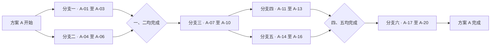

# 模拟二十步骤与六分支工作树测试文档

日期：2026-11-10

状态：测试样例，待执行

方案编号：A（模拟测试项目内的首个方案）

## 测试目标与约定

使用虚构任务“制作示例任务看板”测试二十个步骤提取、六条分支路线展示和五种状态切换。以下分支名及工作树路径均为拟定测试数据，实际创建需在执行测试时另行安排。步骤初始状态统一为待执行，每个步骤同一时刻选择一种状态。

五种状态为待执行、执行中、已阻塞、已完成、已取消。状态选项用于切换测试，完成依据为各步骤的模拟验收要求。阻塞时填写原因和恢复条件，取消时填写原因，返工时保留历史记录。

## 六条分支工作树

| 分支路线 | 步骤范围 | 拟定 Git 分支 | 拟定工作树路径 | 路线顺序 |
|---|---|---|---|---|
| 分支一 · 数据准备 | 1、2、3 | `codex/mock-data` | `G:\rust\Codex-task-monitoring-mock-data` | A-01 → A-02 → A-03 |
| 分支二 · 界面展示 | 4、5、6 | `codex/mock-ui` | `G:\rust\Codex-task-monitoring-mock-ui` | A-04 → A-05 → A-06 |
| 分支三 · 交互验证 | 7、8、9、10 | `codex/mock-interaction` | `G:\rust\Codex-task-monitoring-mock-interaction` | A-07 → A-08 → A-09 → A-10 |
| 分支四 · 同步验证 | 11、12、13 | `codex/mock-sync` | `G:\rust\Codex-task-monitoring-mock-sync` | A-11 → A-12 → A-13 |
| 分支五 · 恢复验证 | 14、15、16 | `codex/mock-recovery` | `G:\rust\Codex-task-monitoring-mock-recovery` | A-14 → A-15 → A-16 |
| 分支六 · 扩展汇总 | 17、18、19、20 | `codex/mock-summary` | `G:\rust\Codex-task-monitoring-mock-summary` | A-17 → A-18 → A-19 → A-20 |

六条路线内部各自按步骤顺序执行，跨路线按下节前置依赖推进。编号为全局展示顺序。各路线的文件范围分别为模拟数据、界面样例、交互测试记录、同步样例、恢复样例和汇总记录，便于分开观察工作树归属。

## 分支先后关系与完成条件

更新日期：2026-11-10

| 分支 | 启动前置条件 | 可同步执行的分支 | 分支完成条件 |
|---|---|---|---|
| 一 | 方案开始 | 二 | A-01 至 A-03 全部完成 |
| 二 | 方案开始 | 一 | A-04 至 A-06 全部完成 |
| 三 | 一、二均完成 | 无 | A-07 至 A-10 全部完成 |
| 四 | 三完成 | 五 | A-11 至 A-13 全部完成 |
| 五 | 三完成 | 四 | A-14 至 A-16 全部完成 |
| 六 | 四、五均完成 | 无 | A-17 至 A-20 全部完成 |

分支一、二可同步开始。两条分支全部完成后启动分支三。分支三完成后，分支四、五可同步开始。两条分支全部完成后启动分支六。分支六全部完成后，方案 A 完成。

每条分支内部按表中路线顺序执行。前置条件尚未满足时，后继步骤保持待执行，并显示等待的前置分支。执行过程中遇到需要外部处理的问题时，按实际情况登记已阻塞。任一前置步骤已阻塞或已取消时，对应分支的完成条件仍需处理。

步骤直接前置关系如下，多个前置均须完成。

| 步骤 | 直接前置步骤 |
|---|---|
| A-01、A-04 | 无 |
| A-02 | A-01 |
| A-03 | A-02 |
| A-05 | A-04 |
| A-06 | A-05 |
| A-07 | A-03、A-06 |
| A-08 | A-07 |
| A-09 | A-08 |
| A-10 | A-09 |
| A-11、A-14 | A-10 |
| A-12 | A-11 |
| A-13 | A-12 |
| A-15 | A-14 |
| A-16 | A-15 |
| A-17 | A-13、A-16 |
| A-18 | A-17 |
| A-19 | A-18 |
| A-20 | A-19 |

本测试方案以二十个步骤均满足验收要求并标记已完成作为整体完成条件。五种状态切换测试的结果应保留在记录中，最终按验收结果更新当前状态。

## 二十个模拟步骤

### 步骤 1 · A-01 建立示例任务数据

- 所属分支工作树为分支一。
- 执行内容为建立示例任务数据，使用虚构样例操作并保存模拟记录。
- 验收要求为生成一份含任务标识和标题的示例数据。
- 当前状态为待执行。
- 状态选项如下，同一时刻勾选一项。
  - [x] 待执行
  - [ ] 执行中
  - [ ] 已阻塞
  - [ ] 已完成
  - [ ] 已取消
- 状态说明、阻塞原因、恢复条件或取消原因填写于此，初始为空。
- 结果与证据位置填写于此，初始为空。

### 步骤 2 · A-02 补齐步骤编号与顺序

- 所属分支工作树为分支一。
- 执行内容为补齐步骤编号与顺序，使用虚构样例操作并保存模拟记录。
- 验收要求为二十个步骤编号唯一，六条路线顺序与分组表一致。
- 当前状态为待执行。
- 状态选项如下，同一时刻勾选一项。
  - [x] 待执行
  - [ ] 执行中
  - [ ] 已阻塞
  - [ ] 已完成
  - [ ] 已取消
- 状态说明、阻塞原因、恢复条件或取消原因填写于此，初始为空。
- 结果与证据位置填写于此，初始为空。

### 步骤 3 · A-03 校验模拟数据完整性

- 所属分支工作树为分支一。
- 执行内容为校验模拟数据完整性，使用虚构样例操作并保存模拟记录。
- 验收要求为缺失编号或重复编号能够被标记。
- 当前状态为待执行。
- 状态选项如下，同一时刻勾选一项。
  - [x] 待执行
  - [ ] 执行中
  - [ ] 已阻塞
  - [ ] 已完成
  - [ ] 已取消
- 状态说明、阻塞原因、恢复条件或取消原因填写于此，初始为空。
- 结果与证据位置填写于此，初始为空。

### 步骤 4 · A-04 绘制任务卡片

- 所属分支工作树为分支二。
- 执行内容为绘制任务卡片，使用虚构样例操作并保存模拟记录。
- 验收要求为卡片显示步骤编号、标题和当前状态。
- 当前状态为待执行。
- 状态选项如下，同一时刻勾选一项。
  - [x] 待执行
  - [ ] 执行中
  - [ ] 已阻塞
  - [ ] 已完成
  - [ ] 已取消
- 状态说明、阻塞原因、恢复条件或取消原因填写于此，初始为空。
- 结果与证据位置填写于此，初始为空。

### 步骤 5 · A-05 展示三条分支路线

- 所属分支工作树为分支二。
- 执行内容为展示三条分支路线，使用虚构样例操作并保存模拟记录。
- 验收要求为分别展示 3、3、4 个站点及各自工作树信息。
- 当前状态为待执行。
- 状态选项如下，同一时刻勾选一项。
  - [x] 待执行
  - [ ] 执行中
  - [ ] 已阻塞
  - [ ] 已完成
  - [ ] 已取消
- 状态说明、阻塞原因、恢复条件或取消原因填写于此，初始为空。
- 结果与证据位置填写于此，初始为空。

### 步骤 6 · A-06 增加状态文字与图标

- 所属分支工作树为分支二。
- 执行内容为增加状态文字与图标，使用虚构样例操作并保存模拟记录。
- 验收要求为五种状态均有可辨识的文字和图标。
- 当前状态为待执行。
- 状态选项如下，同一时刻勾选一项。
  - [x] 待执行
  - [ ] 执行中
  - [ ] 已阻塞
  - [ ] 已完成
  - [ ] 已取消
- 状态说明、阻塞原因、恢复条件或取消原因填写于此，初始为空。
- 结果与证据位置填写于此，初始为空。

### 步骤 7 · A-07 模拟开始与完成事件

- 所属分支工作树为分支三。
- 执行内容为模拟开始与完成事件，使用虚构样例操作并保存模拟记录。
- 验收要求为记录开始和完成各一次，并保存结果摘要。
- 当前状态为待执行。
- 状态选项如下，同一时刻勾选一项。
  - [x] 待执行
  - [ ] 执行中
  - [ ] 已阻塞
  - [ ] 已完成
  - [ ] 已取消
- 状态说明、阻塞原因、恢复条件或取消原因填写于此，初始为空。
- 结果与证据位置填写于此，初始为空。

### 步骤 8 · A-08 模拟阻塞与恢复事件

- 所属分支工作树为分支三。
- 执行内容为模拟阻塞与恢复事件，使用虚构样例操作并保存模拟记录。
- 验收要求为记录阻塞原因及恢复条件，恢复后进入执行中。
- 当前状态为待执行。
- 状态选项如下，同一时刻勾选一项。
  - [x] 待执行
  - [ ] 执行中
  - [ ] 已阻塞
  - [ ] 已完成
  - [ ] 已取消
- 状态说明、阻塞原因、恢复条件或取消原因填写于此，初始为空。
- 结果与证据位置填写于此，初始为空。

### 步骤 9 · A-09 模拟取消与返工事件

- 所属分支工作树为分支三。
- 执行内容为模拟取消与返工事件，使用虚构样例操作并保存模拟记录。
- 验收要求为记录取消原因，并在返工时保留历史状态。
- 当前状态为待执行。
- 状态选项如下，同一时刻勾选一项。
  - [x] 待执行
  - [ ] 执行中
  - [ ] 已阻塞
  - [ ] 已完成
  - [ ] 已取消
- 状态说明、阻塞原因、恢复条件或取消原因填写于此，初始为空。
- 结果与证据位置填写于此，初始为空。

### 步骤 10 · A-10 汇总三条路线的测试结果

- 所属分支工作树为分支三。
- 执行内容为汇总三条路线的测试结果，使用虚构样例操作并保存模拟记录。
- 验收要求为汇总前三条分支的十个步骤最终状态、未完成事项和测试记录位置。
- 当前状态为待执行。
- 状态选项如下，同一时刻勾选一项。
  - [x] 待执行
  - [ ] 执行中
  - [ ] 已阻塞
  - [ ] 已完成
  - [ ] 已取消
- 状态说明、阻塞原因、恢复条件或取消原因填写于此，初始为空。
- 结果与证据位置填写于此，初始为空。

### 步骤 11 · A-11 准备同步事件样例

- 所属分支工作树为分支四。
- 执行内容为准备同步事件样例，使用虚构样例操作并保存模拟记录。
- 验收要求为样例包含事件标识、执行标识及步骤标识。
- 当前状态为待执行。
- 状态选项如下，同一时刻勾选一项。
  - [x] 待执行
  - [ ] 执行中
  - [ ] 已阻塞
  - [ ] 已完成
  - [ ] 已取消
- 状态说明、阻塞原因、恢复条件或取消原因填写于此，初始为空。
- 结果与证据位置填写于此，初始为空。

### 步骤 12 · A-12 模拟重复事件上报

- 所属分支工作树为分支四。
- 执行内容为模拟重复事件上报，使用虚构样例操作并保存模拟记录。
- 验收要求为相同事件重复提交后只保留一条逻辑记录。
- 当前状态为待执行。
- 状态选项如下，同一时刻勾选一项。
  - [x] 待执行
  - [ ] 执行中
  - [ ] 已阻塞
  - [ ] 已完成
  - [ ] 已取消
- 状态说明、阻塞原因、恢复条件或取消原因填写于此，初始为空。
- 结果与证据位置填写于此，初始为空。

### 步骤 13 · A-13 模拟版本冲突

- 所属分支工作树为分支四。
- 执行内容为模拟版本冲突，使用虚构样例操作并保存模拟记录。
- 验收要求为过期版本更新被拒绝，并记录当前版本。
- 当前状态为待执行。
- 状态选项如下，同一时刻勾选一项。
  - [x] 待执行
  - [ ] 执行中
  - [ ] 已阻塞
  - [ ] 已完成
  - [ ] 已取消
- 状态说明、阻塞原因、恢复条件或取消原因填写于此，初始为空。
- 结果与证据位置填写于此，初始为空。

### 步骤 14 · A-14 准备中断恢复样例

- 所属分支工作树为分支五。
- 执行内容为准备中断恢复样例，使用虚构样例操作并保存模拟记录。
- 验收要求为保留中断前状态、最后更新时间及待确认提示。
- 当前状态为待执行。
- 状态选项如下，同一时刻勾选一项。
  - [x] 待执行
  - [ ] 执行中
  - [ ] 已阻塞
  - [ ] 已完成
  - [ ] 已取消
- 状态说明、阻塞原因、恢复条件或取消原因填写于此，初始为空。
- 结果与证据位置填写于此，初始为空。

### 步骤 15 · A-15 模拟跨会话接续

- 所属分支工作树为分支五。
- 执行内容为模拟跨会话接续，使用虚构样例操作并保存模拟记录。
- 验收要求为读取已有状态后沿用原执行标识继续记录。
- 当前状态为待执行。
- 状态选项如下，同一时刻勾选一项。
  - [x] 待执行
  - [ ] 执行中
  - [ ] 已阻塞
  - [ ] 已完成
  - [ ] 已取消
- 状态说明、阻塞原因、恢复条件或取消原因填写于此，初始为空。
- 结果与证据位置填写于此，初始为空。

### 步骤 16 · A-16 模拟结束消息补报

- 所属分支工作树为分支五。
- 执行内容为模拟结束消息补报，使用虚构样例操作并保存模拟记录。
- 验收要求为补报结束原因及相关步骤状态，并保留原事件标识。
- 当前状态为待执行。
- 状态选项如下，同一时刻勾选一项。
  - [x] 待执行
  - [ ] 执行中
  - [ ] 已阻塞
  - [ ] 已完成
  - [ ] 已取消
- 状态说明、阻塞原因、恢复条件或取消原因填写于此，初始为空。
- 结果与证据位置填写于此，初始为空。

### 步骤 17 · A-17 展示新增三条路线

- 所属分支工作树为分支六。
- 执行内容为展示新增三条路线，使用虚构样例操作并保存模拟记录。
- 验收要求为新增路线分别显示 3、3、4 个站点。
- 当前状态为待执行。
- 状态选项如下，同一时刻勾选一项。
  - [x] 待执行
  - [ ] 执行中
  - [ ] 已阻塞
  - [ ] 已完成
  - [ ] 已取消
- 状态说明、阻塞原因、恢复条件或取消原因填写于此，初始为空。
- 结果与证据位置填写于此，初始为空。

### 步骤 18 · A-18 核对六条工作树归属

- 所属分支工作树为分支六。
- 执行内容为核对六条工作树归属，使用虚构样例操作并保存模拟记录。
- 验收要求为六条路线均关联到分组表中的分支及拟定工作树路径。
- 当前状态为待执行。
- 状态选项如下，同一时刻勾选一项。
  - [x] 待执行
  - [ ] 执行中
  - [ ] 已阻塞
  - [ ] 已完成
  - [ ] 已取消
- 状态说明、阻塞原因、恢复条件或取消原因填写于此，初始为空。
- 结果与证据位置填写于此，初始为空。

### 步骤 19 · A-19 检查二十步骤状态展示

- 所属分支工作树为分支六。
- 执行内容为检查二十步骤状态展示，使用虚构样例操作并保存模拟记录。
- 验收要求为A-01 至 A-20 均能展示和切换五种状态。
- 当前状态为待执行。
- 状态选项如下，同一时刻勾选一项。
  - [x] 待执行
  - [ ] 执行中
  - [ ] 已阻塞
  - [ ] 已完成
  - [ ] 已取消
- 状态说明、阻塞原因、恢复条件或取消原因填写于此，初始为空。
- 结果与证据位置填写于此，初始为空。

### 步骤 20 · A-20 汇总全部模拟测试结果

- 所属分支工作树为分支六。
- 执行内容为汇总全部模拟测试结果，使用虚构样例操作并保存模拟记录。
- 验收要求为汇总二十个步骤及六条路线的状态、未完成事项和证据位置，确认全部步骤满足验收要求后将方案 A 标记为已完成。
- 当前状态为待执行。
- 状态选项如下，同一时刻勾选一项。
  - [x] 待执行
  - [ ] 执行中
  - [ ] 已阻塞
  - [ ] 已完成
  - [ ] 已取消
- 状态说明、阻塞原因、恢复条件或取消原因填写于此，初始为空。
- 结果与证据位置填写于此，初始为空。
