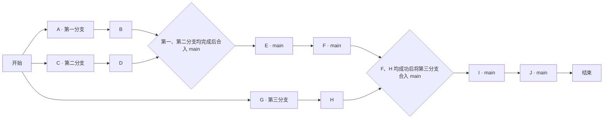

# 测试方案 03：十阶段四分支合流

日期：2026-11-13

状态：方案已编写，待执行

## 测试约定

- 共十个阶段 A～J，使用一个 main 分支和三个其他分支。
- 各阶段执行内容为空，以预设返回值代替实际任务执行。
- 返回值仅允许“成功”和“失败”两个值；本方案各阶段全部预设为“成功”，无等待时间。
- 分支内按阶段顺序执行；第一、第二分支可以并行执行。
- 第三分支的 G、H 可独立执行，其合入 main 的时机必须等待 F 成功。
- 合并表示测试路线的合流节点，不增加阶段数量。本文仅编写方案，尚未创建或合并实际 Git 分支。
- 表中为预设结果，实际返回值及合流结果在执行后记录。

## 分支分配

| 分支 | 名称 | 阶段 | 分支内顺序 |
|---|---|---|---|
| 主分支 | main | E、F、I、J | E → F → I → J，按合流条件推进 |
| 第一分支 | codex/test-plan03-ab | A、B | A → B |
| 第二分支 | codex/test-plan03-cd | C、D | C → D |
| 第三分支 | codex/test-plan03-gh | G、H | G → H |

## 路线与合流条件

1. 第一分支执行 A、B，第二分支执行 C、D。
2. B、D 均成功后，将第一、第二分支合入 main；两条分支均合入成功后才能开始 E。
3. main 依次执行 E、F。
4. F 成功且第三分支 G、H 均成功后，将第三分支合入 main；合入成功后才能开始 I。
5. main 依次执行 I、J，J 成功后结束。

## 十个阶段

| 阶段 | 所属分支 | 开始条件 | 执行内容 | 预设返回值 |
|---|---|---|---|---|
| A | 第一分支 | 方案开始 | | 成功 |
| B | 第一分支 | A 成功 | | 成功 |
| C | 第二分支 | 方案开始 | | 成功 |
| D | 第二分支 | C 成功 | | 成功 |
| E | main | B、D 均成功，第一、第二分支均已成功合入 main | | 成功 |
| F | main | E 成功 | | 成功 |
| G | 第三分支 | 方案开始 | | 成功 |
| H | 第三分支 | G 成功 | | 成功 |
| I | main | F、H 均成功，第三分支已成功合入 main | | 成功 |
| J | main | I 成功 | | 成功 |

## 验收要求

- 阶段恰好十个，编号为 A～J，分支归属与上表一致。
- 第一、第二分支均执行完成并成功合入 main 后，才执行 E、F。
- 第三分支即使提前执行完成，也必须等待 F 成功后再合入 main。
- 第三分支成功合入 main 后，才执行 I、J。
- 任一前置或合流条件未满足时，后继阶段保持待执行。
- 十个阶段均返回“成功”、三条分支均按约定成功合入 main，且 J 成功后，方案测试通过并结束。
