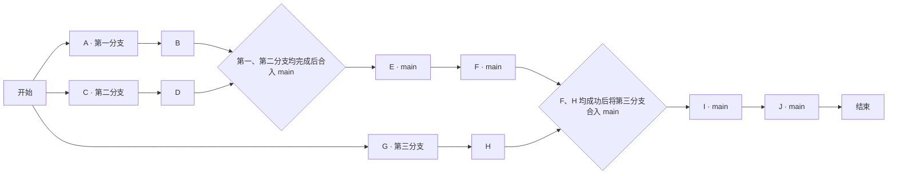

# 测试方案 03：十阶段四项目多会话合流

日期：2026-11-13

更新日期：2026-11-13

状态：方案已编写，待执行

## 测试约定

- 共十个阶段 A～J，使用一个 main 分支和三个其他分支。
- 各阶段执行内容为空，以预设返回值代替实际任务执行。
- 返回值仅允许“成功”和“失败”两个值；本方案各阶段全部预设为“成功”，无等待时间。
- 分支内按阶段顺序执行；第一、第二分支可以并行执行。
- 第三分支的 G、H 可独立执行，其合入 main 的时机必须等待 F 成功。
- 合并由 main 项目内专门新建的合并会话完成，不增加 A～J 的阶段数量。本文仅编写方案，尚未创建项目、会话或执行 Git 合并。
- 表中为预设结果，实际返回值及合流结果在执行后记录。

## 分支分配

| 分支 | 名称 | 阶段 | 分支内顺序 |
|---|---|---|---|
| 主分支 | main | E、F、I、J | E → F → I → J，按合流条件推进 |
| 第一分支 | codex/test-plan03-ab | A、B | A → B |
| 第二分支 | codex/test-plan03-cd | C、D | C → D |
| 第三分支 | codex/test-plan03-gh | G、H | G → H |

## Codex 项目与目录

在 Codex 中建立四个独立项目，分别对应同一 Git 仓库来源的四个项目文件夹，每个文件夹固定使用一个分支。三个分支项目应能同时工作，不能共用同一个执行目录并通过切换分支代替目录隔离。

| Codex 项目 | 同源项目文件夹（拟定） | 固定分支 | 项目内会话 |
|---|---|---|---|
| 测试03-main | test-plan03-main | main | 总控、合并一、E、F、合并二、I、J |
| 测试03-分支一 | test-plan03-ab | codex/test-plan03-ab | A、B，各一个独立会话 |
| 测试03-分支二 | test-plan03-cd | codex/test-plan03-cd | C、D，各一个独立会话 |
| 测试03-分支三 | test-plan03-gh | codex/test-plan03-gh | G、H，各一个独立会话 |

项目文件夹名称为方案占位名，实际执行时记录绝对路径、Codex 项目 ID、仓库来源、分支以及每个会话的真实 ID。必须核验新会话确实归属相应项目，并在对应目录及分支运行；原生项目创建或目录绑定能力缺失时，记录缺项，不能以修改会话标题或提示词中的路径代替真实项目。

## 会话分工与进度反馈

- main 项目保留一个总控会话，负责创建和派发执行会话、收集回执、核验结果、同步工作台及台账进度，并按依赖接续后继会话。
- 每个阶段使用一个新建的独立执行会话。A 成功后才创建并派发 B 会话；C 成功后才创建并派发 D 会话；G 成功后才创建并派发 H 会话。不能用同一个会话连续承接一个分支的两个阶段。
- 三个分支项目同时推进，首批为 A、C、G 三个会话；各项目内部保持顺序，不要求后继会话在同一时刻开始。
- 执行会话将开始、完成、失败或阻塞的进度反馈给 main 项目的同一个总控会话。反馈范围仅限本测试，包含项目、分支、阶段、会话 ID、实际返回值及证据位置。
- 总控会话收到回执后统一核验并同步进度。发出派发、会话空闲或仅有预设返回值，均不能作为实际执行成功的证据。
- 总控会话在 main 项目内另建“合并一”会话，负责第一、第二分支合入 main；另建“合并二”会话，负责第三分支合入 main。总控负责协调，具体合并交给这两个会话执行。
- main 自身的 E、F、I、J 也分别由总控在 main 项目内新建独立会话执行，每次核验并同步前一步成功后再派发下一步。
- 正常路径共 13 个会话：1 个总控、10 个阶段执行会话、2 个合并会话。三个分支项目各 2 个会话，main 项目共 7 个会话。
- A～J 的业务执行内容保持为空，返回“成功”或“失败”；项目创建、会话派发、进度同步与合并属于本方案要实际验证的协调操作。空任务未产生分支差异时，合并会话据实记录 Git 合并结果，不虚构文件变更或合并提交。

## 路线与合流条件

1. main 总控同时向三个分支项目派发 A、C、G；各项目分别用后继新会话执行 B、D、H，完成后向总控反馈。
2. 总控核验并同步 B、D 成功后，在 main 项目新建“合并一”会话；第一、第二分支均成功合入 main 并回报后，才新建 E 会话。
3. E 成功并由总控同步后，新建 F 会话。
4. F、H 均成功并由总控核验同步后，在 main 项目新建“合并二”会话；第三分支成功合入 main 并回报后，才新建 I 会话。
5. I 成功并由总控同步后，新建 J 会话。J 成功后，总控核验全程结果、同步最终进度并宣布结束。

## 十个阶段

| 阶段 | 所属分支 | 开始条件 | 执行内容 | 预设返回值 |
|---|---|---|---|---|
| A | 第一分支 | 方案开始 | | 成功 |
| B | 第一分支 | A 成功 | | 成功 |
| C | 第二分支 | 方案开始 | | 成功 |
| D | 第二分支 | C 成功 | | 成功 |
| E | main | B、D 均成功，第一、第二分支均已成功合入 main | | 成功 |
| F | main | E 成功 | | 成功 |
| G | 第三分支 | 方案开始 | | 成功 |
| H | 第三分支 | G 成功 | | 成功 |
| I | main | F、H 均成功，第三分支已成功合入 main | | 成功 |
| J | main | I 成功 | | 成功 |

## 验收要求

- 阶段恰好十个，编号为 A～J，分支归属与上表一致。
- Codex 中有四个真实项目及对应同源目录，每个项目固定对应一个分支；三个分支项目存在同时执行的会话记录。
- 每阶段各一个独立会话；三个分支项目分别用两个会话依次执行各自阶段。
- 所有执行回执汇集到 main 的同一个总控会话，由它核验并同步进度；两个合并会话和 main 阶段会话均由它在 main 项目内新建并派发。
- 第一、第二分支均执行完成并成功合入 main 后，才执行 E、F。
- 第三分支即使提前执行完成，也必须等待 F 成功后再合入 main。
- 第三分支成功合入 main 后，才执行 I、J。
- 任一前置或合流条件未满足时，后继阶段保持待执行。
- 十个阶段均返回“成功”、三条分支均按约定成功合入 main，且 J 成功后，方案测试通过并结束。
