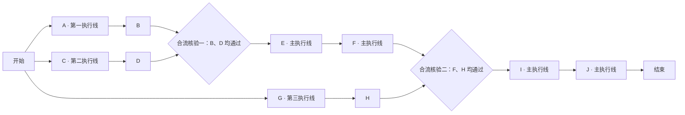

# 测试方案 03：同目录、多会话、十阶段合流测试

日期：2026-11-13

更新日期：2026-11-16

状态：修订完成，待同步工作台并执行

## 测试约定

- 共十个阶段 A～J，分为主执行线和三条逻辑执行线。执行线用于表达任务依赖，不对应实际 Git 分支。
- 各阶段业务执行内容为空，返回值仅允许“成功”和“失败”；全部预设为“成功”，无等待时间。执行会话必须实际返回结果，总控核验后才能登记成功。
- 主线保留主会话所属 Codex 项目，三条分支各建独立侧栏项目文件夹；所有项目及会话使用同一实际工作目录。本次目录统一为 `G:\rust\test`。
- 侧栏项目文件夹只用于会话归类，不新建对应的磁盘目录；不创建、切换或合并 Git 分支，不要求独立工作树；非 Git 普通目录也可执行本测试，branch、head 按真实上下文记录。
- 三条逻辑执行线可以并行推进，线内保持顺序；两个专门的合流核验会话负责核对回执与依赖，不增加 A～J 的阶段数量。
- 表中仅为预设结果，实际返回值、派发记录及合流核验结果在执行后记录。本次文档修订不代表任何阶段已执行或通过。

## 执行线分配

| 执行线 | 阶段 | 线内顺序 |
|---|---|---|
| 主执行线 | E、F、I、J | E → F → I → J，按合流条件推进 |
| 第一执行线 | A、B | A → B |
| 第二执行线 | C、D | C → D |
| 第三执行线 | G、H | G → H |

## Codex 项目与目录

复用主会话已有的 Codex 项目作为主线，三条逻辑分支分别建立同路径的独立侧栏项目文件夹。已有同名且同路径的分支项目可复用。所有阶段和合流核验会话的实际目录一致，侧栏归类按下表固定。记录并核验真实项目 ID、hostId、threadId 和实际 cwd；会话标题或提示词中的路径不能代替真实目录绑定。

| 会话分组 | 所属 Codex 项目 | 实际工作目录 | 会话 |
|---|---|---|---|
| 主执行线与协调 | 主会话所属项目 `test` | `G:\rust\test` | 总控、合流核验一、E、F、合流核验二、I、J |
| 第一执行线 | `test-A` | `G:\rust\test` | A、B，各一个独立会话 |
| 第二执行线 | `test-C` | `G:\rust\test` | C、D，各一个独立会话 |
| 第三执行线 | `test-G` | `G:\rust\test` | G、H，各一个独立会话 |

目录比较使用规范化后的绝对路径，末尾分隔符差异不构成目录不符。本测试不因未使用旧版 `test-plan03-*` 隔离目录或 `codex/test-plan03-*` Git 分支而判定失败。

空任务并行期间，各会话只处理本阶段返回值及证据，证据按阶段和会话分别保存，不覆盖其他会话的文件、不争用同一个证据文件。分支已有会话需调整归类时，保留真实 threadId/cwd，通过宿主移动到对应侧栏项目，回读核对；不得重建会话、重放已完成阶段或因归类调整恢复已暂停任务。若真实目录绑定或并行派发能力不可用，记录具体缺项，不以串行执行冒充并行验证。

## 会话分工与进度反馈

- 保留同一个总控会话，负责派发执行会话、收集回执、核验结果、同步工作台及台账进度，并按依赖接续后继会话。
- 每个阶段使用一个新建的独立执行会话。A 成功并验收后才创建并派发 B；C 成功并验收后才派发 D；G 成功并验收后才派发 H。不能用同一个会话连续承接两个阶段。
- 首批派发 A、C、G，三条执行线独立推进，保留并行派发及运行记录；不要求三个短时空任务在同一时刻完成。
- 执行会话向同一个总控反馈开始、完成、失败或阻塞，包含项目 ID、执行线、阶段、真实会话 ID、实际目录、实际返回值及证据位置。
- 总控收到回执后统一核验并同步。发出派发、会话空闲或仅有预设返回值，均不能作为实际成功的证据。
- B、D 均成功并验收后，总控新建“合流核验一”会话，核对两条执行线的实际回执及验收证据；核验成功并由总控同步后，才派发 E。
- F、H 均成功并验收后，总控新建“合流核验二”会话，核对第三执行线回执及 F 的验收证据；核验成功并由总控同步后，才派发 I。
- E、F、I、J 也分别使用独立新会话，核验并同步前一步成功后再派发下一步。
- 正常路径共 13 个会话：1 个总控、10 个阶段执行会话、2 个合流核验会话。既有总控可复用；历史失败或受阻会话保留追踪，不计作本轮成功执行的替代证据。
- 合流核验检查逻辑依赖，不执行 Git 合并，不生成虚构的分支差异或合并提交。

## 路线与合流条件

1. 总控在各分支侧栏项目、同一目录派发 A、C、G，各线依次通过独立新会话执行 B、D、H。
2. B、D 均成功并验收后，执行合流核验一；核验成功并同步后，才新建 E 会话。
3. E 成功并由总控验收同步后，新建 F 会话。
4. H 可以提前完成，但合流核验二必须等待 F、H 均成功并验收后才开始；核验成功并同步后，才新建 I 会话。
5. I 成功并由总控验收同步后，新建 J 会话。J 成功后，总控核验全程结果及方案结束条件，同步最终进度并宣布结束。

## 十个阶段

| 阶段 | 所属执行线 | 开始条件 | 执行内容 | 预设返回值 |
|---|---|---|---|---|
| A | 第一执行线 | 方案开始 | 空任务 | 成功 |
| B | 第一执行线 | A 成功并验收 | 空任务 | 成功 |
| C | 第二执行线 | 方案开始 | 空任务 | 成功 |
| D | 第二执行线 | C 成功并验收 | 空任务 | 成功 |
| E | 主执行线 | B、D 均成功并验收，合流核验一通过且已同步 | 空任务 | 成功 |
| F | 主执行线 | E 成功并验收 | 空任务 | 成功 |
| G | 第三执行线 | 方案开始 | 空任务 | 成功 |
| H | 第三执行线 | G 成功并验收 | 空任务 | 成功 |
| I | 主执行线 | F、H 均成功并验收，合流核验二通过且已同步 | 空任务 | 成功 |
| J | 主执行线 | I 成功并验收 | 空任务 | 成功 |

## 验收要求

- 阶段恰好十个，编号 A～J，执行线归属、依赖及两次合流顺序与上表一致。
- 主线与合流核验会话属于原项目 test；A/B 属于 test-A，C/D 属于 test-C，G/H 属于 test-G。所有会话的实际目录均为 `G:\rust\test`，有真实身份和目录回读证据。
- 每阶段各一个独立执行会话，两次合流各一个独立核验会话；正常路径为 13 个会话。
- 三条执行线有并行派发及实际运行记录；线内先验收前一步再派发后一步。
- 所有回执汇集到同一个总控，由总控核验并同步；两次合流核验结果均有独立回执和证据。
- B、D 及合流核验一通过后才执行 E，E 通过后才执行 F。
- H 即使提前完成，合流核验二也必须等待 F 通过；合流核验二通过后才执行 I，I 通过后才执行 J。
- 任一前置、阶段验收或合流条件未满足时，后继阶段保持待执行；失败或阻塞如实记录，不凭预设结果放行。
- 十个阶段均实际返回“成功”并验收，两次合流核验均通过，J 通过且方案结束条件完成后，测试通过并结束。

## 已登记旧方案的修订与恢复

本版明确替换旧版“四项目、四个隔离目录、固定 Git 分支及真实 Git 合并”的要求，采用同目录、分支独立侧栏归类、逻辑执行线及回执合流核验。侧栏文件夹不对应磁盘隔离目录。保留 A～J 的稳定步骤 key、编号、依赖和原有业务历史，旧要求及替换依据应在修订历史中留档。

已有工作台登记时，先回读最新版本，复用原 projectId、planId 及步骤身份提交修订。修订请求外层 source 使用当前已登记的旧版来源，snapshot 中的方案 source 使用本次新版来源；expectedRevision 使用最新回读值。替换必要验收条件须经支持明确批准替换的修订流程处理，不能绕过服务校验或直接修改数据库。

发布成功后，回读新版验收条件、同目录路线和协调映射，再核对并解除仅由旧目录或旧分支要求产生的阻塞，取得有效开始或恢复许可。若已有 A 会话被旧执行占用，先按服务支持的接手、结束或恢复流程处理，不复用失效的绑定或执行身份。其他阻塞仍须按真实条件处理。

文档修改不等于工作台已发布或已解除阻塞。发布被拒绝或结果未知时，保存请求及回执，按原事件键查询并恢复；新版规则正式生效前，不在旧验收条件下标记本轮测试通过。
