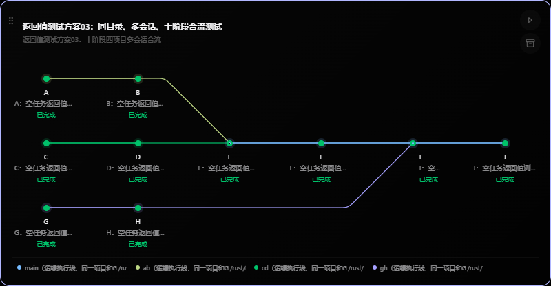

# 多线汇入后段单线居中

日期：2026-11-17
状态：已完成实现、浏览器验证及本机更新

当前方多条线路汇入后方单条线路，且前方各行的节点均位于后段起点之前时，将后段整条线路放在前方各行的垂直中点。奇数条前线与中间行对齐，偶数条前线位于中间两行之间。同步去除原主线位置留下的空白行，重新计算连接线和图形高度。

截图中的方案03已用只读副本复验：前方 A/B、C/D、G/H 三行均匀排布，后段 E/F/I/J 与 C/D 对齐，位于 A/B 与 G/H 的正中。原十个节点、业务依赖、横向列位和路线颜色保持一致。存在左右重叠节点的固定线路和无汇入关系的独立片段维持原布局。

实际修改位于 `G:/rust/windows-dynamic-island/src/workbench/git-roadmap/geometry.ts`，同仓库新增十项几何回归，覆盖 2～5 条前线、两种显示尺寸、奇偶数中点、图高、端点连续、节点唯一、输入不变和排除情况。前端 lint、构建、118 项前端测试、Clippy、41 项 Rust 库测试通过。

本仓库新增 `app/tests/island-centered-continuation.mjs`。使用方案03只读副本，在两种外观、桌面与窄屏宽度、完整与紧凑尺寸下共八项浏览器检查通过，验证后段居中及所有 SVG 端点落在实际站点中心。动态高度与侧边平滑滚轮的另外 24 项浏览器回归也通过。浏览器检查不构成原生桌面交互验收。

证据：[居中检查](assets/centered-continuation-20261117/browser-report.json)、[高度及滚轮回归](assets/centered-continuation-20261117/height-wheel-report.json)。

本机原生程序已编译并切换，运行版本与 `F:/任务岛/dynamic-island.exe` 一致，SHA-256 为 `53b44a14207a2aca9b102bf504032efb57276808e79f42707fc92b85d48e18a5`。原后台进程 PID 23640 持续运行，7 个项目、112 个步骤、89 个执行记录及业务状态与更新前完全一致；旧程序及快照已备份。见 [本机更新核对](assets/centered-continuation-20261117/deployment-proof.json)。

