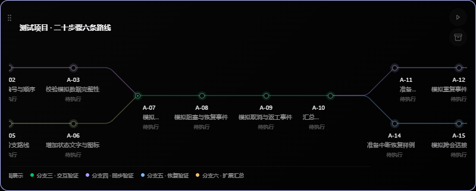

# 按分叉合流复用显示行

日期：2026-11-17
状态：已完成实现、浏览器验证及本机更新

用户进一步明确：并非每条登记路线都代表一条从独立起点开始的固定线路，前后片段无需各占一整行。此前仅处理全部前线汇入最后单线的规则不足以覆盖中途合流、再次分叉及后续合流，本次改为按片段的真实连接关系和横向占用区间分配显示位置。

截图对应的二十步骤、六条路线现在显示为：A-01～A-03 与 A-04～A-06 上下两行，A-07～A-10 位于正中；后续 A-11～A-13 与 A-14～A-16 复用原上下两行；A-17～A-20 再次回到相同中线。完整图高由 566 像素缩至 190 像素，紧凑图高由 114 像素缩至 42 像素。共用段、分叉源和合流目标均与分支范围的垂直中点对齐。

显示排布按横向位置排序片段，汇入时取前线中点，分叉时围绕共用源对称展开，同时避免同一横向区间的行重叠。多条带独立标题起点的固定线路，以及横向跨度重叠的持续线路，保留既有排布。只有一个标题不会使后续所有片段各占一行。所有变化仅作用于显示坐标，不修改路线登记、节点身份、依赖或业务状态。

外壳修改位于 `G:/rust/windows-dynamic-island/src/workbench/git-roadmap/display-lanes.ts` 和 `geometry.ts`。新增九项前端回归，覆盖 2～4 条分支的连续合流和分叉、顺序片段、单标题与多独立起点。前端 lint、构建、127 项前端测试、Clippy 和 41 项 Rust 库测试通过。

本仓库新增 `app/tests/island-topology-centered.mjs`，使用原方案的只读副本，在两种外观、桌面与窄屏宽度、完整与紧凑图下共八项浏览器检查通过。验证二十个节点、两次合流、中间分叉、前后行复用及全部 SVG 端点。上一张方案03的八项居中检查和高度/滚轮的 24 项回归也通过。浏览器证据不构成原生桌面交互验收。

证据：[本次显示检查](assets/topology-centered-20261117/browser-report.json)、[方案03回归](assets/topology-centered-20261117/previous-center-report.json)、[高度及滚轮回归](assets/topology-centered-20261117/height-wheel-report.json)。

本机原生版本已编译并切换，运行程序与 `F:/任务岛/dynamic-island.exe` 一致，SHA-256 为 `b0d054cd304cebb0b3d07b98b2eeeabf41ddbff4119757ddd9d99f0853a50675`。原后台进程 PID 23640 保持运行，7 个项目、112 个步骤、89 个执行记录及业务状态均与更新前一致。旧程序及快照已备份，见 [本机更新核对](assets/topology-centered-20261117/deployment-proof.json)。

