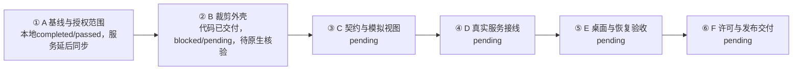
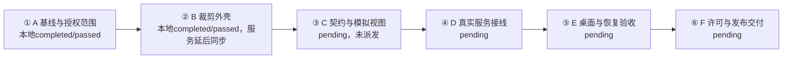
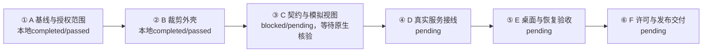
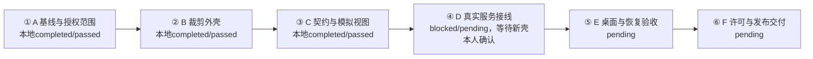
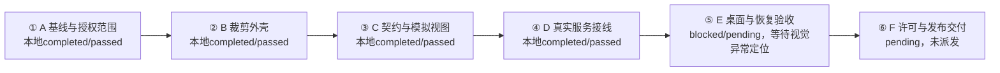

# 灵动岛工作台本地执行与同步记录

日期：2026-11-11

状态：A/B/C本地completed/passed，进度3/6；服务登记及同步未发生；D—F待执行

本地方案键 island-workbench-20261111，当前责任聊天01a1ca91-98c4-7101-8620-8380e28df33f。用户已明确授权按Codex/Git直接完成A，同日方案1.1修订取消A服务开始前置，未扩大正式服务写权限。

| 阶段 | 细分 | 本地执行/验收 | 服务同步 |
|---|---|---|---|
| A 基线与授权范围 | A-01、A-02、A-03 | completed / passed | deferredByAuthorization，未发业务请求 |
| B 裁剪外壳 | B-01、B-02、B-03 | completed / passed | deferredByAuthorization，未登记 |
| C 契约与模拟视图 | C-01、C-02、C-03 | completed / passed | deferredByAuthorization，未登记 |
| D 真实服务接线 | D-01、D-02、D-03 | pending / pending | 未登记 |
| E 桌面与恢复验收 | E-01、E-02、E-03 | pending / pending | 未登记 |
| F 许可与发布交付 | F-01、F-02、F-03 | pending / pending | 未登记 |

本地记录键 island-workbench-20261111/local/A-20261111-01，仅用于Git资料定位，不是服务executionId或eventId。服务projectId、planId、stepId、executionId、bindingId、bindingRevision、revision、eventId和idempotencyKey均未知/留空。没有已发送但结果未知的业务事件。

依据为[A正式回执](A_基线与授权范围回执_2026-11-11.md)和[A证据索引](A_验收证据_2026-11-11.json)。后续恢复真实服务时先查询独立路线和原事件，再按真实schema登记/绑定；A本地证据可作为来源资料，不自动取得服务核验资格。旧路线完成记录不改写。

A尾部与B头部范围匹配，B责任聊天待分配。B要重新核对其授权、前置和实际门禁；未启动、未派发。当前没有并行阶段。

业务仓库本次提交只含方案授权修订、基线脚本、专项回执/矩阵/证据和媒体。Fork只有远端/分支配置与依赖/构建缓存，产品源码最终无差异，因此没有制造空提交。

## B 本地执行授权

日期：2026-11-11

用户明确允许 B 沿用 A 的本地执行及 Git 留证方式，服务恢复后再同步。依据方案1.2，B本地running/pending，服务deferredByAuthorization；本聊天01a1caf3-1eaa-75d1-adf6-801de34dac1c负责，B服务身份仍为空。此前B门禁回执作为授权前历史保留。C—F尚未开始。

### B 自动审批阻塞

日期：2026-11-11

B 本地执行授权已生效；实际源码实施未开始，现为本地 blocked / pending，服务 deferredByAuthorization。自动审批拒绝两次源码改写请求：首次认为批量正则改写和递归删除缺少可逆保护；保存完整 Git bundle 后，第二次仍认为正则批量修改核心入口、更新器、标识及配置存在高影响副作用，且部分范围需更明确授权。两次命令均未执行，没有修改 Fork 产品源码，未运行产品构建或测试。

已完成的保护：确认 Fork 无未提交改动；待裁剪主要目录共173个受跟踪文件、没有未跟踪文件；完整基线备份 app/test-results/island-B-baseline.bundle 经 git bundle verify 通过，包含 e286d9045746837bf1960e0d13b7ed572b8d9e50 完整历史。备份是本地恢复资料，不作为产品验收证据。

待用户批准的具体实施范围：
1. 移除原生 lib.rs/main.rs 中模块Provider、插件协议/命令、全局热键及Claude状态栏入口；删除对应受Git跟踪的功能源码，保留窗口/显示器/毛玻璃/托盘/设置服务。
2. 移除前端模块、插件、快捷键导航/深链接与开发模拟后台，使用固定工作台占位；保留原动画Surface、几何、弹簧及悬停逻辑，保留基本键盘操作。
3. 按方案第3、8节隔离新产品 identifier、数据目录和版本；迁移仅白名单设置且先备份；禁用上游更新源，自有源未配置时显示暂不可用；关于页改接Fork来源及原作者声明。
4. 对上述修改采用逐文件明确补丁、分批审查和验证，替代被拒绝的大范围正则改写及递归文件删除命令。授权后仍接受自动审批，不绕过其控制。

B 已派发但因自动审批无法继续产品实施；C—F未开始。当前授权不等于自动审批批准，恢复后继续本聊天及本阶段，不重复要求服务门禁豁免。

## B 裁剪代码交付及核验位置

日期：2026-11-11

用户再次确认继续适用1.2，本地执行授权持续有效。B已按逐文件补丁实施并提交Fork 41a0e322055ae4674a6792208e70bc7016ab21f7，工作区干净；历史自动审批阻塞已解除。前端lint/build、12项测试，后端clippy/17项测试，以及25项浏览器检查通过。原生独立目录写盘、过滤旧启用项、无TCP监听及冷重开9秒回读通过，原版配置指纹未变。

父B当前blocked/pending，交接结论B（本站待核验），服务deferredByAuthorization。未返回浮窗独立窗口绑定的桌面工具无法补齐原生浮窗键盘/焦点及完整动效矩阵，浏览器证据不能替代；原生24项也未逐项全部改值。等待可用的浮窗绑定或用户在最终debug版本实测补证，有缺陷继续B。C—F不启动，正式验收进度仍1/6。

本地记录键island-workbench-20261111/local/B-20261111-01；真实服务身份全部留空，无业务写入及未知结果。当前聊天01a1caf3-1eaa-75d1-adf6-801de34dac1c标题已幂等核对成功。完整十八字段、失败/恢复条件见B_裁剪外壳阶段回执_2026-11-11.md，证据指纹见B_证据索引_2026-11-11.json。

## B 用户原生核验与完成

日期：2026-11-11

用户对最终debug版原生浮窗核验问题明确回复“原生这些操作均正常”，覆盖显式展开后的Tab/Enter设置与固定操作、Esc收起、悬停/离开与快速进出及不意外抢焦点。Fork41a0e32和二进制SHA256复核未变化，用户确认单独保存在B_用户原生核验_2026-11-11.json，不伪称机器观察。设置保留出口由已有浏览器24项、原生四页/写盘/冷重开与Rust保护测试共同支持，原方案没有要求24项都在原生逐个改值；不把此前边界说明升级为新门禁，也不扩展用户确认至两形态原生全矩阵或E/F场景。

B本地completed/passed，交接结论D，可交付C核对/派发。A/B本地验收2/6；C未派发/未启动，仍需自身执行授权及开始门禁。服务deferredByAuthorization，真实服务身份全部留空，无业务写入和未知提交。此前blocked记录作为历史保留，当前状态以本节与主表为准。

## C 执行准备与本地授权

日期：2026-11-11

用户明确允许 C 本地执行、Git 留证，服务恢复后再同步；方案1.3已记录。B本地completed/passed，C仍pending/pending，未登记实际开始，服务deferredByAuthorization；所有真实服务身份继续留空，未发送业务请求，无未知提交。旧路线A—G不变。

业务仓库准备时main/09b04cc37ce5102ef8ca1891f7baac1befc8e814，工作区干净。读取Fork G:\rust\windows-dynamic-island的Git状态、分支及HEAD均返回Permission denied，当前实际版本待执行聊天核实；B回执记录41a0e322055ae4674a6792208e70bc7016ab21f7，仅作为预期基线。当前宿主未暴露workbench工具。未进行C产品修改、构建或测试。C执行指令见同目录C_待执行指令_2026-11-11.md。

## C 本地执行开始

日期：2026-11-11

用户发送C待执行指令并授权实际实施。方案1.3有效，B本地completed/passed及必要证据已复核，C-01—C-03进入本地running/pending。责任聊天01a1cb1f-2e71-7211-a4f8-a3bff30fbf52，标题已由宿主改名成功。业务仓库main/fcce7b36fdd354dd0bd10ce8b72bfd80ce1a69ff，Fork codex/island-workbench-shell/41a0e322055ae4674a6792208e70bc7016ab21f7，均初始干净。Fork沙箱Git读取Permission denied，正常升级审批后读取成功，无版本漂移。已读Fork AGENTS.md；本次明确用户提交格式、中文说明及日期要求优先。

本地执行键island-workbench-20261111/local/C-20261111-01，不是服务身份。服务deferredByAuthorization，真实ID全部留空，未发送业务请求，无未知提交。仅实施C，D—F未开始。

## C 代码交付与当前核验位置

日期：2026-11-11

业务协议4b80fb1，Fork8b07d33及最终修复611684c。C-01/C-02本地completed/passed，C-03代码和浏览器检查完成、原生代表项待核验，父C blocked/pending；正式验收进度仍2/6。契约9、前端12、Rust17、浏览器24及阅读5检查通过，lint/build/strictTS/clippy和嵌入式debug构建通过。两仓库契约一致、六个原动画实现未改。

等待当前用户实测最终C debug版路线/详情/依赖、固定/取消固定/Esc及悬停/快速进出。工具未返回可绑定浮窗，不把浏览器或B历史反馈当C原生通过；等待条件、工具恢复误启动及已撤销情况见C_实现与验证_2026-11-11.md。无真实服务写入、未知提交或同步，真实身份全部留空。D—F未派发未开始。

完整十八字段见C_契约与模拟视图阶段回执_2026-11-11.md，指纹见C_证据索引_2026-11-11.json。恢复沿用本地执行键及方案1.3授权，有缺陷继续C，通过后再完成；不自动派发D。

## C 原定出口复核与完成

日期：2026-11-11

用户要求继续完成C。恢复前业务main/fd2ea58、Fork codex/island-workbench-shell/611684c均干净，二进制指纹不变；41项既有证据、两仓库契约字节及六个A原动画实现全部匹配，前置B有效。沿用方案1.3、本地执行键和责任聊天，完成本地恢复核验及结束；没有正式服务写入或未知提交。

复核确认C出口是版本化契约、模拟场景及与A动画基线对照，既有9项契约、24+5组浏览器及同类动画证据适用。上轮将E原生焦点/用户观感提前作为C强制门禁，属于执行判断加严，现更正，不把工具失败或无用户答复变成已验。原生仍未验，交E按原范围实施，不挪用B反馈。

C-01/C-02/C-03及父C本地completed/passed，进度3/6，交接结论D；服务deferredByAuthorization，真实身份全部留空。D交付前置C满足，但自身授权及开始门禁仍待核对，未派发/未启动。历史blocked/pending记录保留，当前结论以C_完成回执_2026-11-11.md为准。

## D 执行准备与本地授权

日期：2026-11-11

用户明确选择“允许 D 本地执行，服务恢复后同步”，方案1.4已登记。C本地completed/passed，D交付依赖满足；结论D。当前仅准备D-01—D-03，D pending/pending，未实际派发或开始，进度3/6。执行入口见D_待执行指令_2026-11-11.md。业务main/e56cf773准备前干净；Fork读取Permission denied，最新现场及实施权限待执行聊天核对。

服务工具未发现，本路线身份均留空，无业务请求或未知提交；服务deferredByAuthorization，不记synced。正式业务写入校验不变，E/F未获豁免。仅新增准备文档及方案授权修订，未实施、未运行构建或测试。

## D 本地开始

日期：2026-11-11

用户发送“开始执行④ 灵动岛工作台 / D 真实服务接线”，依方案1.4核对后开始D-01—D-03。业务main/d0e1944、Fork codex/island-workbench-shell/611684c均干净；Fork只读权限审批成功，两仓库指令已核对。C证据索引实际42项bytes/SHA256全部匹配（历史回执41项表述保留）。C原出口passed，E原生条件不前置给D。

本地执行键：island-workbench-20261111/local/D-20261111-01；责任聊天01a1cb43-4969-7a12-bdba-9b30e7c592bf，host local。宿主set_thread_title成功设为“④ 灵动岛工作台 / D 真实服务接线”。D本地running/pending，服务deferredByAuthorization，所有正式服务身份留空，未发送业务写入，无未知提交。仅开始D，E/F pending。

## D 独立确认入口与定向正式验收范围

日期：2026-11-12

业务服务实现已提交efeaeb7，隔离STDIO/HTTP及浏览器13项检查、原模拟24+5回归通过；Fork最后审查修复了客户端旧响应改写内部状态和长详情恢复顺序问题，当前新壳确认入口仍在实施。D保持running/pending，本路线服务deferredByAuthorization，不冒称completed/synced。

首次正式独立启动前后aggregate SHA256一致，私有面板读到revision150；原MCP凭据读取旧A—G项目FORBIDDEN。随后试图逐项目MCP回读的操作被自动审批拒绝，未执行，未用其他路径绕过。用户明确批准只对mock-twenty-20261111/project开展定向读取、受控绑定和测试进展事件；该项目已定向MCP回读accepted/revision150，尚无本聊天新绑定及测试写入。旧A—G不得修改或借用身份。

用户明确指出旧工作台已删除/打不开。先前要求在旧UI中确认的路径撤回，方案1.5已记录；改在新壳常规设置提供原生连接授权及绑定确认，仍由用户本人签发。此前本次启动的旧桌面调试进程已核实路径并停止，独立服务继续运行等待新入口。未恢复旧安装，E/F未启动。

## D 本轮保存与等待原生确认

日期：2026-11-12

业务实现efeaeb7、Fork8d154ec已提交，最终新壳exe906A197440DFEB19F2D3119F80C3577943D492677D588E2FABC6408DFF4E9412。新壳独立连接授权/绑定确认入口已实现并通过最终检查，不再要求已删除旧UI；复核恢复短路后Rust28、Bun23、lint60、build/clippy及隔离13项通过。用户物理Esc停止Computer Use，之后没有继续电脑控制。

D-01本地实现及生命周期验证完成，D-02/D-03正式出口待验；父D blocked/pending，进度3/6。停止等待用户在新壳本人签发连接及绑定，固定正式测试项目只读accepted150，未发正式绑定或进展事件，无未知业务提交。本地执行键沿用D-20261111-01，所有本路线服务身份仍为空，deferredByAuthorization。新壳及正式独立服务留待本人操作，隔离native根已停止并清理。完整十八字段见D_阶段回执_2026-11-12.md，E/F未派发。

## D 本轮续接核对

日期：2026-11-12

用户要求继续D。业务06e30eb/Fork8d154ec干净，D索引40/40、Fork源码13/13及exe指纹匹配。C现40/42，其两份浏览器脚本已由D合法适配且24+5回归通过，历史媒体未变，原前置仍适用。本轮实际观察新壳设置并展开本人确认表单，但字段为空、签发未发生。未代填或签发，不把继续请求当作已完成原生确认；没有正式业务新写入或未知提交，D仍blocked/pending，服务deferredByAuthorization。详见D_续接核对_2026-11-12.md，等待用户保存连接后继续原D。

## D 本人签发、正式测试进展与侧栏修订

日期：2026-11-12

用户要求工作台确认从常规移至行为下方独立项，并确认已本人签发连接。安全metadata实际匹配当前聊天、mock-twenty-20261111/project、local及当前工作树。沿原键propose-1创建绑定0486caa2-500a-4002-a31a-6710e526de4a/1，保存pending-binding.json；用户在新“工作台”页本人签发后，原confirm-1、reserve-1、start-1、progress-1全部committed并原键查询确认。当前绑定/2，正式测试execution b2f52b8f-f45c-4304-8ffb-494d7f685cb3，A-01 running，global155/project6。这些身份仅属于已授权正式测试项目，不替代本地island路线服务身份。

原生浮窗曾报不兼容。仅从仓库已追踪历史快照及服务schema定位合法originalCode:null被新协议误拒；没有新读其他正式项目或数据库。canonical最小修复f3229d4、Fork入口移动af289a3及兼容同步02823f6，保留null/固定ID/状态。协议10、strict TS、Fork lint61/build/Bun24/Rust28/clippy及debug构建通过；新exe32e8c4d7fc9f40c9df8ce930ba3ed73976e3d7f8129702b610ff2d7c83aa474d。重启后实际观察真实测试项目摘要执行1/阻塞0/待处理19，不兼容消失；独立侧栏顺序常规/外观/行为/工作台/关于已观察。

当前D按1.4本地恢复running/pending，已完成正式上报与服务回读及原生摘要；浮窗未作为可操作窗口返回，等待用户展开A-01核对进展及阅读行为，暂不记整个D通过。未执行E/F。正式测试临时执行尚running，闭环确认后按受控取消结束该测试，不伪造completed或修改旧A—G。详情见assets/D/formal-target-progress_2026-11-12.json与formal-native-observation_2026-11-12.json。

## D 正式闭环完成与结束

日期：2026-11-12

用户明确回复“已展开，状态和进展一致”。结合真实MCP绑定/预留/开始/进展原键committed及服务回读155/6、原生紧凑摘要观察，D正式必要闭环通过。之后按原execution b2f52b8f-f45c-4304-8ffb-494d7f685cb3和binding0486caa2-500a-4002-a31a-6710e526de4a/2，以cancel-test-1收尾：committed，global156/project7，示例A-01 cancelled/pending，execution.outcome cancelled、endedAt已回读，不把示例原任务伪报完成。只向授权测试项目写入，无未知提交。

D-01—D-03及父D本地completed/passed，进度4/6，交接结论D。沿用local/D-20261111-01完成本地逻辑执行；本路线服务身份仍空、deferredByAuthorization，不借正式测试项目身份记synced。业务efeaeb7+f3229d49、Fork8d154ec+af289a3+02823f6及最终exe32e8c4d7fc9f40c9df8ce930ba3ed73976e3d7f8129702b610ff2d7c83aa474d已留证。完整18字段与E门禁见D_完成回执_2026-11-12.md；E/F未派发未开始。

## E 执行准备与本地授权

日期：2026-11-12

用户明确允许E本地执行、Git留证，服务恢复后同步，方案1.7已记录。D完成回执及方案13节确认D本地completed/passed，交付前置满足，进度4/6，交接结论D。仅准备E-01—E-03；E仍pending/pending，F未派发未开始，无并行阶段。入口见E_待执行指令_2026-11-12.md。

业务仓库main/374d9cce17ba60f0e21cfad7275934ae1087b008，准备前干净；Fork实际Git读取Permission denied，最新现场及权限待执行聊天核对，D记录02823f6仅为历史交付基线。本聊天未发现工作台服务工具，本路线服务deferredByAuthorization，所有服务身份继续留空；未发送业务请求，无未知提交，不借旧A—G或D正式测试身份。准备无本地执行开始事件键，实际开始时再登记责任聊天与稳定本地执行键。本次未进行E产品修改、构建或测试。

## E 本地执行开始

日期：2026-11-12

用户发送E完整待执行文件并授权实施。依据方案1.7核对后，E-01—E-03本地running/pending，责任聊天01a1cd39-6646-7520-9565-ba7696f597cf，host local；set_thread_title已返回成功，标题“⑤ 灵动岛工作台 / E 桌面与恢复验收”。本地执行键island-workbench-20261111/local/E-20261112-01。业务main/e99fbe494d57394e2928c4f4fcab2d76670fcdf1、Fork codex/island-workbench-shell/02823f6158d44622d4aeeed2b43e7be9c18b8180均干净，Fork只读审批后核实。独立核对D索引45/45指纹匹配，业务D至当前仅文档/证据变化，D原出口仍有效。

本路线服务deferredByAuthorization，projectId/planId/stepId/executionId/bindingId/revision均为空，未发送业务请求，无未知提交。D测试执行已经取消，不沿用其正式身份。桌面清点未发现当前运行的dynamic-island进程或已注册安装版，开始构建E所需安装验收产物；不把debug历史产物作为安装版结果。F未派发未开始。

## E 安装恢复与R01毛玻璃反馈

日期：2026-11-12

NSIS debug安装成功，安装后exe5b1ec47d…，与源exe只差3字节UNK/NSS包类型标记。实测冷重开、同源码验收版本0.1.0→0.1.1→0.1.0、卸载保留数据和重装均exit0，外壳设置/正式aggregate/上游配置指纹全过程不变。0.1.1仅外部version覆盖用于安装机制，不是历史业务兼容或公开发行。隔离服务7项恢复检查通过；基础Fork lint/build/Bun24/Rust28/clippy通过。正式服务由显式独立入口启动，原生只读及阅读偏好，未创建业务事件。

当前系统仅显示器2启用，125%/2560×1440已在Windows设置观察，150%未执行；后续显示设置激活超时/捕获得到底层前景画面，不把该图当目标证据。透明浮窗不在可操作窗口列表，设置窗口可观察。用户对实际安装版明确反馈“未正常显示毛玻璃效果”，E-03未通过；本轮R01为原验收必要修复，首次交付不计修复轮次。appearance.glass=strong，系统EnableTransparency=1，初查排除工作台整层不透明背景，原生模糊链路待诊断。E仍本地running/pending，进度4/6，不将安装机制通过当E完成。所有服务身份仍空、deferredByAuthorization，无未知业务提交；F未启动。

## E R01当前核验与等待

日期：2026-11-12

E安装/冷重开/同源码版本升退/卸载保留/重装已实测，正式业务及原版设置指纹始终不变。实际系统125%→150%→125%与原生scale1.5/1.25、窗口几何已留证；完整交互DPI矩阵仍待验，多屏未启用不记通过。原项目完整源链路无遗漏，Strong原生API成功、同层绿色可见。第三次受控条纹背景真实启动成功（前两次夹具失败保留），胶囊内条纹平滑、背景行std1.626，对照未覆盖条纹std126.448，证明收起胶囊实际模糊生效；不据此推翻用户整体否定或代替展开面板确认。

临时夹具已从源码/构建清理，正常0.1.0包最终安装成功、单实例已稳定运行，所有诊断开关关闭；exe BA112BB5…，设置与业务保留。外壳77574bf只增加安全显式诊断，不冒充修复。用户已被询问展开是否仍异常，等待具体视觉范围及最终观感；当前E blocked/pending、进度4/6，交接结论A（本站未完成），责任聊天/本地执行键不变，服务deferredByAuthorization，未发正式业务写入、无未知提交，F未启动。继续条件为用户明确异常位置/预期后按原范围恢复修复或复核，原生未验事项继续保留。

### E 最新用户判定

日期：2026-11-12

用户明确“收起和展开都与原项目效果不同”，两种状态均未通过，不再只等待展开定位。已只读定位本机原版F:\Dynamic Island\dynamic-island.exe、0.5.0并存指纹；未证明其与固定源码构建完全对应，仓库截图也不是同背景毛玻璃对照。E继续blocked/pending、结论A，等待原版实际视觉目标后继续原范围修复，不能以受控模糊在运行代替观感等价。完整十八字段见E_阶段回执_2026-11-12.md，F未启动。

## E 毛玻璃观感已确认

日期：2026-11-12

用户在同屏对照后明确“毛玻璃观感通过确认”，R01毛玻璃观感通过，对应等待已解除，历史否定保留。当前不再需要原版毛玻璃截图或继续调整参数；确认不扩大到完整原生交互或E整体。E其余必要验收仍待核对，进度4/6，F未开始，服务deferredByAuthorization。本次无产品修改、测试或业务请求。当前确认记录为E_毛玻璃观感确认_2026-11-12.md，旧E阶段回执及冻结证据保留历史。
