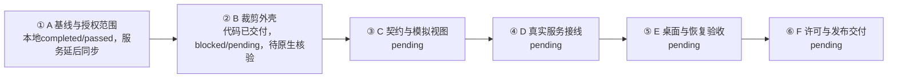
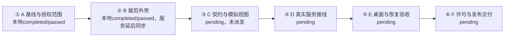
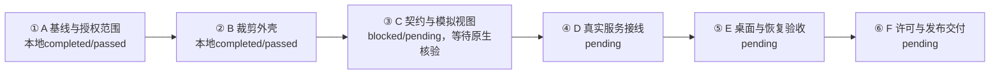

# 灵动岛工作台本地执行与同步记录

日期：2026-11-11

状态：A/B本地completed/passed，进度2/6；服务登记及同步未发生；C待原生核验，D—F待执行

本地方案键 island-workbench-20261111，当前责任聊天01a1ca91-98c4-7101-8620-8380e28df33f。用户已明确授权按Codex/Git直接完成A，同日方案1.1修订取消A服务开始前置，未扩大正式服务写权限。

| 阶段 | 细分 | 本地执行/验收 | 服务同步 |
|---|---|---|---|
| A 基线与授权范围 | A-01、A-02、A-03 | completed / passed | deferredByAuthorization，未发业务请求 |
| B 裁剪外壳 | B-01、B-02、B-03 | completed / passed | deferredByAuthorization，未登记 |
| C 契约与模拟视图 | C-01、C-02、C-03 | blocked / pending，原生待核验 | deferredByAuthorization，未登记 |
| D 真实服务接线 | D-01、D-02、D-03 | pending / pending | 未登记 |
| E 桌面与恢复验收 | E-01、E-02、E-03 | pending / pending | 未登记 |
| F 许可与发布交付 | F-01、F-02、F-03 | pending / pending | 未登记 |

本地记录键 island-workbench-20261111/local/A-20261111-01，仅用于Git资料定位，不是服务executionId或eventId。服务projectId、planId、stepId、executionId、bindingId、bindingRevision、revision、eventId和idempotencyKey均未知/留空。没有已发送但结果未知的业务事件。

依据为[A正式回执](A_基线与授权范围回执_2026-11-11.md)和[A证据索引](A_验收证据_2026-11-11.json)。后续恢复真实服务时先查询独立路线和原事件，再按真实schema登记/绑定；A本地证据可作为来源资料，不自动取得服务核验资格。旧路线完成记录不改写。

A尾部与B头部范围匹配，B责任聊天待分配。B要重新核对其授权、前置和实际门禁；未启动、未派发。当前没有并行阶段。

业务仓库本次提交只含方案授权修订、基线脚本、专项回执/矩阵/证据和媒体。Fork只有远端/分支配置与依赖/构建缓存，产品源码最终无差异，因此没有制造空提交。

## B 本地执行授权

日期：2026-11-11

用户明确允许 B 沿用 A 的本地执行及 Git 留证方式，服务恢复后再同步。依据方案1.2，B本地running/pending，服务deferredByAuthorization；本聊天01a1caf3-1eaa-75d1-adf6-801de34dac1c负责，B服务身份仍为空。此前B门禁回执作为授权前历史保留。C—F尚未开始。

### B 自动审批阻塞

日期：2026-11-11

B 本地执行授权已生效；实际源码实施未开始，现为本地 blocked / pending，服务 deferredByAuthorization。自动审批拒绝两次源码改写请求：首次认为批量正则改写和递归删除缺少可逆保护；保存完整 Git bundle 后，第二次仍认为正则批量修改核心入口、更新器、标识及配置存在高影响副作用，且部分范围需更明确授权。两次命令均未执行，没有修改 Fork 产品源码，未运行产品构建或测试。

已完成的保护：确认 Fork 无未提交改动；待裁剪主要目录共173个受跟踪文件、没有未跟踪文件；完整基线备份 app/test-results/island-B-baseline.bundle 经 git bundle verify 通过，包含 e286d9045746837bf1960e0d13b7ed572b8d9e50 完整历史。备份是本地恢复资料，不作为产品验收证据。

待用户批准的具体实施范围：
1. 移除原生 lib.rs/main.rs 中模块Provider、插件协议/命令、全局热键及Claude状态栏入口；删除对应受Git跟踪的功能源码，保留窗口/显示器/毛玻璃/托盘/设置服务。
2. 移除前端模块、插件、快捷键导航/深链接与开发模拟后台，使用固定工作台占位；保留原动画Surface、几何、弹簧及悬停逻辑，保留基本键盘操作。
3. 按方案第3、8节隔离新产品 identifier、数据目录和版本；迁移仅白名单设置且先备份；禁用上游更新源，自有源未配置时显示暂不可用；关于页改接Fork来源及原作者声明。
4. 对上述修改采用逐文件明确补丁、分批审查和验证，替代被拒绝的大范围正则改写及递归文件删除命令。授权后仍接受自动审批，不绕过其控制。

B 已派发但因自动审批无法继续产品实施；C—F未开始。当前授权不等于自动审批批准，恢复后继续本聊天及本阶段，不重复要求服务门禁豁免。

## B 裁剪代码交付及核验位置

日期：2026-11-11

用户再次确认继续适用1.2，本地执行授权持续有效。B已按逐文件补丁实施并提交Fork 41a0e322055ae4674a6792208e70bc7016ab21f7，工作区干净；历史自动审批阻塞已解除。前端lint/build、12项测试，后端clippy/17项测试，以及25项浏览器检查通过。原生独立目录写盘、过滤旧启用项、无TCP监听及冷重开9秒回读通过，原版配置指纹未变。

父B当前blocked/pending，交接结论B（本站待核验），服务deferredByAuthorization。未返回浮窗独立窗口绑定的桌面工具无法补齐原生浮窗键盘/焦点及完整动效矩阵，浏览器证据不能替代；原生24项也未逐项全部改值。等待可用的浮窗绑定或用户在最终debug版本实测补证，有缺陷继续B。C—F不启动，正式验收进度仍1/6。

本地记录键island-workbench-20261111/local/B-20261111-01；真实服务身份全部留空，无业务写入及未知结果。当前聊天01a1caf3-1eaa-75d1-adf6-801de34dac1c标题已幂等核对成功。完整十八字段、失败/恢复条件见B_裁剪外壳阶段回执_2026-11-11.md，证据指纹见B_证据索引_2026-11-11.json。

## B 用户原生核验与完成

日期：2026-11-11

用户对最终debug版原生浮窗核验问题明确回复“原生这些操作均正常”，覆盖显式展开后的Tab/Enter设置与固定操作、Esc收起、悬停/离开与快速进出及不意外抢焦点。Fork41a0e32和二进制SHA256复核未变化，用户确认单独保存在B_用户原生核验_2026-11-11.json，不伪称机器观察。设置保留出口由已有浏览器24项、原生四页/写盘/冷重开与Rust保护测试共同支持，原方案没有要求24项都在原生逐个改值；不把此前边界说明升级为新门禁，也不扩展用户确认至两形态原生全矩阵或E/F场景。

B本地completed/passed，交接结论D，可交付C核对/派发。A/B本地验收2/6；C未派发/未启动，仍需自身执行授权及开始门禁。服务deferredByAuthorization，真实服务身份全部留空，无业务写入和未知提交。此前blocked记录作为历史保留，当前状态以本节与主表为准。

## C 执行准备与本地授权

日期：2026-11-11

用户明确允许 C 本地执行、Git 留证，服务恢复后再同步；方案1.3已记录。B本地completed/passed，C仍pending/pending，未登记实际开始，服务deferredByAuthorization；所有真实服务身份继续留空，未发送业务请求，无未知提交。旧路线A—G不变。

业务仓库准备时main/09b04cc37ce5102ef8ca1891f7baac1befc8e814，工作区干净。读取Fork G:\rust\windows-dynamic-island的Git状态、分支及HEAD均返回Permission denied，当前实际版本待执行聊天核实；B回执记录41a0e322055ae4674a6792208e70bc7016ab21f7，仅作为预期基线。当前宿主未暴露workbench工具。未进行C产品修改、构建或测试。C执行指令见同目录C_待执行指令_2026-11-11.md。

## C 本地执行开始

日期：2026-11-11

用户发送C待执行指令并授权实际实施。方案1.3有效，B本地completed/passed及必要证据已复核，C-01—C-03进入本地running/pending。责任聊天01a1cb1f-2e71-7211-a4f8-a3bff30fbf52，标题已由宿主改名成功。业务仓库main/fcce7b36fdd354dd0bd10ce8b72bfd80ce1a69ff，Fork codex/island-workbench-shell/41a0e322055ae4674a6792208e70bc7016ab21f7，均初始干净。Fork沙箱Git读取Permission denied，正常升级审批后读取成功，无版本漂移。已读Fork AGENTS.md；本次明确用户提交格式、中文说明及日期要求优先。

本地执行键island-workbench-20261111/local/C-20261111-01，不是服务身份。服务deferredByAuthorization，真实ID全部留空，未发送业务请求，无未知提交。仅实施C，D—F未开始。

## C 代码交付与当前核验位置

日期：2026-11-11

业务协议4b80fb1，Fork8b07d33及最终修复611684c。C-01/C-02本地completed/passed，C-03代码和浏览器检查完成、原生代表项待核验，父C blocked/pending；正式验收进度仍2/6。契约9、前端12、Rust17、浏览器24及阅读5检查通过，lint/build/strictTS/clippy和嵌入式debug构建通过。两仓库契约一致、六个原动画实现未改。

等待当前用户实测最终C debug版路线/详情/依赖、固定/取消固定/Esc及悬停/快速进出。工具未返回可绑定浮窗，不把浏览器或B历史反馈当C原生通过；等待条件、工具恢复误启动及已撤销情况见C_实现与验证_2026-11-11.md。无真实服务写入、未知提交或同步，真实身份全部留空。D—F未派发未开始。

完整十八字段见C_契约与模拟视图阶段回执_2026-11-11.md，指纹见C_证据索引_2026-11-11.json。恢复沿用本地执行键及方案1.3授权，有缺陷继续C，通过后再完成；不自动派发D。
