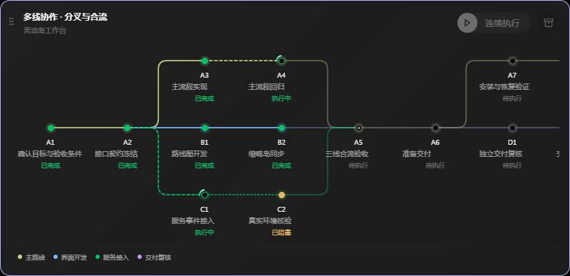
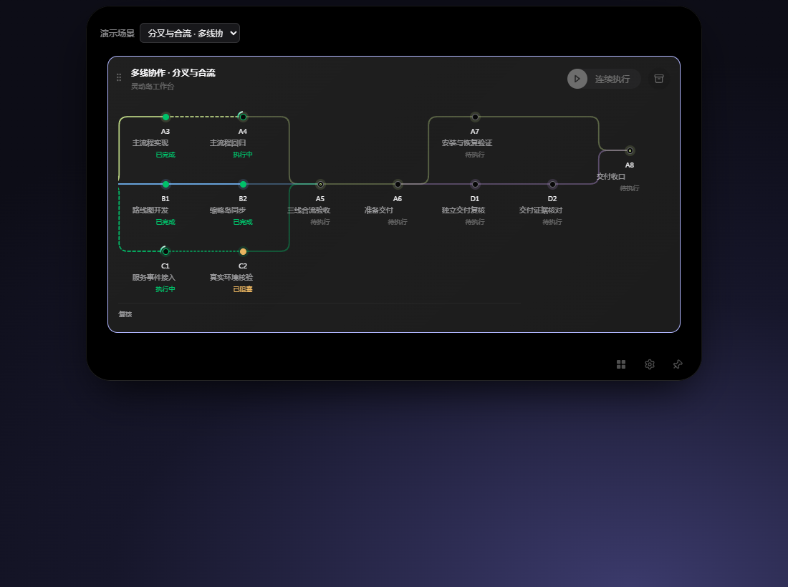
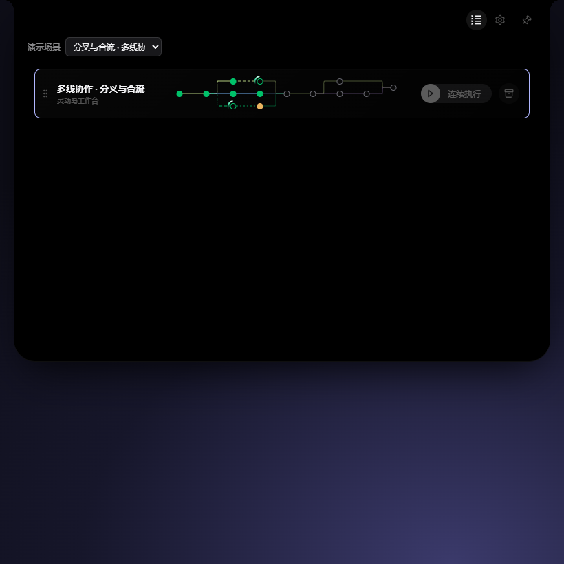

# React Git Log 源码提取与任务路线图改造

日期：2026-11-13

状态：源码改造与隔离构建完成；浏览器交互回归通过；原生安装版尚未替换，原生视觉待验收

## 分支与工作树

按用户要求，两个仓库均在新工作树和 `codex/roadmap-git-graph` 分支执行。

| 仓库 | 基线 | 新工作树 | 本次用途 |
| --- | --- | --- | --- |
| windows-dynamic-island | `7f5f46706ed64a3e0225681d0f454ffad5f572d9` | `C:\Users\Zyf\.codex\worktrees\roadmap-graph-shell\windows-dynamic-island` | 实际路线图组件、绘图源码和许可记录 |
| Codex-task-monitoring | `2b85e5c53494a459674909f8315d0aeaba9a1424` | `C:\Users\Zyf\.codex\worktrees\roadmap-git-graph\Codex-task-monitoring` | 下载完整上游源码、浏览器回归与本交付记录 |

外壳实现提交：`814267dc2a9d652b3be4d4d9e47b0e267ba477ff`。

本次没有合并回原分支。原工作树在执行期间出现的连续执行相关并行改动不属于本次提交范围，继续保留。

## 提取与改造范围

上游：[TomPlum/react-git-log](https://github.com/TomPlum/react-git-log)，固定提交 `1b9eb87f25917f435335f665e0b082a7fa99a096`。

完整源码下载在业务新工作树的 `.upstream/react-git-log`，该目录已忽略，不作为嵌套仓库提交。外壳的 `third_party/react-git-log` 保留两份相关原始绘图文件、Apache-2.0 许可证、SHA-256 校验值及 `PROVENANCE.md`。原始快照来自固定提交的 Git blob，使用目录内 `.gitattributes` 保留原始字节。

- 提取 Grid 的 `CurvedEdge`，保留 SVG path、虚线与固定笔画宽度，改为由整个路线图共享 SVG 视口。
- 将 `CanvasRenderer.drawEdgeBetweenNodes` 的直线与二次曲线绘图方式改造成横向任务路线的圆角折线。没有直接启用上游未完成的 Canvas 渲染器。
- `src/workbench/git-roadmap/geometry.ts` 将既有布局转为绘图坐标：分叉在起点附近转弯，合流在终点附近转弯，跨越中间节点的同轨长依赖绕行。
- `GroupRouteGraph.tsx` 复用现有 `layoutRoutes` 的真实路线与依赖，不改变任务数据模型；共享步骤仍只有一个节点，保持居中及轨道复用。
- 分支使用颜色和名称区分，状态更新与输入排序不会改变分支配色。执行状态继续通过节点填充、文字、连线透明度与虚线表达；合流节点增加内环标记。
- 保留整卡选中、节点动作暂停、滚轮横向阅读、拖动排序、归档、应用筛选与收起岛路线同步。紧凑图保留全部节点及连线，不显示文本；没有恢复右侧阶段详情栏。

没有引入新的运行时依赖，没有修改业务服务或 MCP 协议。原始 Git 提交作者、SHA、时间、索引伪节点、占位提交、表格及 Storybook 壳没有进入任务界面。许可全文追加进已有随安装包分发的 `THIRD-PARTY-NOTICES.txt`。

## 验证结果

| 验证 | 结果 |
| --- | --- |
| `bun run build` | 通过，TypeScript 与 Vite 构建完成 |
| `bun run lint` | 通过，99 个文件 |
| `bunx biome ci --error-on-warnings .` | 通过，99 个文件 |
| `bun test src` | 62 项通过，其中新增 6 项绘图语义回归 |
| `cargo clippy --offline -- -D warnings` | 通过 |
| `cargo test --offline --lib` | 37 项通过 |
| `node tests/island-route-selection.mjs` | 12 项浏览器回归通过，覆盖两种外观下标题、图面、节点显示面、紧凑图、键盘与收起岛同步 |
| `node tests/island-git-roadmap.mjs` | 6 项浏览器组合通过，覆盖两种外观及 1100 / 820 / 480 像素视口 |
| 上游 SHA-256 | 两份原始文件与固定 Git blob 一致 |
| 提交范围 | 仅改造、样例、许可、回归与交付材料；Cargo.lock 和依赖清单未改变 |

新增浏览器场景验证了 14 个步骤、16 条真实连线、2 个合流节点、4 个不同分支颜色，逐边核对 SVG 端点与实际节点中心（容差 1.2 像素），同时检查滚轮不误滚外层、尺寸切换、选中状态、轮询后阅读位置及零页面错误。

回执：[路线选择](assets/route-selection-report.json)、[分叉合流](assets/git-roadmap-report.json)。浏览器使用 Edge 无头模式与隔离模拟数据；没有将其计作真实原生交互或实际项目数据验收。

## 查看与复验

本次已启动本地隔离模拟预览：[打开路线图](http://127.0.0.1:1474/?workbench=simulation)。展开后，在“演示场景”选择“分叉与合流 · 多线协作”。长图可用滚轮横向阅读，顶部按钮可切换完整卡片与紧凑列表。

预览关闭后，可在外壳新工作树启动：

```powershell
bun run build
bun node_modules/vite/bin/vite.js preview --host 127.0.0.1 --port 1474 --strictPort
```

在业务新工作树的 `app` 目录复跑浏览器回归：

```powershell
$env:ISLAND_SHELL_ROOT = 'C:/Users/Zyf/.codex/worktrees/roadmap-graph-shell/windows-dynamic-island'
# Bun 已在 PATH 时可省略 BUN_EXECUTABLE；本机本次使用已有隔离工具目录。
$env:BUN_EXECUTABLE = 'G:/rust/Codex-task-monitoring/app/test-results/island-A-tools/node_modules/bun/bin/bun.exe'
node tests/island-route-selection.mjs
node tests/island-git-roadmap.mjs
```

本次新工作树通过目录联接复用本机已安装的开发依赖，未修改原工作树源文件或锁文件。全新环境应按各仓库锁文件安装开发依赖后再复验。

## 截图与交付边界

完整卡片示例（长图右端可横向滚动查看）：





紧凑示例：



本次交付为隔离分支中的源码实现及浏览器预览。未替换当前安装版，未生成或发布安装包，未改变真实任务执行状态；Windows 原生窗口的视觉与交互仍需在后续合并或安装前核验。
