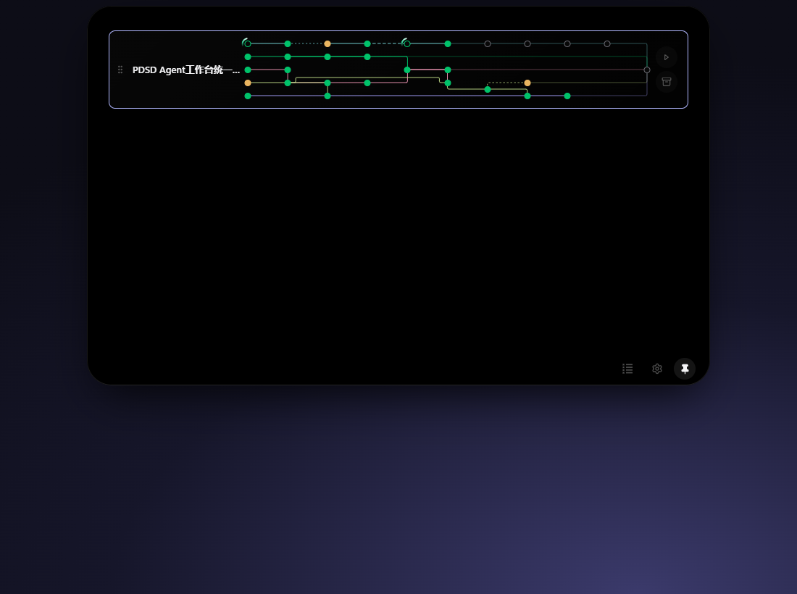

# 工作台节点展示与按步骤接续修复

日期：2026-11-17
状态：已修复、已更新本机运行版及插件，原业务状态核对通过

## 原因与处理

PDSD 已登记五个分组和22个责任包，但每条路线只引用分组标题。旧外壳仅绘制直接引用的节点，同一快照只生成五个竖排节点和零条连线。本次将既有子步骤展开实现接入当前外壳，并递归展开责任包内部明确的阶段；保留跨路线显式归属和原依赖。

原绑定脚本默认选择全方案。换聊接续又要求整体转移旧绑定和全部未结束执行，导致只执行 I-04 的请求扩展为27个实体、五个执行，触发审批拒绝。现在生成绑定请求必须显式提供 stepIds/stepKeys，整方案只接受明确 allSteps。selected 接续只转移所选子树中的全部未结束执行，其他责任保留；旧绑定排除已转出子树并前进版本，刷新版本也不能重新取得该范围。跨边界的同一个执行不可拆分，意图、目录、授权、版本和验收门禁继续生效。

服务、技能规范化和界面均支持多层阶段。已知的包内技术实现、隔离验收和现场收口应登记为稳定节点。重试复用原节点，完成子阶段不等于责任包完成；全部必要后代仍须验收通过。

## 验证

| 范围 | 结果 |
| --- | --- |
| 服务、MCP、技能、桌面完整回归 | 314/314 通过 |
| 协调及绑定说明调整后的定向复验 | 60/60 通过 |
| 外壳前端明确源码文件 | 75/75 通过；lint、类型检查和构建通过 |
| Rust | 40/40 通过，Clippy 无警告 |
| 浏览器 | 八项检查通过，含多层阶段、1100/820/480宽度、跨线依赖和真实项目只读副本27个节点 |
| I-04 第1阶段历史凭据 | 八份日志 SHA256 全部一致，合计23项通过，产品提交3017c73a/8d7c8117 |

接续回归使用两个独立授权主体、真实本机HTTP、临时Git工作树及持久重开，检查原执行不重建、其他执行保持、旧写入拒绝及迟到结果待核对。真实 PDSD 只读快照验证未写入原项目。

初次 Bun 测试命令把 src-tauri/target 中的打包服务测试副本也纳入，出现缺少夹具和超时；改用明确前端文件路径列表后75项全部通过。没有改变产品逻辑来绕过这些错误。

## 本机更新与数据边界

目标为现有 F:\任务岛 安装。源码修复、配套后台和插件应一起更新；更新前备份当前安装及工作台数据，维护重启后核对原步骤、执行、绑定和事件完整保留。PDSD 阶段补录通过公开 revise 接口，保留原方案、I-04、执行及必要出口，不接管其业务执行，不启动原现场或模型。

原生切换和阶段补录结果在实际完成后追加，不把隔离测试表述为原生验收。

## 2026-11-17 本机切换与真实阶段补录结果

业务代码提交 bc1ad02，外壳提交2a935e3。0.1.27插件通过既有本地市场正规安装；源码、独立技能及插件技能目录逐文件一致，发布指纹校验通过。当前运行 F:\任务岛\dynamic-island.exe，SHA256为128820756279f159a6cf0f4b9135fa02daa674e807b099da6c782dae69647d55；105项后台资源摘要核对通过。未公开发布或生成新安装包。

维护重启前已在当前用户私有ACL目录备份程序与数据。重启后7项目、109步骤、87执行、26绑定以及全部业务状态与重启前逐字一致。首次复制程序遇到退出句柄尚未释放，等待实际退出后完成切换；后台和原业务数据没有回滚或重置。私有恢复目录及结构化结果见同名JSON。

原I-04追加 I-04-01 技术实现、I-04-02 隔离验收、I-04-03 原现场与整包收口，公开修订事件 revise/pdsd-i04-visible-phases-20261117-v1，真实回读 revision93。第1阶段依据八份匹配日志和23项通过补录completed/passed；第2阶段pending/recheck，保留原会话实际执行及待核验结果；第3阶段pending。项目显示节点27→30，全库109→112；原有步骤状态、验收、证据、依赖、阻塞、执行与绑定全部保持。原执行仍87条，没有伪造阶段执行。

当前聊天缓存的旧MCP校验曾拒绝historicalSteps，原事件查询unknown且项目仍92；改由已正规安装的0.1.27公开STDIO MCP提交相同请求并回读93，不改缓存、不绕过审批、不扩大绑定。旧连接仍可正常读取新节点；已经运行的聊天若继续使用旧工具参数，需要加载新版插件工具。

原生设置窗口可回读，已观察到更新后的收起路线。自动化无法直接绑定透明浮窗的展开卡片，坐标操作被目标进程检查拒绝，没有点击用户其他应用；不将此记为完整原生展开交互验收。完整路线由真实只读快照的浏览器验证覆盖。

最终复验：已补录项目的只读副本30/30节点显示，八项浏览器检查再次全部通过。下图为2026-11-17隔离浏览器验证图，不是原生截图。

