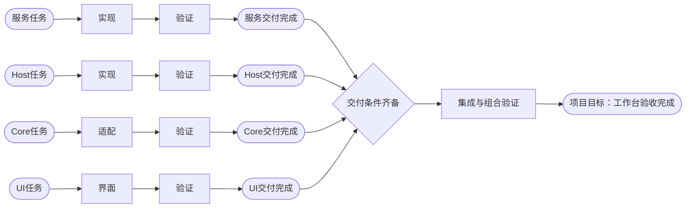
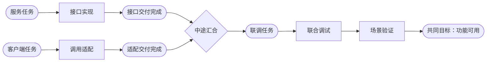
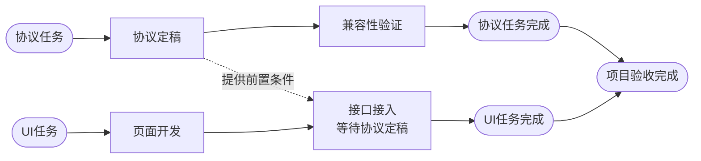
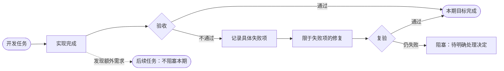
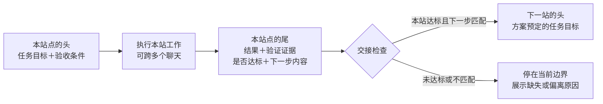

# Codex 任务状态监测工作台：任务线、站点交接与收敛可执行方案

日期：2026-11-08  
状态：需求已确认，实施方案待执行；本次仅文档落盘  
版本：1.0

## 1. 目的与依据

用户先编写包含步骤、目标和验收要求的可执行方案，再按需要建立 Git 分支、工作树和对应的 Codex 项目文件夹，每个文件夹中可能有多个连续工作的聊天。现有实践中，每次交接都报告已做内容并提出下一步，但无法直观看到任务在哪里、什么时候应结束、何时能够合流，容易无限追加局部工作。

本工作台以既定方案为基准，把任务及步骤展示成地铁到站图，核验每个站点的目标、结果与交接，明确区分本站完成、任务线交付、集成完成和项目最终完成。满足预设条件后自动关闭任务，并向用户展示是否达到最初方案预期。

本次需求来源为 2026-11-08 对话及用户提供的项目文件夹和提示词截图。业务示例依据：

- `G:/rust/PDSD-v0.3/docs-v0.4.0/03_功能新增/05_Agent工作台/03_四条开发线状态确认与集成条件_2026-11-06.md` 及其引用的权威方案。
- 示例中包括服务、设计 Host、AionCore、AionUi 四条开发线及集成线。它们涉及多个仓库，汇合不都等于 Git merge；也可能是交付版本锁、补丁及组合验收。
- 本文的图是结构示意，不是上述分支的实时状态，也不授权执行 PDSD 集成。

## 2. 已确认的产品范围

1. 开发项目容纳多个任务；每个任务有明确交付目标，步骤串联或按依赖构成任务线。
2. 一个开发项目可以关联多个 Codex 项目文件夹。一个任务限定于一个项目文件夹，但可跨多个聊天延续。聊天不是任务本身，也不是固定一个步骤。
3. 必须先有可执行方案，站点工作及终点来自方案。不能从聊天里不断出现的“下一步”反向无限扩展路线。
4. 第一阶段只监测、核对及展示可复制指令，不自动驱动 Codex 开发。后期若具备并获授权使用操控能力，再将同一份指令注入目标聊天。
5. 已完成站点亮红色，正在执行亮绿色，未执行显示暗色。等待、阻塞、待核验和路线偏离使用文字或图标补充，不能仅凭颜色识别状态。
6. 满足预设验收条件后自动关闭任务，不逐次要求用户批准关闭；证据不足或必须修改方案时不能自动通过。
7. 本次仅生成实施文档和原文指令，不包含代码改造、任务调度或外部聊天写入。

## 3. 层级与术语

```text
开发项目：PDSD Agent 工作台
│
├─ 可执行方案：定义目标、任务线、步骤及验收条件
│
├─ Codex 项目文件夹：agent 服务线 / aion-agent-service
│  ├─ 聊天会话 ①
│  ├─ 聊天会话 ②
│  └─ 聊天会话 ③
│     └─ 共同推进该文件夹内的任务线
│
├─ Codex 项目文件夹：设计 Host 线
├─ Codex 项目文件夹：AionCore 线
├─ Codex 项目文件夹：AionUi 线
│
└─ 集成任务线 → 项目最终目标
```

| 概念 | 定义及约束 |
| --- | --- |
| 开发项目 | 业务目标的最外层容器，关联方案、多文件夹、多任务和最终验收 |
| Codex 项目文件夹 | 用户在 Codex 侧组织聊天的项目容器；与磁盘目录、Git 分支分别记录，不能混用名称当作身份 |
| 任务 / 任务线 | 一项有明确交付目标的任务；固定归属一个 Codex 项目文件夹，可关联多个聊天 |
| 站点 / 步骤 | 任务执行的一个有目标、有验收、有交付尾部的单元 |
| 起点 | 任务名称及范围 |
| 任务终点 | 本任务约定的交付目标，达到后可独立关闭 |
| 项目终点 | 所有必要任务交付及集成验收满足项目完成条件 |
| 依赖 | 前一站为后一站提供必要条件，不必意味着任务合并 |
| 合流 | 多条线的必要交付汇入下游任务；原任务保留身份及完成记录 |
| 聊天记录 | 执行来源与证据载体；换聊天不重置路线或进度 |

可在一个项目文件夹下维护多个任务，但每个任务只有一个所属文件夹。合流后由接手任务所属文件夹继续执行，不能将原任务悄悄迁移到其他文件夹。

## 4. 全部任务线结构示意

箭头表示顺序或依赖，不表示时间长度。以下保留本次讨论的五种任务线和站点交接图。

### 4.1 单条任务线：达到终点即结束


终点必须有可检查的完成条件。完成后关闭任务，新需求另开任务，不默认追加到原任务尾部。

### 4.2 四线汇入同一个项目终点



开发线可以先结束，由集成任务继续推进。工作台应展示“已交付，等待集成”，不能因为项目未结束而让四条开发线一直进行。

### 4.3 中途合流，由后续任务接手



明确交接对象与接手步骤。前两条任务线已达各自终点时结束，不各自重复创建联调工作。

### 4.4 存在依赖，但任务线不合并



等待别人交付与自身正在执行是不同状态。依赖图需要完整核对多前置条件，不能只看最近一条聊天。

### 4.5 验收失败修复，额外需求另行安排



修复仍归属原站点的验收范围，执行尝试追加记录，不不断创建新主路线站点。非必要的新需求登记为独立候选任务。不能把复验失败写成持续推进，也不能隐藏阻塞。

### 4.6 站点头尾交接



需要分别判断本站结果是否达标，以及尾部提出的下一步是否与下一站头部相符。交接通过仅允许下一站开始，不表示下一站已经开始。

## 5. 站点数据与交接规则

### 5.1 数据契约（实施建议）

| 对象 | 必需内容 |
| --- | --- |
| 方案基线 | 标识、版本、日期、原文、来源路径、章节、内容摘要、初始项目目标及验收条件 |
| 项目 | 标识、名称、方案基线、关联文件夹、任务线、最终完成条件 |
| 任务线 | 稳定标识、所属项目及唯一文件夹、名称、目标、步骤集合、终点条件、交接对象 |
| 执行来源 | 聊天标识、文件夹标识、仓库、工作树、分支、消息或回执位置、时间 |
| 站点头部 | 稳定步骤编号、名称、方案出处、目标、范围、全部前置、验收项、合法后继 |
| 站点尾部 | 实际结果、交付物、提交、逐项验收结果与证据、未决事项、下一步编号及内容 |
| 核验记录 | 规则版本、证据适用范围、通过/未通过/待核验、交接匹配结果、判断理由及时间 |
| 状态事件 | 执行开始、回执导入、核验、关闭、失效及修订记录；保留历史，不覆盖来源 |

文件夹或聊天连接标识在未接入时允许待绑定，禁止仅凭相似名称自动关联。Git 提交不是所有步骤的必需产物，但涉及代码交付时应记录版本。文档、测试、人工验收等证据按原方案要求判断。

### 5.2 头尾匹配

头部给出任务目标、前置条件、完成条件；尾部给出实际结果、验证证据、达标判断及下一步内容。逐项检查：

1. 回执归属正确的开发项目、文件夹、任务线和步骤，方案版本适用。
2. 本站验收条件全部通过，证据与实际交付版本对应，必要未决项已解决。
3. 尾部下一步编号对应既定后继；工作范围、目标、交付要求一致，不要求文字逐字相同。
4. 下一站的全部前置条件已满足，包括其他任务线依赖。
5. 才标记“可进入下一站”；获得实际开始记录后才亮绿灯。

例如“验证保存后重新打开”与“执行保存及冷重开验证”可对应同一既定步骤；“继续优化保存体验”不能直接替代该步骤。模糊或冲突的语义不能强行判为匹配，应展示待核验及具体差异。

分叉时分别判断每条合法后继边；合流时核对所有必要前置。固定回执原文采用单数“下一站”，实施时可以用多份明确编号的交接记录覆盖多个后继，不能因只收到一份回执就判全部后继可开始。

### 5.3 证据与信任边界

聊天自述“完成”、Git 已提交、文件存在都不能独立证明验收通过。结构解析与 AI 语义整理只产生候选判断；核验层需检查验收项、实际结果、证据可用性和适用版本。无法核验的条件保留待核验；方案明确要求人工验收时，需要对应验收记录，不能由模型猜测替代。

第一版至少支持用户粘贴或导入完成回执和证据引用，不把自动读取 Codex 聊天作为唯一入口。后续只读连接器是否可稳定读取文件夹、聊天及消息，需实测确认；本文不宣称已具备该能力。

## 6. 状态、显示与自动结束

| 状态或条件 | 站点显示 | 后续行为 |
| --- | --- | --- |
| 未执行 | 暗色＋未开始 | 不冒充正在执行 |
| 前置及交接通过，尚无执行开始记录 | 暗色＋可开始 | 提供可复制指令 |
| 实际正在执行 | 绿色亮起＋进行中 | 展示当前聊天与步骤 |
| 报告完成但缺必要证据 | 不亮完成红灯＋待核验 | 补必要核验，不解锁后继 |
| 本站验收通过 | 红色亮起＋已完成 | 独立计算交接是否匹配 |
| 已完成但后继其他依赖不足 | 本站红色、后继暗色＋等待依赖 | 指明等待对象与条件 |
| 阻塞或偏离路线 | 保留最后可核实状态＋原因图标/文字 | 不虚构推进 |
| 任务线到终点且预设条件全部通过 | 终点红色＋任务已结束 | 自动关闭，不再生成本任务下一步 |

红色在本产品中明确表示完成，不沿用通常的错误含义。错误必须有独立文字或图标。历史完成证据失效时保留原关闭记录，追加“当前待复核”事件，不继续把失效条件作为后续依赖的有效证明。

自动关闭任务必须同时满足：既定必需步骤和终点验收通过、无阻塞本任务交付的未决项、证据有效、交付对象和范围明确。不能要求所有可选优化完成，也不能仅因为没有下一步文字就关闭。

项目关闭另行核对项目级完成条件和集成验收，不能把四条开发线关闭直接当成项目完成。关闭展示固定对照：原定目标 → 实际交付 → 验收结果 → 是否满足最初方案预期 → 偏差及交接对象。

## 7. 防止工作无限延伸

- 在执行前固定方案基线、任务终点及验收条件，给每个步骤稳定编号。
- 分开记录本站、任务线和项目三个层级，禁止用本轮局部步骤数冒充项目剩余步骤数。
- 下一步必须属于方案的合法后继；修复未过验收仍属于本站，不伪装为路线前进。
- 本任务已交付而集成未结束时，把后续责任交给集成任务，不重新打开原任务补无限工作。
- 新需求和非必要优化独立登记；暂停项不自动恢复；已通过且未受影响的验证不重复。
- 修改方案保留初始版本和修订差异，明确影响哪些任务、站点和验收；不通过降低标准或移动终点伪造完成。
- 分别展示“是否符合当前方案”和“是否符合最初方案”，不能用新版目标遮盖原始偏差。
- 确实需要方案之外的必要修复时，说明与原目标关系及影响；涉及范围或验收变更时进入变更待确认。

## 8. 指令生成、回执与未来注入

完整指令原文独立保存在 [02_任务收敛与交接指令_原文_2026-11-08.md](../../../../03_轻量路线工作台/05_使用与指令模板/02_任务收敛与交接指令_原文_2026-11-08.md)，代码块保持上一条回复原文，不在本文重复维护另一份。

原提示词强制要求“下一步工作”，缺少结束出口。本次改进先确定终点，再按以下结论决定是否生成执行指令：

| 结论 | 含义 | 输出 |
| --- | --- | --- |
| A | 本站未完成 | 继续本站必要工作指令 |
| B | 本站待核验 | 补充必要核验指令 |
| C | 本站已完成，等待依赖 | 等待回执及恢复条件 |
| D | 本站已完成，可进入既定下一站 | 下一站执行指令 |
| E | 本任务线已完成，交付其他任务线接手 | 结束及交付回执，无本任务下一步 |
| F | 项目最终目标已完成 | 项目结束回执，无下一步 |
| G | 方案冲突或需要变更 | 差异及待决定事项，不擅自推进 |

使用流程：选择任务/站点 → 复制核对提示词至执行聊天 → 导入路线核对及交接结果 → 核验 → 按结论展示可复制执行指令或结束回执 → 执行后导入本站完成回执。

原文中的方案路径属于 PDSD 示例。工作台未来生成项目专属副本时替换为该项目绑定的方案路径、版本和身份，不修改原文归档。核对提示词只要求核对及生成指令；生成的执行指令才描述实际开发工作，两种用途必须明确区分。

未来注入模式复用已展示的同一份指令，记录目标文件夹、聊天、任务、站点、方案版本和指令摘要，防止错误投递和重复投递。只有实际注入成功后记录发送状态，只有获得执行开始证据后标记进行中。该阶段尚未授权实施，不影响第一版监测闭环。

## 9. 与现有工程的关系

本次已查看目录及 `03_MVP开发与使用说明_2026-11-08.md`。目录已有 `app`、旧方案、UI 原型和导入实验记录，不能按空项目重做。

现有说明文档记载：本地网页 MVP 支持方案导入、AI 辅助提取、路线及分叉合流、手动状态、执行总结和本地持久化；尚未接入 Codex 或自动执行任务。以上属于已有文档的描述，本次未运行应用、审计全部源码或复验其测试，不能作为本次已验证能力。

本次新增要求主要是：开发项目与多个 Codex 项目文件夹的映射、任务跨聊天延续、稳定方案基线、逐站头尾核验、红绿暗显示、自动关闭、原始目标对照和收敛指令生成。开发前需核对现有实现与这些要求的差异，优先复用。

旧资料保留不覆盖；本次已确认需求与旧方案有冲突时，以本文的本次需求为后续改造依据，并在实施时登记迁移影响。旧手动“已记录完成”不得未经核验直接升级成“验收通过”。

## 10. 有限实施路线与交付门槛

以下为本工作台自身的实施任务，不是 PDSD 的剩余步骤。每步验收通过后停止扩大本站范围。当前均为待执行，本文落盘不代表实现完成。

| 编号 | 本站目标与工作 | 前置 | 交付与完成条件 | 下一站 |
| --- | --- | --- | --- | --- |
| M01 | 核对现有工程，固定本期模型、方案基线及迁移边界 | 本文及原文指令已落盘 | 差异清单、字段与状态契约；明确项目/文件夹/任务/聊天映射，不重复开发已有能力 | M02 |
| M02 | 实现项目、任务线、站点及方案版本持久化 | M01 | 任务唯一文件夹归属、跨聊天关联、稳定编号与依赖校验；保存重开保留关系，原数据不误升验收状态 | M03 |
| M03 | 实现回执导入、证据登记及头尾核验 | M02 | A—G 可解释判断；缺证据不通过；范围不符不推进；合流等待全部依赖；保留历史回执 | M04 |
| M04 | 实现地铁站点监测与自动收敛 | M03 | 红/绿/暗正确；可开始不等于进行中；任务和项目分别关闭；关闭结果对照初始目标 | M05 |
| M05 | 实现可复制指令、结束回执及方案变更展示 | M04 | A/B/D 有对应指令，C/E/F/G 无虚假下一步；指令独立可执行；原文归档不变；展示方案版本差异 | M06 |
| M06 | 完成端到端场景验收与使用交付 | M05 | 下表必需场景全部通过；交付精确版本、结果和使用说明；明确任务已结束，无新增本站工作 | 本期任务结束 |

Codex 自动采集与指令注入是后续独立任务，非 M06 的完成前提。第一版用手动导入仍可形成完整监测闭环。若实现期间发现原方案缺失验收条件，应明确缺口并处理方案变更，不能编造已通过结果。

## 11. 验收场景

| 场景 | 预期结果 |
| --- | --- |
| 单线完成终点 | 任务自动关闭，显示符合原定目标，无下一步指令 |
| 四线交付、集成未完成 | 四线可分别关闭，项目保持未完成，集成线承担后续工作 |
| 两线中途合流 | 原任务交付与接手任务清晰，不复制两份联调任务 |
| 依赖未满足 | 后继保持暗色并标等待，展示等待对象 |
| 头尾编号相同但范围不符 | 判不匹配，不因编号相同而通过 |
| 措辞不同但任务和交付要求一致 | 可匹配，并保留判断依据 |
| 回执声称完成但缺证据 | 待核验，不亮完成红灯、不自动关闭 |
| 实现已提交但验收失败 | 留在本站，生成必要修复指令，不新增主路线步骤 |
| 交接通过但尚未执行 | 下一站暗色＋可开始，不亮绿灯 |
| 同文件夹换聊天继续 | 任务和步骤身份不变，记录多个来源 |
| 来自其他文件夹的同名回执 | 不自动归入当前任务，要求核对归属 |
| 同一回执重复导入 | 不重复推进、关闭或生成状态事件 |
| 额外优化或暂停专项 | 独立候选记录，不自动阻塞本期或恢复执行 |
| 方案修改 | 保留初始目标、当前目标及差异，不覆盖旧验收记录 |
| 旧手动完成记录 | 显示原状态与待核验边界，不自动视为有效验收证据 |
| 保存并重新打开 | 方案版本、站点状态、回执证据及关闭记录一致 |

测试范围应覆盖上述实际行为，按改动运行必要定向检查，不以测试数量代替业务验收。真实 Codex 数据连接、自动注入和 PDSD 实际集成不在本轮测试范围。

## 12. 本次文档交付记录

日期：2026-11-08  
状态：文档已落盘，软件实施待执行

- 已整理本轮全部确认需求、层级关系、五种任务线及站点头尾流程，共六个 Mermaid 流程图和一个层级文本图。
- 已将完整改进提示词单独原文归档，包含核对流程、A—G 结论、可复制执行指令结构及完成回执格式。
- 已给出有限实施路线 M01—M06、完成条件、下一站映射和本期结束边界。
- 本次未修改旧文档、应用源码或运行数据，未操作 PDSD 分支或聊天。
- 当前 `G:/rust/Codex-task-monitoring` 非 Git 仓库；本次不擅自初始化或纳入已有目录，无法完成 Git 提交。
